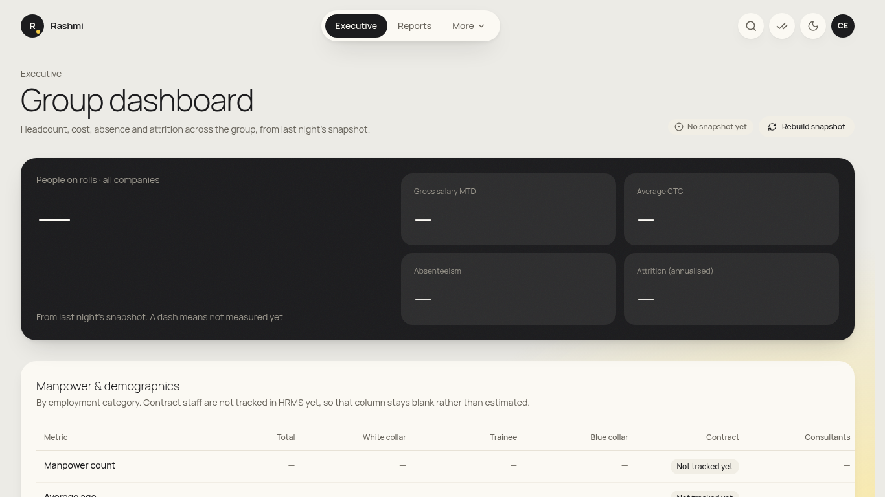
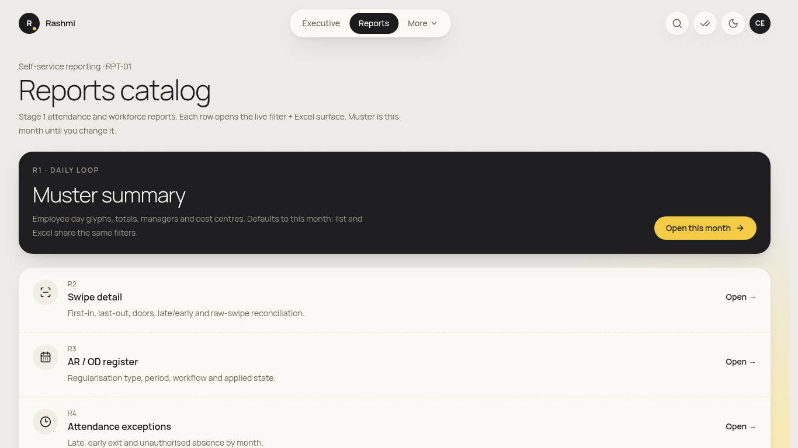
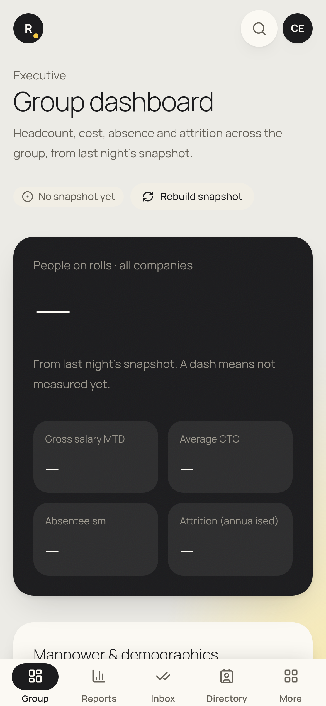

# CEO cell guide (group, read-only)

_For the CEO office. You see group-wide aggregates and never individual salaries, payslips or bank details. Checked against the app on 19 Oct 2026 (screens from the earlier crawl; the look may have been refreshed since). **(coming)** = not built yet._

**Where to find things:** **Executive** (your home) and **Reports**. Other items are under **More**.

## Daily / weekly
### 1. Group dashboard
1. Sign in. You land on **Executive** ("Group dashboard").
2. Sections:
   - **Manpower & demographics** (with **Manpower by category**)
   - **Attendance & attrition** (with **Absenteeism trend**)
   - **Overtime hours** (approved OT minutes ÷ 60, by month)
   - **Productivity & cost**
   - **Burnout index**
3. **Recent leavers & attrition drill-down** lists the latest exits with reasons. It's aggregated, with no salary column.
4. Trends are drawn "Month by month, from the nightly snapshot", so today's changes show up tomorrow.

### 2. Reports
1. Click **Reports**. Use **R27 headcount**, **R26 attrition**, **R24 boarding/exit** and others, across all entities.
2. Export to Excel for board packs.

## Not yet in the app
- **Final CEO approval in the offer/LOI chain, and CEO review on separations:** (coming). The CEO cell has no approvals inbox today.
- **Daily group boarding & exit email:** (coming, needs SMTP).
- **New-hire attrition at 3/6/12 months on the dashboard:** check the attrition report. A dashboard tile is (coming).

## On your phone
- Bottom bar: **Group · Reports · Directory**, plus **More**. **Group** opens the Executive dashboard. The cards stack in one column on a phone.

## FAQ
- **Why can't I see someone's salary?** CEO cell is aggregate-only by design.
- **Can I approve payroll?** No. Payroll needs the payroll team plus the HR head co-sign.
- **Numbers differ from yesterday's PDF.** The dashboard uses the nightly snapshot. Check the "as of" date.
