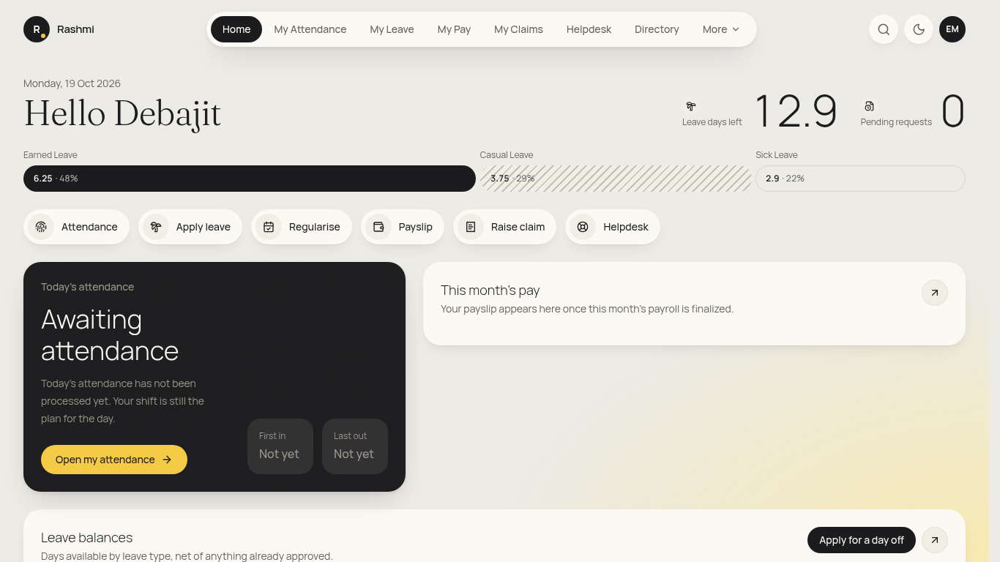
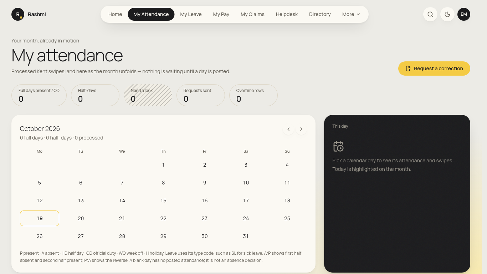
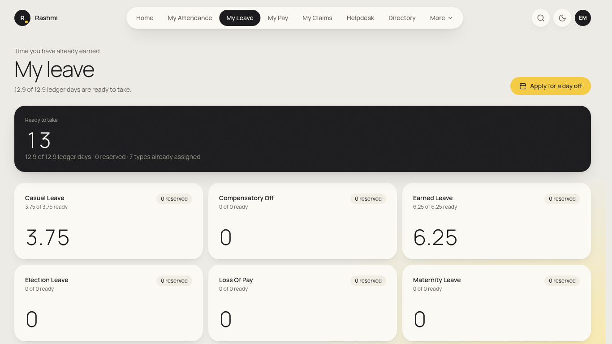
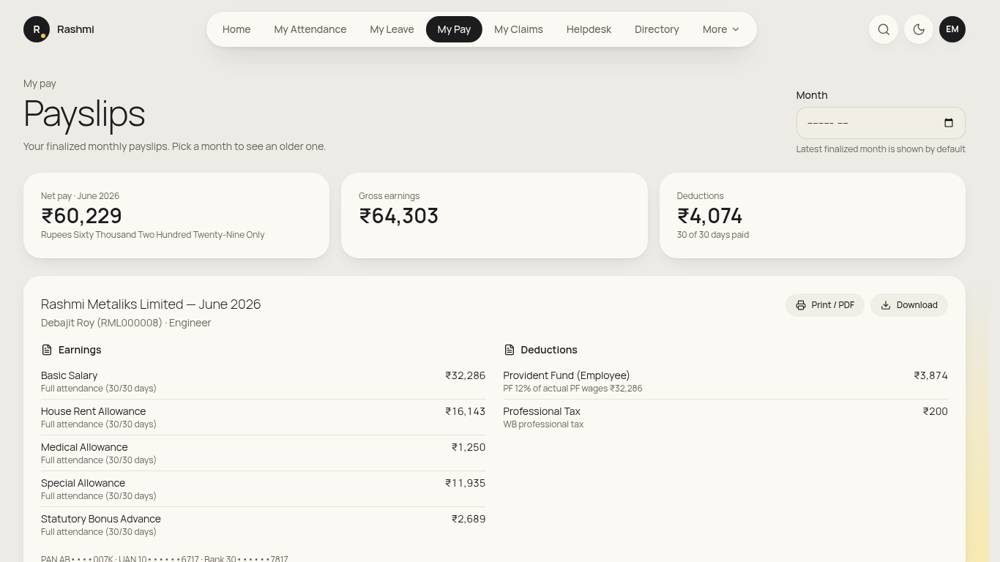
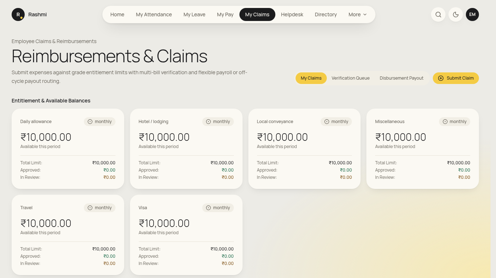
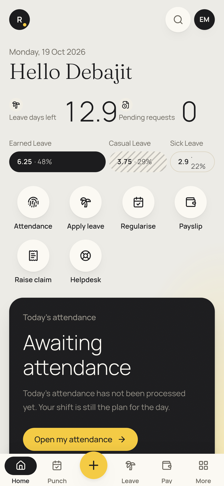
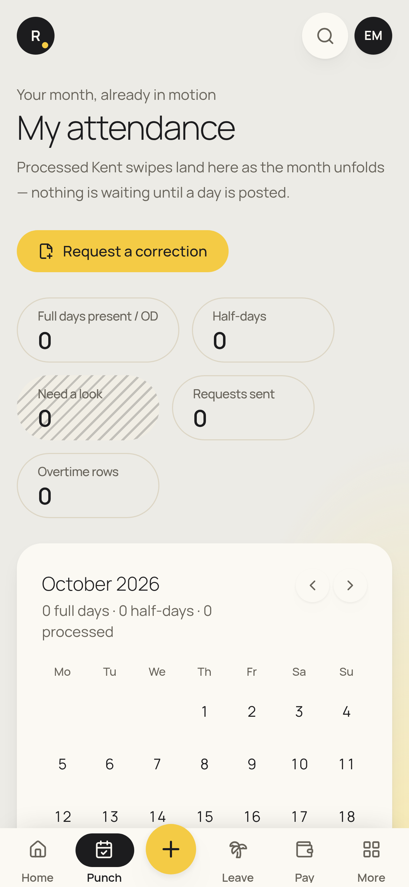

# Employee guide (self-service)

_For every Rashmi Group employee. Checked against the app on 19 Oct 2026. Items marked **(coming)** are not built yet._

**Where to find things (top menu):** **Home**, **My Attendance**, **My Leave**, **My Pay**, **My Claims**, **Helpdesk**, **Directory**, and under **More**: **My Tax**, **My Letters**, **Policies**, **Travel**. Your initials (top right) → **View my info** opens your profile.

## Daily

### 1. Check today's attendance (in/out time, present or absent)
1. Click **My Attendance** (phone: **Punch** tab).
2. The tiles at the top count **Full days present / OD**, **Half-days**, **Need a look**, **Requests sent** and **Overtime rows** for the month.
3. In the month calendar, click a day. The **This day** panel shows **First in**, **Last out**, **Late** and **Overtime**, and the status of each half of the day (morning and afternoon session), e.g. *Half-day present* when one session is absent.
4. Use **‹ / ›** (**Previous month** / **Next month**) to look at other months.

> Swipes come from the Kent face terminals at your gate. A day shows up once the swipes have been processed, so today may still be blank in the morning.

### 2. Fix a missed or wrong swipe (regularisation), official duty, or short permission
1. On **My Attendance**, click a day and choose **Request a correction for this day**, or click **Request a correction** at the top.
2. Under **What do you need?** pick one of these:
   - **Attendance regularisation**: fix a past day with a missing or wrong swipe.
   - **Official duty**: you were on company work, not at the gate. Future dates are allowed.
   - **Short permission**: a short approved gap in the day. Fill **Permission from** and **Permission to**.
3. Set **From date** and **To date**. Under **Which part of each day?** choose the whole day or one half.
4. Write **Why should this be approved?**
5. Click **Send to my manager**, or **Keep draft** to finish later.
6. Track it under **Requests you have already sent**. The status shows *Awaiting approval*, *Approved*, *Sent back for review* or *Not approved*. The day changes to present only after final approval.
7. If it was **sent back**, open it with **View request and decisions**, edit it, and choose **Resubmit for approval**.

### 3. See all leave balances
1. Click **My Leave**.
2. The dark card shows the total **Ready to take**. Below it there is one card per leave type (Casual, Earned, Compensatory Off, Maternity and others), each showing "x of y ready" and any days **reserved** by pending applications.
3. Scroll to **Immutable ledger — every credit and debit** to see how each balance was built up.

## When you need it

### 4. Apply for leave
1. On **My Leave**, click **Apply for a day off**. Or use Home → **Apply leave**, or on a phone **+ → Apply leave**.
2. **Leave type**: pick from the list. Only types you're eligible for appear.
3. Pick the **First day** and **Last day** with the date pickers. Tick **First day is a half day** for a half day.
4. Fill **Why are you taking this time?**
5. Check the live balance preview. Applying for more than your balance is blocked.
6. Click **Send to my manager**.
7. Follow progress under **Applications already in motion** (*With your manager*, *Confirmed*, *Sent back*, *Not approved*).

- **Floating holiday:** under **Floating holidays**, choose **Pick the floating holiday you will take**. This appears only once HR has published the year's list.
- **Cancel an approved leave:** (coming). For now, ask your manager or HR on **Helpdesk**.
- **Leave encashment request:** (coming).
- **Compensatory off for working on a week-off or holiday:** the comp-off balance card shows credits. Claiming comp-off from the screen is (coming).

### 5. View and download your payslip
1. Click **My Pay**. The latest finalised month is shown by default.
2. Change **Month** to see another payslip.
3. Click **Download**, or **Print / PDF**, to save it. Earnings, Deductions and Gross earnings are listed on the page.

- **Form 16:** issued by Payroll after year end. Ask on Helpdesk if you can't find it under My Letters (employee self-download is (coming)).

### 6. Declare investments for tax (My Tax)
1. Go to **More → My Tax**.
2. Choose the **Financial year** and your **Tax regime** (**New regime** or **Old regime**).
3. Under **Sections**, enter the **Amount (₹)** for each item and click **Save**. This works while **Declaration window open** is shown.
4. At year end, when **Proof window open** is shown, use **Attach proof** (or **Replace proof**) on each line.

### 7. Raise a reimbursement claim (with a bill photo)
1. Click **My Claims**, then **Submit Claim**.
2. Fill **Claim Type**, **Amount (₹)**, **Bill No**, **Bill Date** and the period (**Period From** / **Period To**).
3. Under **Photo of bill**, take a photo with your phone camera or attach a file.
4. Click **Submit for Approval**. Track it in **Submitted Claims History**.

### 8. Travel: trip, advance and expenses
1. Go to **More → Travel**.
2. **Plan New Business Trip**: fill **Trip Title**, **Destination City**, **Departure Date**, **Return Date**, **Travel Classification** and **Purpose of Travel**, then submit.
3. **Request Travel Advance**: select the trip and enter **Advance Amount (₹)** and **Justification**. An approved advance is credited to your **Travel Wallet**.
4. **File Expense Claim**: use **Select Associated Trip**, then fill **Expense Category**, **Receipt Amount (₹)** and **Description / Vendor**.
5. The **Wallet Audit Trail & Transaction Ledger** shows the balance after every movement.

### 9. Ask HR or IT for help (Helpdesk)
1. Click **Helpdesk**, then **Raise a ticket**.
2. Pick **Category** and **Priority**, write a **Subject** and **What is the problem?**, then click **Raise ticket**. It is acknowledged immediately.
3. Open the ticket from **My tickets** to **Reply**. If a resolved ticket isn't really fixed, choose **Reopen ticket** and give a reason.

### 10. Read and acknowledge policies
1. Go to **More → Policies**.
2. Click **Read** on a policy, then **I have read this**. Each acknowledgement is recorded once.

### 11. Download your letters (appointment, confirmation, experience and others)
1. Go to **More → My Letters** (or initials → **My documents**).
2. Click **Open the latest letter**, or open any letter in the list.

### 12. Check your profile and request family or nominee changes
1. Initials → **View my info**. The tabs include **Overview**, **Job & Reporting**, **Statutory & Bank** (masked), **Family**, **Attendance**, **Leave**, **Documents & Letters** and **Assets**.
2. On **Family**, click **Add member** (or **Edit** on a row). Fill **Full name**, **Relation**, **Date of birth**, **Nominee (PF / gratuity)** and **ESIC dependent**, then click **Submit to HR**.
3. The change shows **Pending HR approval** until HR approves it. Your master record changes only after that.
- Changes to bank, PAN or address: raise a Helpdesk ticket. Master fields can't be edited by employees.

### 13. Find a colleague
- Click **Directory** and type in **Search people**.

### Occasional / not yet in the app
- **Loan application:** (coming for employees). Loans are set up by Payroll today.
- **Resign:** there is no employee self-service entry yet (coming). Speak to your manager or HR.
- **Geo check-in from the phone (field staff):** (coming). See the mobile plan.
- **Polls and surveys:** shown under Engagement when HR publishes them. Employee view (coming).

## On your phone
- Bottom bar: **Home · Punch · + · Leave · Pay · More**.
- The yellow **+** opens quick actions: **Today's attendance**, **Apply leave**, **Regularise a day**, **View payslip**, **Raise a claim** (opens the camera for the bill) and **Ask HR / IT**.
- Add the app to your home screen (see [README](README.md#installing-on-a-phone-all-roles)). Long-press the icon for Attendance, Apply leave and Payslip shortcuts.

 

## FAQ
- **My attendance for today is empty.** Kent swipes appear after the devices sync and the day is processed. Check again later. If yesterday is still wrong, request a regularisation.
- **A day shows Absent but I was in.** Click the day and check First in / Last out. If a swipe is missing, use **Request a correction** → **Attendance regularisation**.
- **Why is my balance "reserved"?** Days in a pending application are held until it is approved or rejected.
- **I can't see a leave type.** It only appears once HR assigns it to you (e.g. Maternity Leave is offered only where eligible).
- **No payslip yet.** Payslips appear only after Payroll finalises the month.
- **Who approves my requests?** Your reporting manager first, then any further steps HR has configured. You can see each decision with **View request and decisions**.
