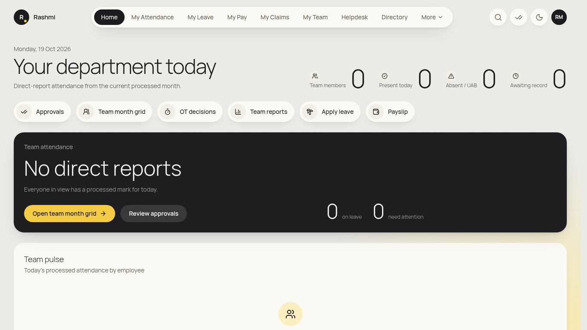
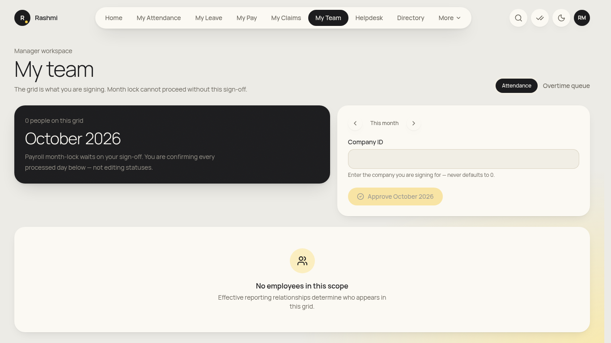
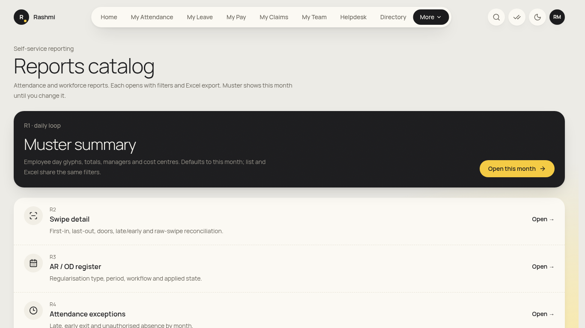
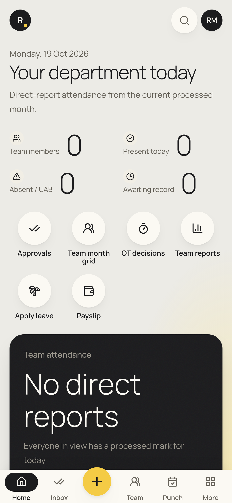

# Head of department (HOD) guide

_You become an HOD when HR designates you in **Admin → Heads of department**, or when employees list you as their HOD. You also do everything in the [manager](manager.md) and [employee](employee.md) guides. Checked against the app on 19 Oct 2026. **(coming)** = not built yet._

**Where to find things:** the same menu as a manager: **Home**, **My Attendance**, **My Leave**, **My Pay**, **My Claims**, **My Team**, **Helpdesk**, **Directory**, and under **More**: **My Tax**, **OT Decisions**, **My Letters**, **Reports**, **Policies**, **Travel**. Approvals are under the **✓✓** icon.

## Daily
### 1. Department today
1. Open **Home**. It is titled "**Your department today**" and counts your whole department, not just your direct reports.
2. Use **Team month grid** (or **My Team** with **Entire reporting subtree** ticked) to see everyone's days.

### 2. Approve department-level requests
1. Open **Approvals** (✓✓). Items where an approval chain has a *department head* step reach you after the reporting manager. Today that is **travel** (step 2 of travel). Other HOD steps depend on HR's **Approval chains** setup.
2. Open the item and choose **Approve**, **Send back** or **Reject** (a note is required for the last two).

### 3. Overtime and your own team
- The same as a manager: **OT Decisions** within 48 hours, plus approvals for direct reports.

## Monthly
### 4. Department reports
1. Go to **More → Reports**, then the report you need (**R27 headcount**, **R26 attrition**, **R6 absence**, **R5 OT**, **R29 helpdesk**, …).
2. Filter by department or month, then export to Excel.

### 5. Roster and month approval for your direct team
- See [manager guide §4–5](manager.md#monthly).

## Not yet in the app
- A department dashboard with headcount, absenteeism, OT and attrition for your department only: (coming). Home shows today's attendance for now.
- HOD steps for leave beyond N days, OT pre-approval, requisitions and offers: (coming), as HR adds them to approval chains.

## On your phone
- Bottom bar: **Home · Inbox · Team · Punch · Leave**. Use **Inbox** for approvals.

## FAQ
- **I'm an HOD but my Home looks like a manager's.** HR must designate you under **Heads of department** for your department. Ask HR ops.
- **Can I see another department?** No. Only your own department.
- **Can I edit attendance or see salaries?** No. The same rules as managers apply.
