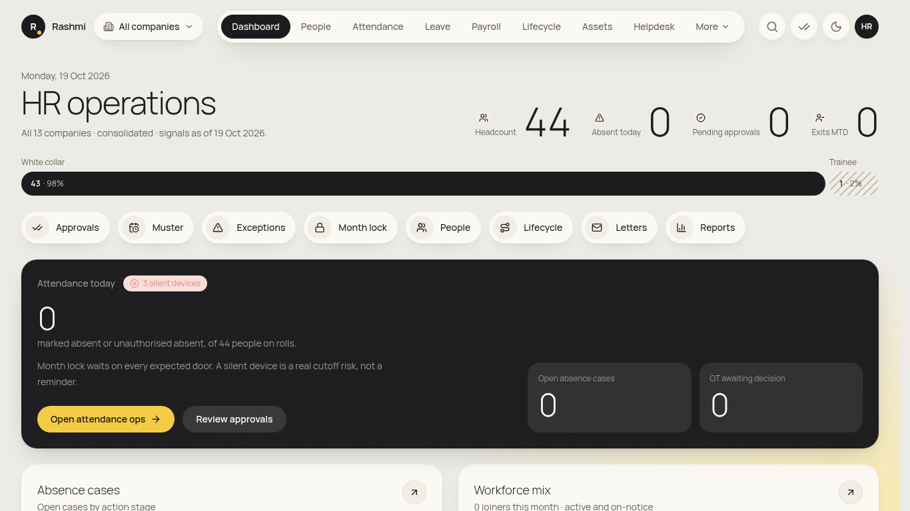
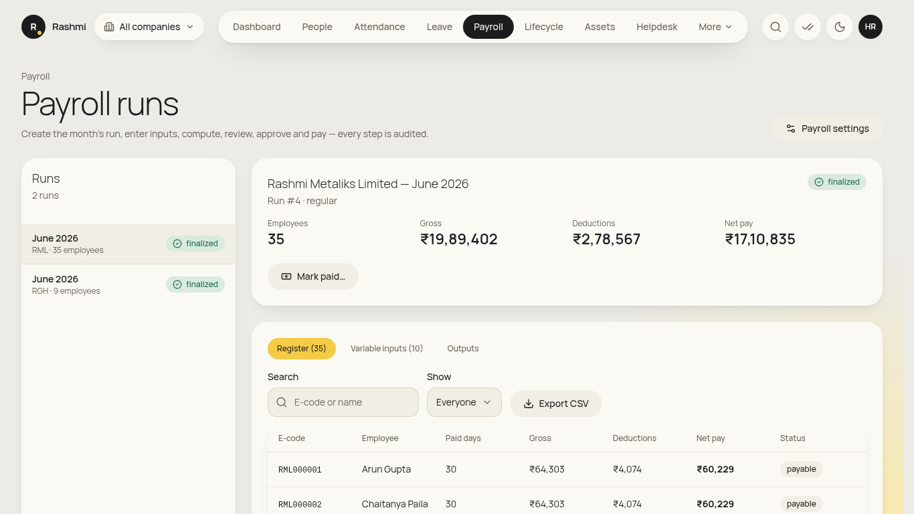
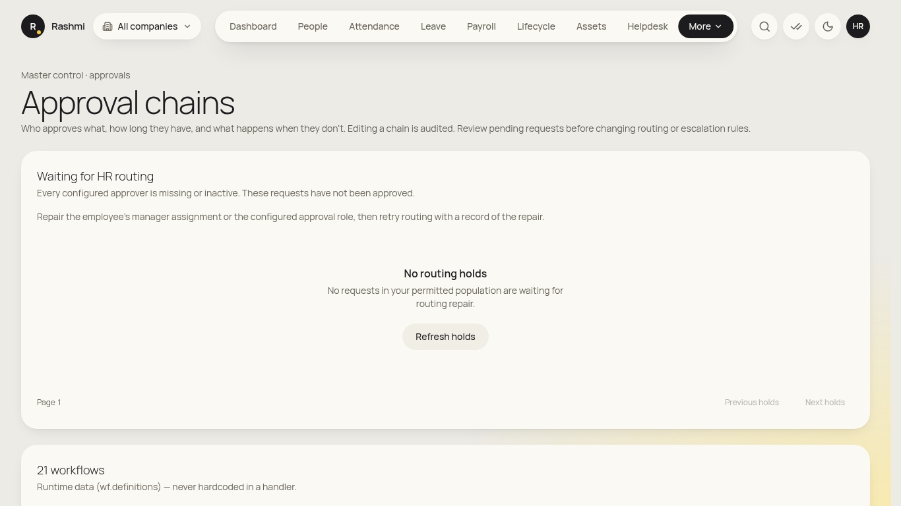
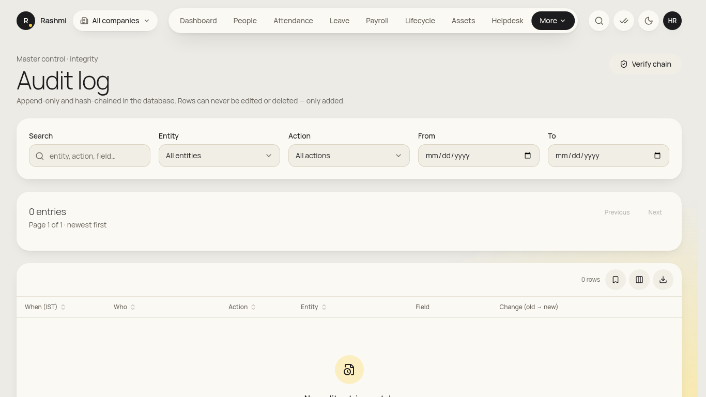

# HR head guide (group level)

_You see **every entity** (RML, RGH and any new company, automatically). You can do everything in the [HR operations guide](hr_ops.md), plus the items below. For your own attendance, leave and pay, use **initials → View my info** and the [employee guide](employee.md). Checked against the app on 19 Oct 2026. **(coming)** = not built yet._

**Where to find things:** the same menu as HR ops, plus **Payroll**, **TDS compliance**, **Loans** and **Claims**. Under **More** you also get **Approval chains**, **Attendance masters**, **Audit log** and **Settings**. Use the **company switcher** in the header to change which company you're viewing.

## Daily
### 1. Group approvals
1. Open **✓✓ Approvals**. Your steps include loans (step 2), probation confirmation (step 2), resignations (step 2), letter signatures, claims, and post-lock attendance changes.
2. Open an item, then **Approve**, **Send back** or **Reject** (a **Decision note** is needed for the last two). You can't approve your own requests.

### 2. Requests waiting for HR routing
1. Go to **More → Approval chains** and scroll to **Requests waiting for HR routing**.
2. These are requests the system couldn't route (for example, a missing manager). Fix the master (the reporting manager or the head of department), write a **Routing repair note**, then **Retry routing**. You can't approve on someone's behalf here.

## Monthly
### 3. Payroll co-sign (two-person rule)
1. When Payroll sends a run for approval, open **Payroll**. The run shows **Under review**: *"Waiting for an independent checker (HR head) to approve."*
2. Check the **Register** tab (Gross, Deductions, Net pay; filter **Show** → *With LOP*, *Zero / negative net*, *On hold*) and the **Variable inputs** tab.
3. Click **Approve (checker)**. Payroll can then **Finalize…**. If something is wrong, ask Payroll to use **Back to draft** with a reason.

### 4. Probation confirmations
1. Go to **Lifecycle → Probation**. Open a review that has the manager's evaluation.
2. Under **Execute Final Confirmation Decision**, choose the **Authorized Decision** (confirm, extend or terminate). Enter the **Effective Confirmation Date**, the confirmed salary structure and CTC (for confirm) or the **Extension Months** (for extend), and the **HR Authorization Notes**.
3. Salary switches to 100% automatically on confirmation.

### 5. Group dashboards and reports
- **Reports**: every report across all entities. **Dashboard** shows group-wide HR numbers.

## Occasional
### 6. Configure approval chains
1. Go to **More → Approval chains** and pick a workflow.
2. For each step choose the **Approver**: *Reporting manager*, *Functional manager*, *Dotted-line manager*, *Head of department* or a role. Set the **SLA (hours)** and the **On breach** action: *Escalate* (pass to the approver's manager), *Lapse*, *Auto-approve*, or *Auto-reject* / *Reject at cutoff*.
3. Toggle **Chain is active** and save. Every change is audited.

### 7. Settings and attendance masters
- **More → Settings**: search for a policy setting, enter the **New value** and a **Reason for the change**, then save. Settings are grouped by module.
- **More → Attendance masters**: shifts (**Start time**, **End time**, **Grace in/out**, **Min full-day / half-day hours**, **Crosses midnight**) and holidays (**Add holiday**). Both are audited.

### 8. Audit log
1. Go to **More → Audit log**. Filter by **Action**, **Entity**, **From** date or **Search**.
2. Each row shows who did what, with the old and new values.

### 9. Statutory rates (jointly with payroll)
- In **Payroll → Payroll settings**, use **Add version** with an *Effective from* date. Finalised months are never changed retroactively. See the [payroll guide](payroll_admin.md#7-statutory-rates-pt-slabs-gl-mapping).

### Not yet in the app
- **Approving post-lock attendance changes and payroll reopen from a single screen:** (coming). Reopen is currently limited to break-glass access.
- **Offer/LOI approval and manpower requisition (step 2):** (coming).
- **Exporting the access-control matrix:** read it under Users & Roles (IT admin / super admin). An HR head view is (coming).

## On your phone
- Bottom bar: **Home · Inbox · People · Muster · Payroll · Reports**. Use Inbox for approvals on the move. Do the payroll co-sign on a desktop.

## FAQ
- **Why can't I finalise payroll on my own?** It's a two-person rule. Payroll computes and submits, you approve as the checker, and then the run can be finalised.
- **A new company was added. Do I need access to it?** No. Group roles see new entities automatically.
- **Someone was never notified of an approval.** Check the chain's step and approver in **Approval chains**, and the request's timeline in Approvals.
