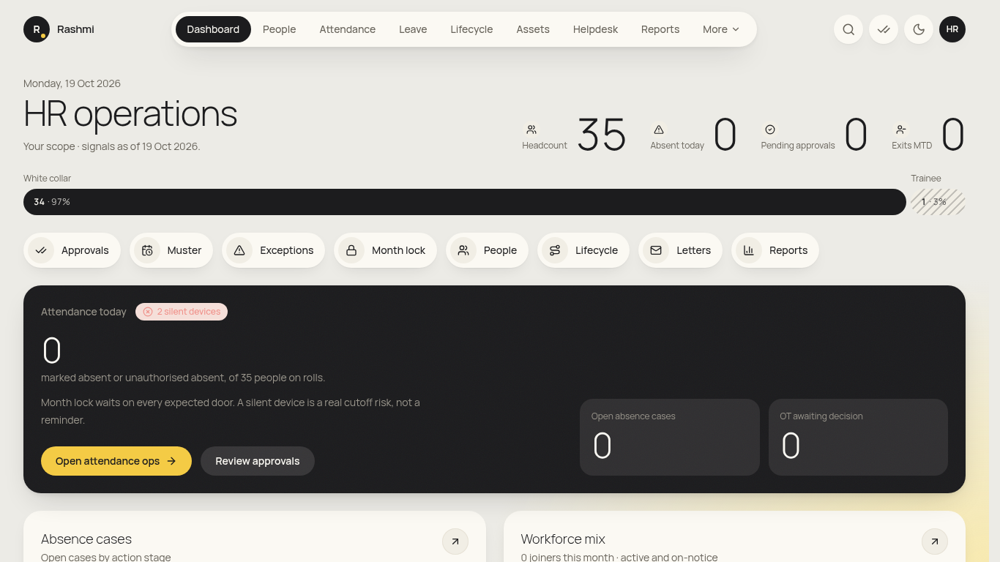
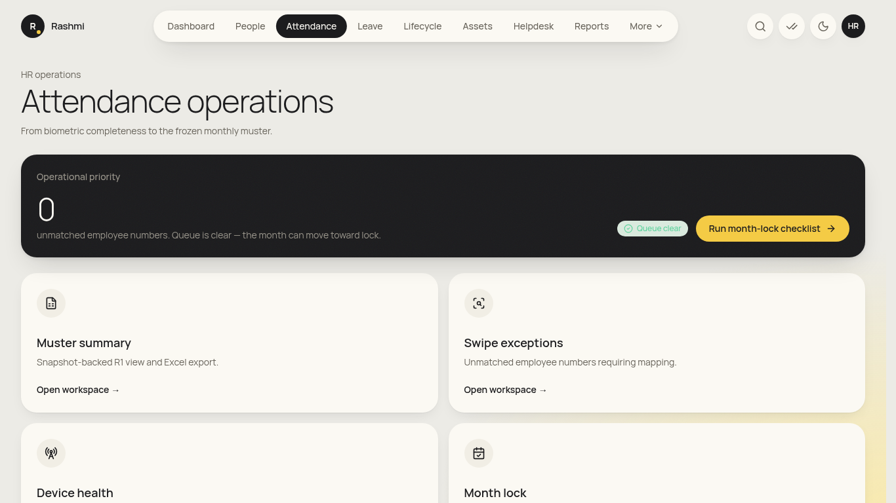
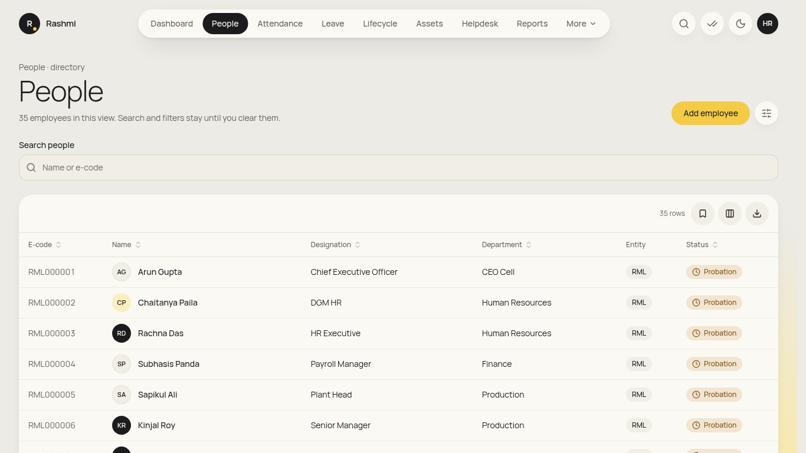
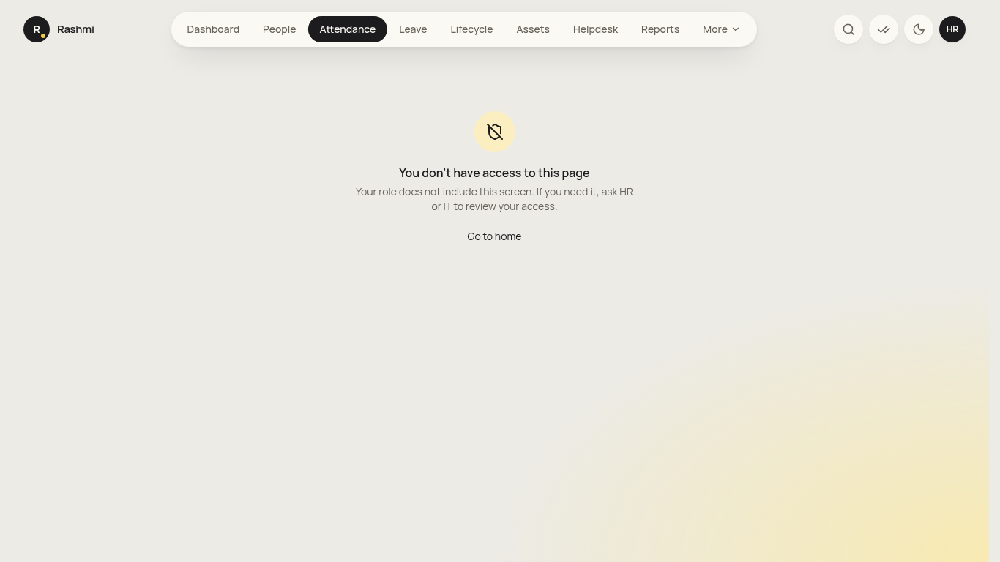
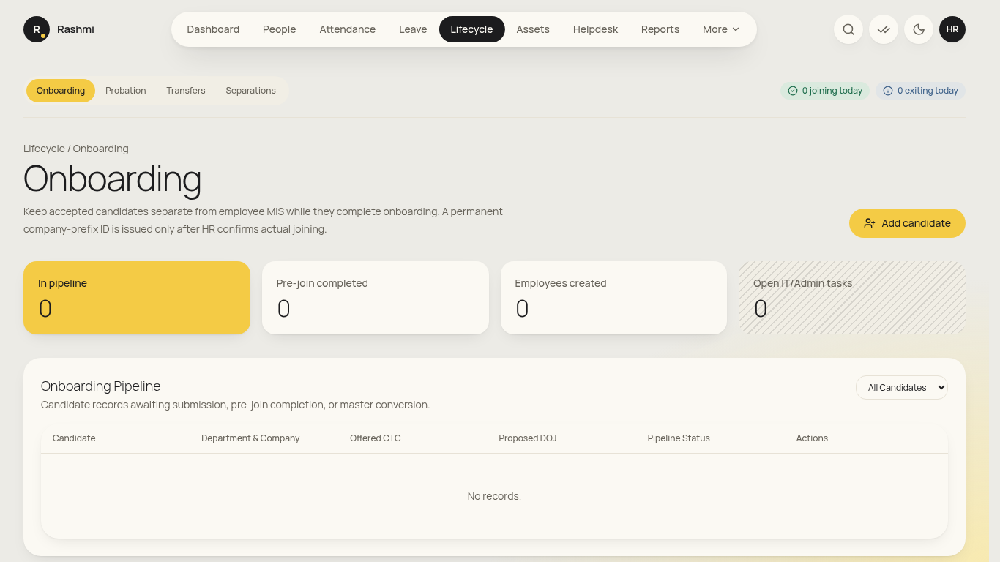
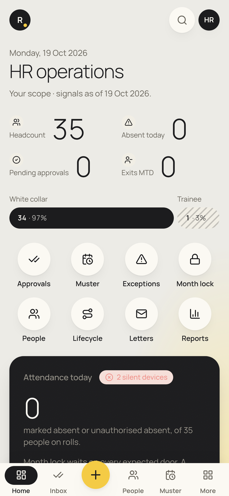

# HR operations guide (hr_ops)

_For entity or plant HR. You see only your own entity's people. You're also an employee: use **initials → View my info** and its **Open My Attendance / Open My Leave / Open My Pay** links for your own records (see [employee guide](employee.md)). Checked against the app on 19 Oct 2026. **(coming)** = not built yet._

**Where to find things (top menu):** **Dashboard**, **People**, **Attendance**, **Leave**, **Lifecycle**, **Assets**, **Helpdesk**, **Reports**. **More** holds **Letters**, **Recruitment**, **Policies**, **Engagement**, **Travel**, **Heads of department** and **Data imports**. The **✓✓** icon opens Approvals.

## Daily

### 1. Morning check on the dashboard
1. Open **Dashboard** ("HR operations"). The headline numbers are **Headcount**, **Absent today**, **Pending approvals** and **Exits MTD**.
2. The **Attendance today** card shows absences and any **silent devices** (Kent doors that stopped sending). Click **Open attendance ops**.
3. **Open absence cases** and **OT awaiting decision** are counted there too. Use **Review approvals** for your queue.

### 2. Attendance operations
1. Click **Attendance** ("Attendance operations"). The tiles lead to **Swipe exceptions**, **Muster summary**, **Month lock**, **Absence cases** and **Device health**.
2. **Swipe exceptions** (`/attendance/exceptions`) lists Kent numbers that match no employee (**Unmatched**, with first and last seen). Follow **Resolution guidance**: correct the employee mapping (the e-code or device number on the employee record), and the pipeline reprocesses the swipes.
3. **Device health** (`/attendance/devices`) shows each door's last contact. Tell IT about any red or silent door. Month lock waits on every expected door.
- **Manual attendance correction with a reason:** no screen yet (coming). Employees raise a regularisation instead, or ask IT/payroll to use the audited API.

### 3. Approvals (step 2 and HR verify)
1. Open **✓✓ Approvals**. HR steps include leave (if configured), encashment, transfers, resignations, and claim proof verification.
2. Open an item, then **Approve**, **Send back** or **Reject** (a **Decision note** is required for the last two).

### 4. Helpdesk queue
1. Click **Helpdesk**, then the **Queue** tab. Filter by status or tick **Breached only**.
2. Open a ticket. Use **Reply** (tick **Internal note** to hide it from the raiser), assign it, then **Resolve ticket** with a **Resolution**.
3. The **Performance** tab shows **Avg 1st response**, **Avg resolution**, **Resolution rate** and **Escalations** for the month.

### 5. Find and update people
1. Click **People**. Use **Search people** and the filter drawer (**Filter people**). Export the filtered list from the table's export button.
2. **Add employee** opens the employee form (Personal, Job, Statutory and bank, Company, Org unit, Department, Grade…). Errors show inline (PAN, Aadhaar, IFSC, duplicates). Every save is audited.
3. On a profile, click **Edit details**. Under **Family**, approve or reject the employee's family and nominee changes (**Pending HR approval**).

## Monthly (attendance cycle 26th–25th)

### 6. Absence cases (watch → show-cause → warning)
1. Go to **Attendance → Absence cases**. **Open cases only** is on by default.
2. Each case shows **Absent since**, **Days**, **Stage** and **Next action**. Choose **Stay on watch**, **Draft the show-cause notice**, **Escalate to warning** / **Draft the warning letter**, or **Move to termination review**.
3. When issuing a letter, pick the **Template** (**Show-cause notice** / **Warning letter**) and the **Response window (days)**, then **Draft letter**. It goes into the signature chain and later appears in the employee's My Letters.

### 7. Muster and month lock
1. **Attendance → Muster summary**: set **Month**, **Company ID**, and optionally **Department**, **Plant / location**, **Cost centre code** or **Category**, then export to Excel.
2. **Attendance → Month lock**: choose the **Month** and **Company ID**, then **Run checklist**.
3. Clear every gate that is still **Open**. The **Manager approval ledger** shows which managers are still *Pending* (chase them to approve their team's month).
4. When the checklist says **Ready to lock**, click **Lock month** and confirm. After locking, changes need HR head approval.

### 8. Leave administration
1. Click **Leave**. **Monthly accrual** runs automatically on the 1st at 00:05 IST. **Run accrual now** is only for catch-up.
2. **Comp-off expiry**: **Run expiry sweep** lapses credits that have passed their expiry date.
- Balances are never edited directly ("Balances are never edited counters"). Adjustments go through the ledger. A screen for adjustments with a reason is (coming).

## Occasional

### 9. Lifecycle: onboarding, probation, transfers, separations
Click **Lifecycle**. It has four tabs.
1. **Onboarding:** **Add candidate**, send the pre-join link (the candidate fills address, emergency contact, statutory IDs and bank details online), review it, then confirm joining to create the e-code. Follow the **Joining checklist** (IT/Admin tasks; overdue ones show *Escalated SLA Overdue*).
2. **Probation:** the **Probation Review Queue** shows reviews **Due in 14 days (urgent)** and **Due in 30 days**. Chase managers for their evaluation. HR head makes the final decision.
3. **Transfers:** **Initiate Employee Movement / Promotion**. Pick the **Movement Type**, target department, location, entity, designation or manager, the **Effective Date** and the **Leave Balances Treatment**. Nothing changes before the effective date. Use **Organization As-Of Date Explorer** to check history.
4. **Separations:** the **Active Separation Pipeline**, the **Departmental Clearance Workbench** (flag unreturned assets), and the **Full & Final (F&F) Settlement Workbench**. **Initiate Termination / Absconding** needs **Termination Grounds & Justification**. Relieving and experience letters come after clearance.

### 10. Letters
1. Go to **More → Letters**. Under **Issue a letter**, enter the **Employee ID** and **Template**, then **Draft into signature chain**. It is issued after the signature approvals.
2. The **Template catalog** lists the available templates.

### 11. Policies and engagement
- **Policies → Publish a policy**: fill **Title**, **Effective date** and **Short summary**, plus optional full text. The acknowledgement count is shown live ("How many people are already covered").
- **Engagement**: **Publish Announcement**, **Create Poll or Pulse Check**, or **Create Structured Survey** (with an **Anonymity Firewall** option). Audiences are limited to the company.

### 12. Assets
1. Click **Assets**, then **Register asset** (**Asset number**, **Category**, **Serial number**, **Warranty till**…) and **Save asset**.
2. **Allocate** to an employee or a **Third party / contractor**. **Record return** with a **Return condition** (*Goes to maintenance* / *Not returned* keeps the exit clearance open).

### 13. Bulk data and department heads
- **More → Data imports**: pick an import, **Download template**, fill it, upload it, and read the per-row check before applying it.
- **More → Heads of department**: under **Designate a head**, pick the **Entity** and **Department**, enter the **Employee code**, then **Add head**. That person gets the HOD view.

### 14. Reports
- **Reports** → the catalogue (R2 swipes, R3 regularisations, R4 exceptions, R5 OT, R6 absence, R21 offers, R23 transfers, R24 boarding, R25 probation, R26 attrition, R27 headcount, R28 assets, R29 helpdesk, R30 policies, R31 claims). The on-screen table and the Excel file use the same filters.

### Not yet in the app
- **Recruitment / ATS, offer and LOI drafting and approval chain:** the **Recruitment** page explains the plan. Building it is (coming).
- **Daily boarding & exit email to plant head, HR and CEO cell:** the report exists (R24). Scheduled email is (coming, needs SMTP).
- **Leave adjustment screen and manual attendance override screen:** (coming).

## On your phone
- Bottom bar: **Home · Inbox · People · Muster · Payroll/Reports** (depending on your permissions), plus **More**.
- Best used for approvals and quick lookups. Month lock and imports are desktop jobs.

## FAQ
- **I can't see RGH employees.** hr_ops is limited to its own entity. Group HR (hr_head) sees everything.
- **Month lock says Blocked.** Open the checklist. Usually a manager hasn't approved their team's month, requests are still pending, or a device is silent.
- **A swipe number isn't matched.** Fix the employee's device or e-code mapping. The swipes then reprocess automatically, and nothing is lost.
- **Can I edit salaries or finalise payroll?** No. That belongs to Payroll and the HR head.
