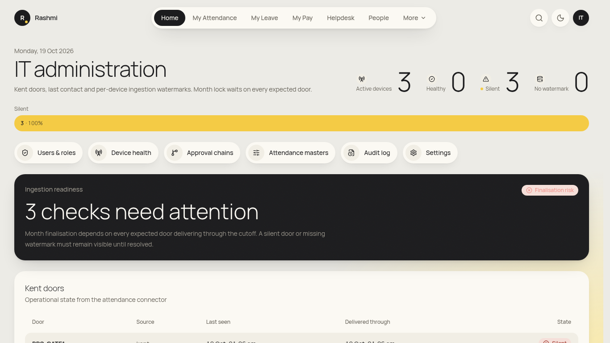
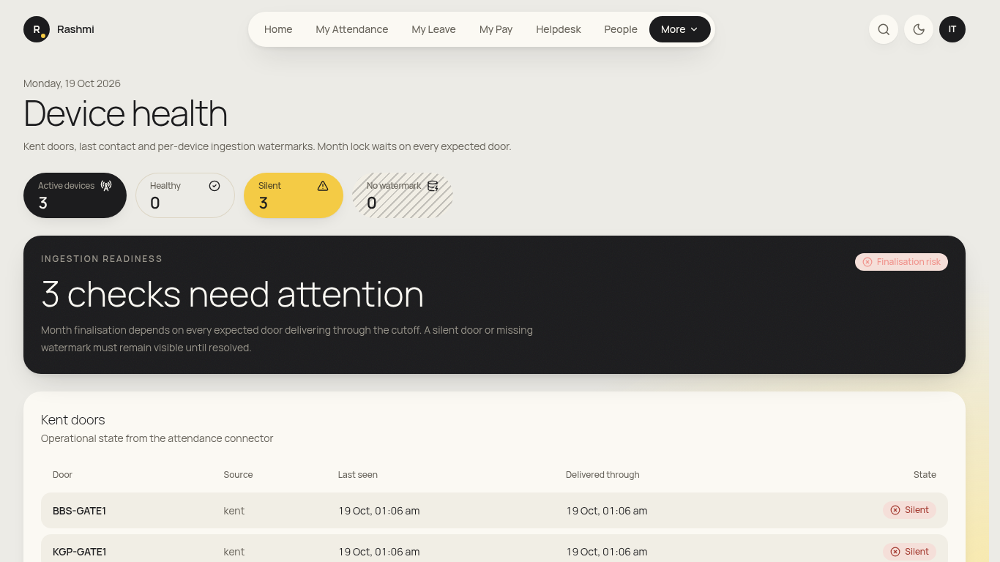
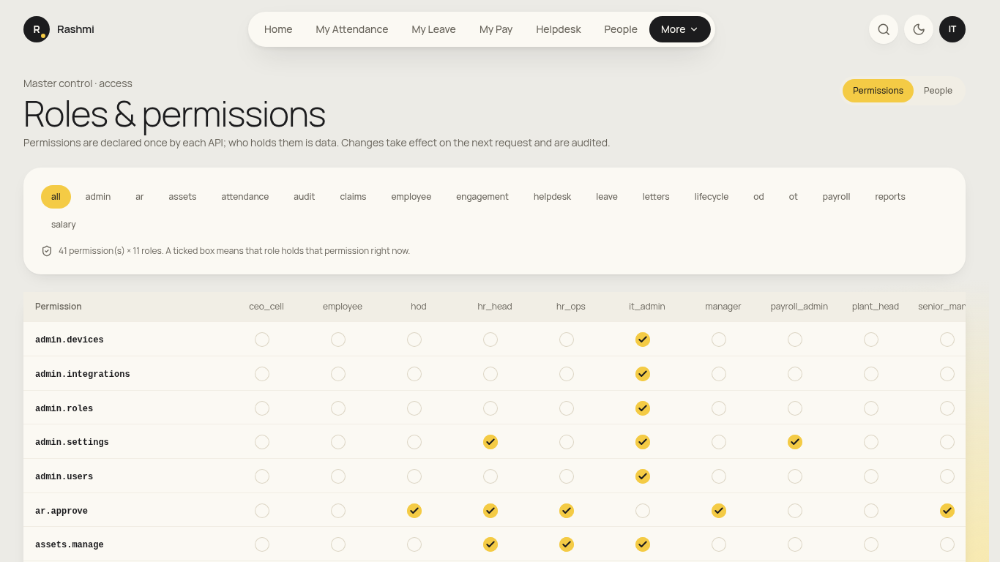
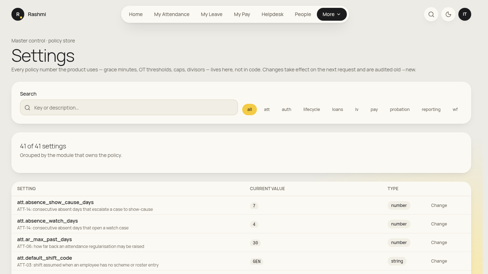
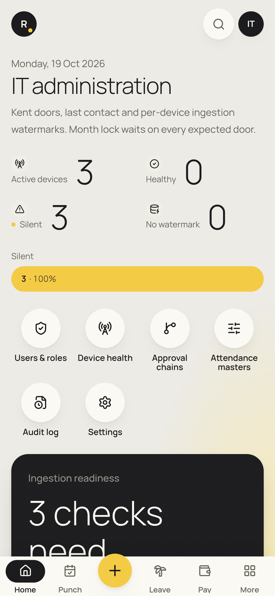

# IT admin guide

_For IT: user access, Kent devices, settings and IT tasks during joining and exit. You never see compensation, payslips or bank data. Your own attendance and leave work as in the [employee guide](employee.md). Checked against the app on 19 Oct 2026 (some screens are from the earlier crawl). **(coming)** = not built yet._

**Where to find things:** **Home** ("IT administration"), **My Attendance**, **My Leave**, **My Pay**, **Helpdesk**, **People**. **More** holds **Attendance**, **Assets**, **Users & Roles**, **Approval chains**, **Attendance masters**, **Data imports**, **Audit log** and **Settings**.

## Daily
### 1. Kent door health
1. Open **Home**. It shows **Active devices**, **Healthy**, **Silent** and **No watermark**, and the **Ingestion readiness** card ("n checks need attention").
2. The **Kent doors** table lists each door's **Source**, **Last seen**, **Delivered through** and **State**. You can also open it at **Attendance → Device health**.
3. If a door is **Silent**, check its power and network and the Kent cloud sync. Month lock waits on every expected door.
- **Sync now button:** (coming in the UI). The backend endpoint exists (`POST /api/attendance/sync`); see `docs/integrations/KENT.md`. Kent is pulled automatically every few minutes once it's configured.

### 2. Helpdesk (IT tickets)
- **Helpdesk → Queue**: filter to IT categories, **Reply**, then **Resolve ticket** with a resolution.

## Occasional
### 3. Users, roles and sessions
1. Go to **More → Users & Roles**. It has three tabs: **Permissions**, **People** and **Sessions**.
2. **People**: **Find a person**, then **Add role**. Pick the role and, for entity-scoped roles, the **Entity (org unit)**. Remove a role from the person's role list. Every change is audited.
3. **Permissions**: the grid of which roles hold which permission (**Grant** / **Revoke**). Change this only with HR head sign-off.
4. **Sessions**: **Live sessions** with **Device** and **Last active (IST)**. Use **Sign out** for one session or **All devices** for a lost phone or a leaver.
- **Unlocking an account, resetting a password, deactivating a user from this screen:** (coming). Employees use *Forgot password? Email HR Ops* for now.

### 4. Settings (non-payroll)
1. Go to **More → Settings**. **Search** for the setting (for example, mail or attendance sync).
2. Enter the **New value** (or **New value (JSON)**) and the **Reason for the change**, then save.
- **SMTP / email delivery status page:** (coming). Configure email through deployment env settings (see `DEPLOY.md`).

### 5. Joining and exit tasks
- **Onboarding IT tasks** (e-code activation, email, Kent biometric enrolment verification) appear in the **Joining checklist** under **Lifecycle → Onboarding** for whoever is assigned. Mark them complete with evidence.
- **Exit clearance** (laptop, email): the IT items are in **Lifecycle → Separations → Departmental Clearance Workbench**. Returned kit is recorded in **Assets → Record return**.

### 6. Assets
- **Assets → Register asset / Allocate / Record return**. See [HR ops §12](hr_ops.md#12-assets).

### 7. Backups
- Backup and restore are scripts run on the server (see `DEPLOY.md`). An in-app record of restore drills is (coming).

## On your phone
- Bottom bar: **Home · Punch · Leave · Pay · People** (plus **More**). Device health on Home works on a phone for quick checks.

## FAQ
- **A user can't see a menu.** Menus follow permissions. Check their roles under Users & Roles → People.
- **Should I give someone super_admin?** No. It's break-glass only. Give the narrowest role with the correct entity.
- **Kent sync fails.** It fails safely when it isn't configured (no fake punches). Check the `KENT_*` settings with the integration doc.
