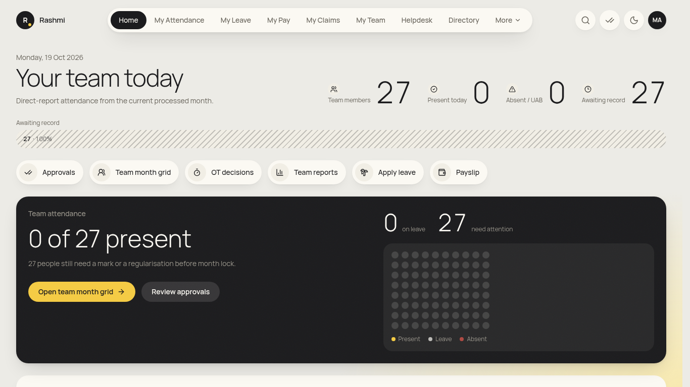
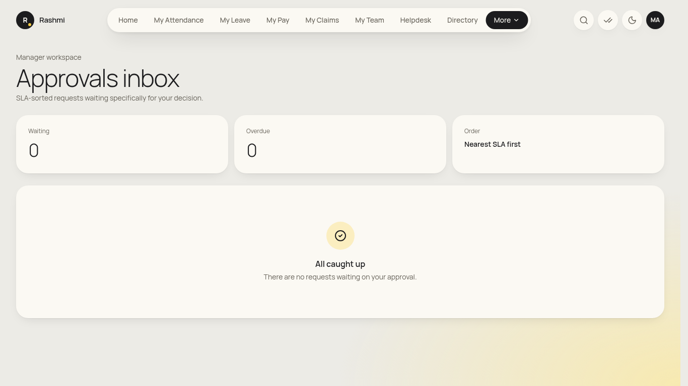
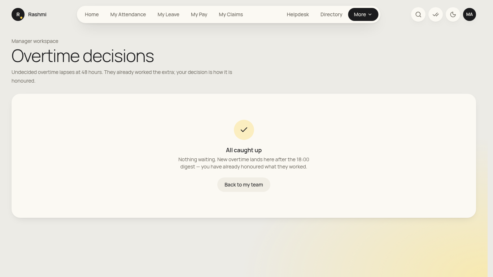
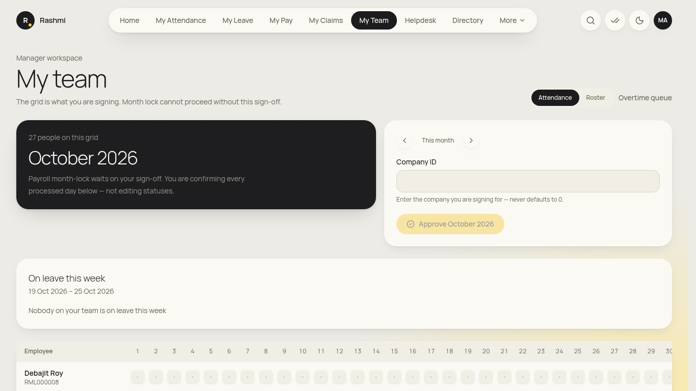
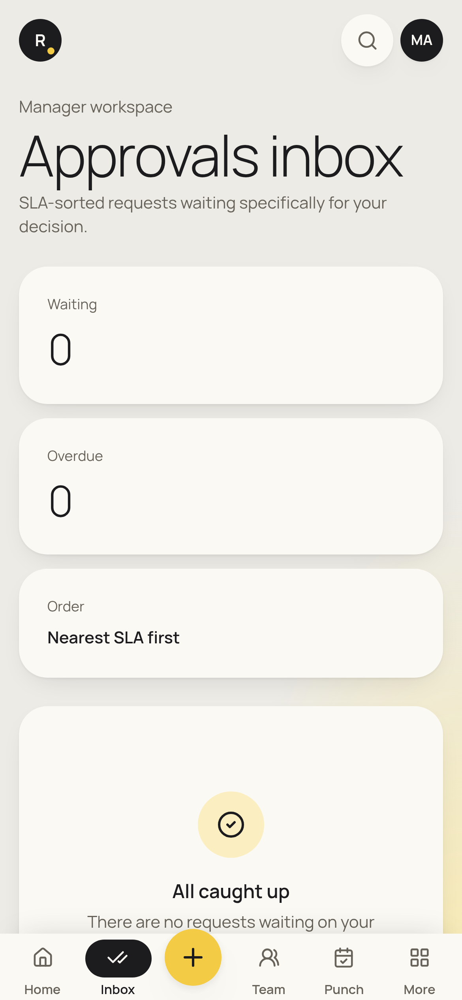

# Manager guide

_For anyone with people reporting to them (senior managers too). You also do everything in the [employee guide](employee.md). Checked against the app on 19 Oct 2026. **(coming)** = not built yet._

**Where to find things:** the top menu adds **My Team** to the employee items. **More** adds **OT Decisions** and **Reports**. The **✓✓ approvals icon** (top right, with a badge) opens **Approvals**. Home is "**Your team today**", with shortcuts **Approvals**, **Team month grid**, **OT decisions**, **Team reports**, **Apply leave** and **Payslip**.

## Daily

### 1. Clear your approvals inbox (leave, regularisation, OD, permission, OT, claims)
1. Click the **✓✓** icon, Home → **Approvals**, or **Review approvals** on the team card.
2. The **Queue** is sorted **Nearest SLA first**. **Overdue** and **Waiting** items are tagged, and items you hold for someone else show **Delegated**.
3. Click a request to see who, what, the dates, the reason and the history.
4. Choose **Approve** (a note is optional), or **Send back** / **Reject**. These need a **Decision note**. Keyboard: **A** approves, **R** rejects.
5. **Bulk approve:** tick several requests, then **Approve selected** and confirm.
6. When the queue is empty you'll see **All caught up**.

> A day changes to present, or leave is deducted, only after the **last** approval step. You can't approve your own requests.

### 2. Decide overtime within 48 hours
1. Go to **More → OT Decisions** (or Home → **OT decisions**).
2. **Waiting on you** lists OT with the nearest deadline first. *"The 48-hour rule is real."* Unanswered OT lapses and isn't paid.
3. Adjust **Minutes to honour** if needed, then click **Approve as OT pay** or **Reject**.

### 3. See who is in today
- Home shows **Team members**, **Present today**, **Absent / UAB** and **Awaiting record**, plus a dot grid (Present / Leave / Absent).
- **My Team** lists the team and **On leave this week**. Tick **Entire reporting subtree** to include indirect reports (senior managers).

## Monthly

### 4. Plan next month's roster (by the 5th)
1. Open **My Team** and scroll to **Roster editor**. Move to next month with **Next month**.
2. Choose a **Default shift**, then **Fill weekdays** and **Sundays → week-off**. Adjust individual cells (P / WO / L).
3. Click **Save roster (n)**. **Reload** discards unsaved changes. After HR locks the month, only HR can change it.

### 5. Approve your team's month (attestation before HR month lock)
1. On **My Team**, go to the month and fix any red (**A / UAB absent**) days with your team first. They raise regularisations and you approve them.
2. Click **Approve <Month Year>**. If asked, enter the **Company ID**.
3. HR can't lock the month until every manager has approved.

### 6. Team reports
1. Go to **More → Reports**.
2. Open a report (e.g. **R27 headcount**, **R26 attrition**, **R2 swipes**, **R5 OT**). Filter, then export to Excel.
3. The muster (**Muster summary**) can be filtered by **Reporting manager ID**, with **Entire RM subtree** for your whole tree.

## Occasional
- **Probation reviews:** when a team member's probation is due, the review appears in **Lifecycle → Probation** (if your login has access). Fill the **Manager Probation Evaluation** ratings and the **Manager Recommendation**, then submit. HR head makes the final confirmation.
- **Resignations, transfers, loans and travel (step 1):** these arrive in **Approvals** like any other request.
- **Claims (step 1):** in **Approvals**. Finance and HR do later steps.
- **Delegate approvals while you're away:** (coming as a self-service screen). Ask HR to set a delegate for now. Items they handle show **Delegated**.
- **Pre-approve OT for the team (OT plan):** (coming).
- **Manpower requisition:** (coming).

## On your phone
- Bottom bar: **Home · Inbox · Team · Punch · Leave**, and the **+** button opens **Approve requests** first.
- Approving from the phone works the same way: open the item, then **Approve** / **Send back** / **Reject**.

## FAQ
- **I can't see someone in my team.** Only people in your reporting tree appear. Check **Entire reporting subtree**, or ask HR to correct their reporting manager.
- **Can I mark someone present?** No. Managers never edit attendance. The employee raises a regularisation and you approve it.
- **Can I see salaries?** No. Team pay and bank details are hidden from managers.
- **Approve is greyed out.** You may be the requester, or the item is at someone else's step. Check the request timeline.
