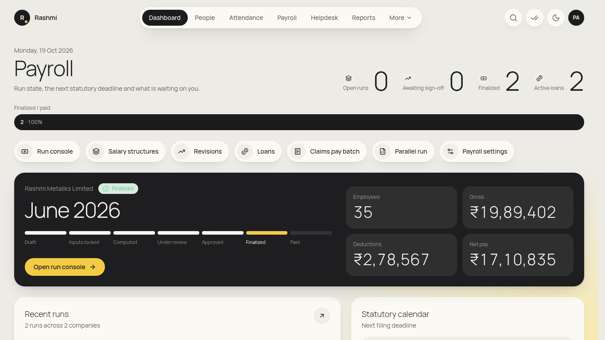
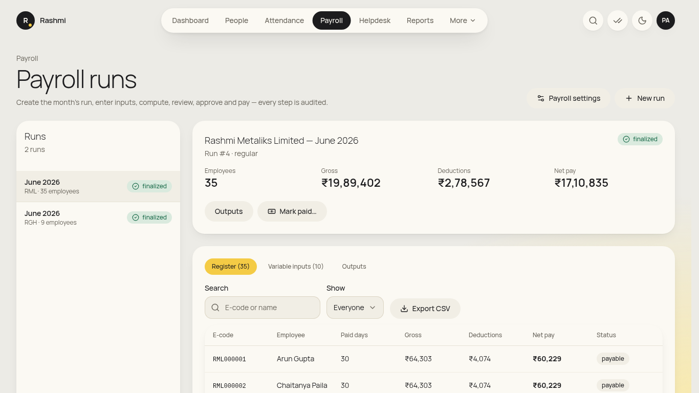
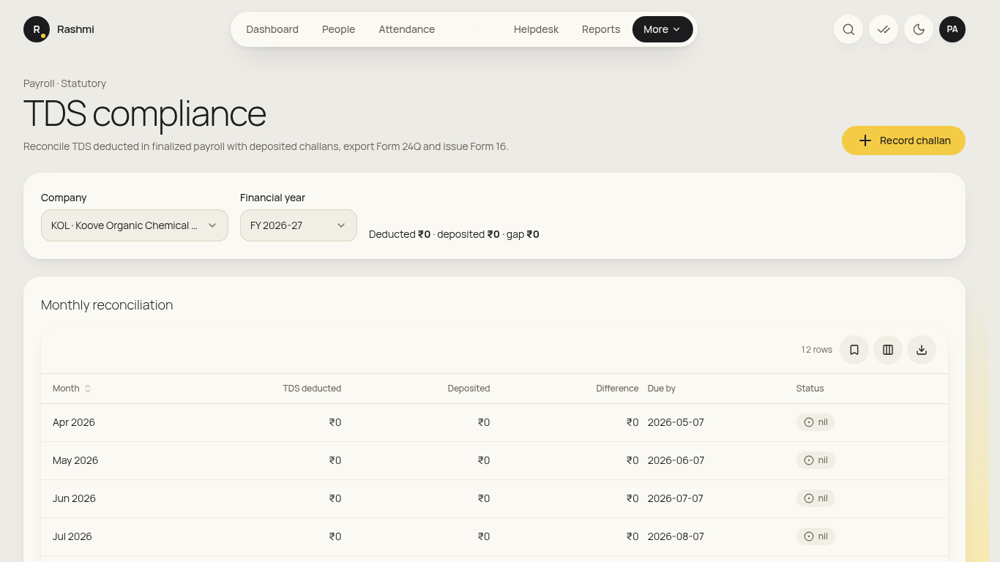
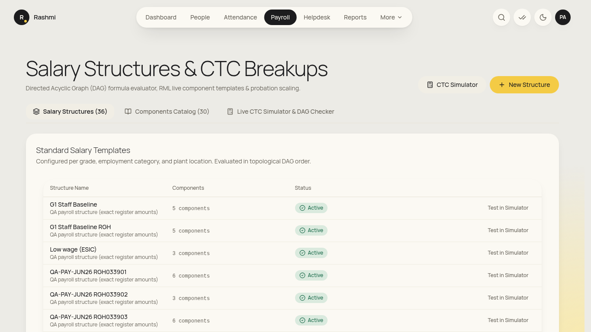
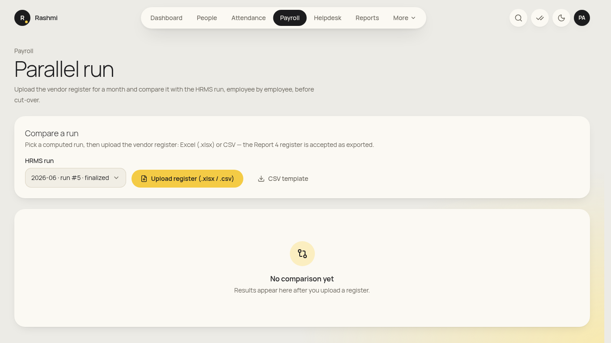
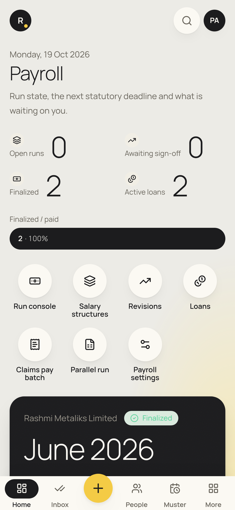

# Payroll admin guide

_For the payroll team (entity-scoped). For your own payslip, use **initials → View my info → Open My Pay** and the [employee guide](employee.md). Checked against the app on 19 Oct 2026. **(coming)** = not built yet._

**Where to find things:** **Dashboard**, **People**, **Attendance**, **Payroll**, **Helpdesk**, **Reports**. **More** holds **TDS compliance**, **Loans**, **Claims**, **Approval chains**, **Attendance masters**, **Data imports**, **Audit log** and **Settings**. Inside Payroll there are links to **Payroll settings**, salary **structures**, **revisions** and the **parallel run**.

## Monthly payroll run (in order)
The run moves through **Draft → Inputs locked → Computed → Under review → Approved → Finalized → Paid**.
1. **Check that attendance is locked.** Attendance → **Month lock** must show the month as locked (HR ops does this).
2. **Payroll → New run.** Pick the **Company** and **Payroll month**, then **Create draft run**.
3. **Variable inputs** (incentive, other earnings, project allowance, canteen, guest house, recoveries):
   - Add rows with **E-code**, **Component**, **Amount (₹)** and **Note**, or
   - use **Upload variable inputs** (Excel or CSV, via **More → Data imports → Payroll run (draft)**). Rows are checked for e-code and name match, active status, duplicates and value range.
4. Click **Lock inputs**. Inputs become read-only. Use **Back to draft** (with a reason) to change them.
5. Click **Compute payroll**. If "*n employees need attention*" appears, fix the data and recompute (Back to draft → Lock → Compute).
6. **Review** the **Register** tab. Use **Show** → *With LOP*, *Zero / negative net* or *On hold*, then **Export CSV**.
7. Click **Send for approval**. The run moves to **Under review**, and the HR head clicks **Approve (checker)**.
8. Once **Approved**, click **Finalize…** and confirm ("Finalize this payroll run?"). The run locks.
9. **Outputs:** **Generate payslips**, **Bank file (CSV)** and **SAP JV (CSV)**.
10. After the bank transfer, click **Mark paid…** and enter the payment reference.

## Monthly statutory
### TDS compliance
1. Go to **More → TDS compliance**. Pick the **Company** and **Financial year**.
2. **Monthly reconciliation** compares the TDS deducted against the amount deposited, with the difference and due date for each month.
3. **Record challan**: fill **For month**, **Challan**, **Paid on** and **Amount**, then **Save**.
4. **Returns and certificates**: Form 24Q and Form 16 for an **Employee code**.

## Occasional
### Salary structures and assignments
1. **Payroll → structures** (`/payroll/structures`): the **Salary Components Master** and **Standard Salary Templates**. **Create Salary Structure**. The **CTC Breakup Simulator & DAG Formula Verifier** previews a CTC (e.g. the G1 sample: BASIC 32,286 … gross 64,573).
2. **Payroll → revisions** (`/payroll/revisions`): **Assign Salary Revision**. Enter the **Employee ID**, **Salary Structure**, **Annual CTC (₹)**, **Effective Date**, **Employment Phase** (with **Probation Percentage (%)** if on probation) and **Revision Reason**. **Salary Revision History & Retro Preview** shows arrears.

### Parallel run against greytHR / the vendor register
1. **Payroll → parallel run**: choose the **HRMS run**, then **Upload vendor register** (get the format from **CSV template**).
2. Read the verdict for each employee: **Exact**, **Rounding**, **Policy**, **Data** or **Unexplained**. Look for **Cut-over gate passed**. (Reference: all 44 June 2026 employees match; RML033625 nets ₹59,124.)

### 7. Statutory rates, PT slabs, GL mapping
1. Go to **Payroll → Payroll settings**. Pick a **Section**: **Statutory rates (PF, ESIC, OT, bonus)**, **Professional tax slabs** or **GL mapping (SAP)**.
2. Click **Add version**, then fill the value, **Effective from** and the **Source / circular reference**, and **Save**. Older months keep their old version.

### Loans and claims payouts
- **More → Loans**: **Staff Loans & Advances**. Use **Loan Application** (the **Amortization Schedule Preview** shows the EMIs) or **Import Legacy SAP / greytHR Loan**. EMIs are deducted in the next run.
- **More → Claims**: **Approved Claims Pending Payout**, then **Route Reimbursement Payout**. Choose the **Payout Method** and, for payroll payout, the **Target Payroll Run ID**.

### Full & final settlement
- **Lifecycle → Separations → Full & Final (F&F) Settlement Workbench** (if your login has Lifecycle access; otherwise HR ops runs it). Enter **Days payable**, **EL balance**, **Recovery amount (₹)** and **TDS ₹**, then record the **Bank UTR / Payment Reference**.

### Not yet in the app
- **Off-cycle payroll run:** (coming).
- **Verifying employee investment proofs:** (coming). Employees can declare and attach proofs in My Tax today.
- **Statutory files (ECR, ESIC, PTRC, Form D):** (coming). The bank file and SAP JV are available.
- **Bonus true-up and increment batch upload:** (coming).

## On your phone
- Bottom bar: **Home · Inbox · People · Muster · Payroll**. Use it to check run status. Do runs and uploads on a desktop.

## FAQ
- **"Create draft run" is refused.** The attendance month isn't locked yet. Ask HR ops.
- **Can I finalise without the HR head?** No. The run has to be **Approved** by the checker first.
- **A finalised run is wrong.** Reopening needs a reason and elevated approval. Don't try to fix it in the next run without telling HR.
- **Amounts look 100× too big.** Report it at once. All money is stored in paise and shown in rupees.
