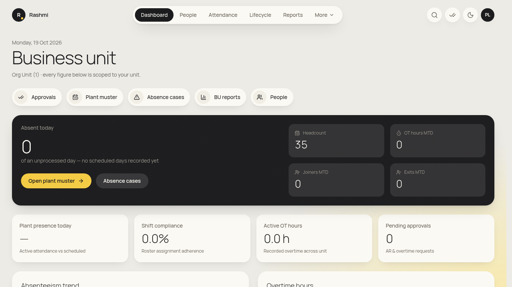
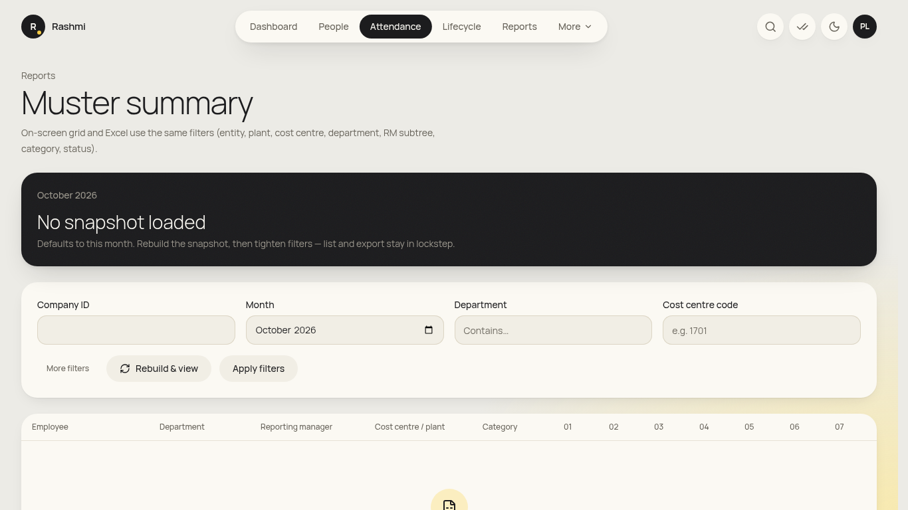
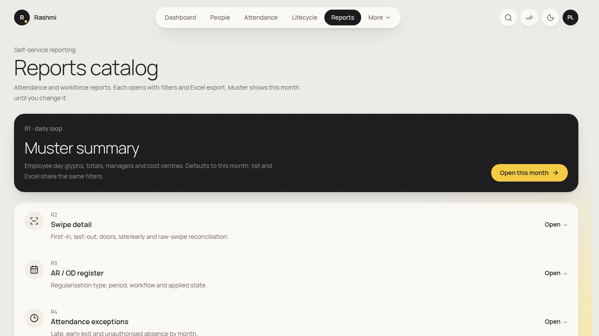
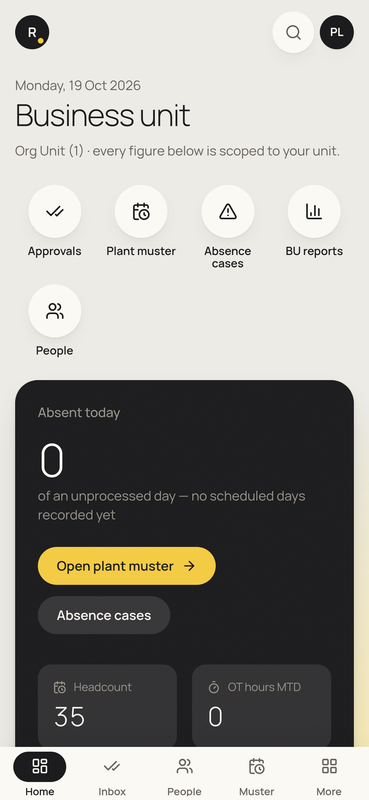

# Plant head guide (business unit)

_For plant or business heads. Everything is limited to your own plant or unit, and it is read-only except for approvals. You're also an employee and probably a manager: see the [employee](employee.md) and [manager](manager.md) guides (your own records are under **initials → View my info**). Checked against the app on 19 Oct 2026. **(coming)** = not built yet._

**Where to find things:** **Dashboard**, **People**, **Attendance**, **Lifecycle**, **Reports**. **More** holds **My Letters**, **Recruitment**, **Policies** and **Travel**. **✓✓** opens Approvals.

## Daily
### 1. Business unit dashboard
1. Open **Dashboard** ("Business unit"). It shows **Absent today**, **Headcount**, **OT hours MTD**, **Joiners MTD** and **Exits MTD**, then **Plant presence today**, **Shift compliance**, **Active OT hours** and **Pending approvals**.
2. Further down are the **Absenteeism trend** and **Overtime hours** charts.
3. Shortcuts: **Approvals**, **Plant muster**, **Absence cases**, **BU reports**, **People**.

### 2. Approvals
- Open **✓✓ Approvals**, then an item, then **Approve** / **Send back** / **Reject**. This covers your direct reports and any step where the plant head is the configured approver.

## Monthly
### 3. Plant muster and absentees
1. Click **Open plant muster** (or **Attendance → Muster summary**).
2. Set the **Month** and **Plant / location**, and optionally **Department**, **Cost centre code** or **Category**. Read it on screen or export to Excel.
3. **Absence cases** lists people on long absence and the stage each case is at (HR runs the letters).

### 4. BU reports
- **Reports** → for example **R6 absence**, **R5 OT**, **R24 boarding/exit**, **R27 headcount**, **R26 attrition**, **R25 probation**. Export to Excel.

### 5. Lifecycle view
- **Lifecycle** shows onboarding, probation, transfers and separations for your plant. Actions there belong to HR. You can read them here.

## Not yet in the app
- **Approving offers/LOIs for your plant (step 1 of the offer chain):** (coming).
- **Daily boarding & exit email for your plant:** (coming, needs SMTP). Use report **R24 boarding** meanwhile.

## On your phone
- Bottom bar: **Home · Inbox** (shown when you have approvals) **· People · Muster · Reports**. The dashboard and approvals work well on a phone.

## FAQ
- **I can't see another plant.** That's correct. Plant heads are limited to their own unit.
- **Can I correct attendance?** No. Ask the employee to raise a regularisation, or ask HR ops.
- **Salaries aren't shown.** Individual pay isn't visible to plant heads unless specially granted.
