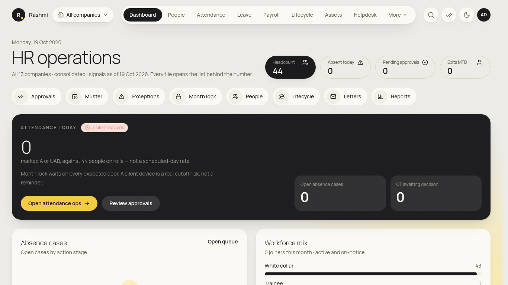
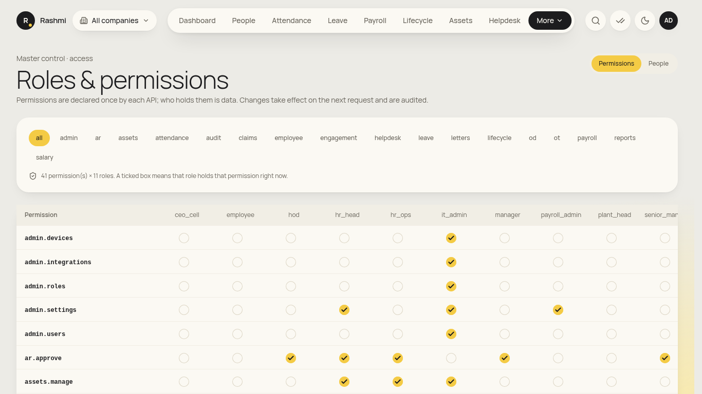
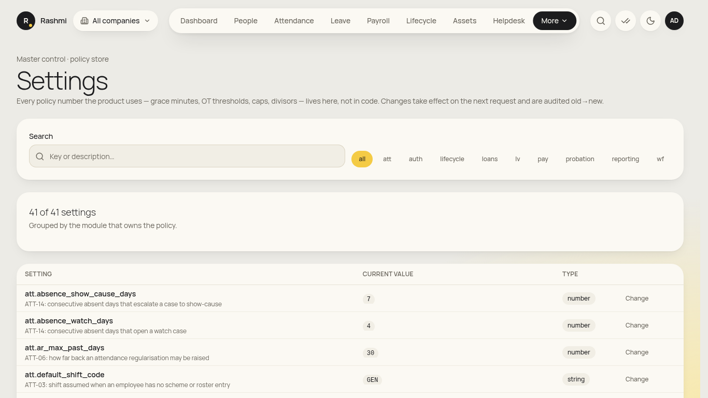
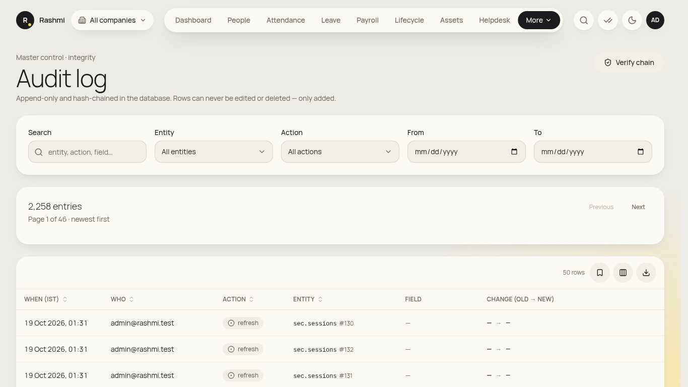

# Super admin guide (break-glass)

_super_admin has every permission in every entity. **It is not for daily work.** Use it only for setup and emergencies; every action is audited. This login has no employee record, so the "My …" pages don't apply. Checked against the app on 19 Oct 2026 (screens from the earlier crawl). **(coming)** = not built yet._

**Where to find things:** every menu item. Ops pages are grouped under **More** by **People**, **Attendance**, **Workplace** and **Admin**. **Settings** and **Gallery** (the design-system gallery) are also under More.

## Setup tasks (one-time or rare)
### 1. Org masters and companies
1. Go to **More → Org masters**. Pick a **Master** (company, location, plant, org unit, cost centre, department, grade, …).
2. **Edit**, **Save** or **Delete** entries. Changes are audited.

### 2. Roles and permissions
1. Go to **More → Users & Roles**.
2. **Permissions** tab: **Grant** / **Revoke** a permission for a role.
3. **People** tab: **Find a person**, then **Add role** with the **Entity (org unit)**.
4. **Sessions** tab: sign out sessions.

### 3. Approval chains, settings and attendance masters
- See the [HR head guide §6–7](hr_head.md#6-configure-approval-chains).

### 4. Heads of department, data imports
- See the [HR ops guide §13](hr_ops.md#13-bulk-data-and-department-heads).

### 5. Payroll reopen (emergency only)
1. **Payroll** → the finalised run → **Reopen…**, with a written reason.
2. Tell the HR head and Payroll. The run then goes through the normal compute, approve and finalise steps again.

### 6. Audit verification
1. Go to **More → Audit log**. Filter by **Action**, **Entity** and **From**.
2. Check break-glass actions regularly. Export them for the auditors.

## Not yet in the app
- **Break-glass reason prompt on every action:** (coming). The actions are already audited.
- **Audit chain export from the UI:** (coming).

## On your phone
- Not recommended. Use a desktop.

## FAQ
- **"My attendance" pages are empty or hidden.** This login has no employee record, which is expected.
- **Can I approve a request about myself?** No. Self-approval is blocked for every role.
- **Who should hold super_admin?** At most two named people in IT or HR, with the password kept sealed.
