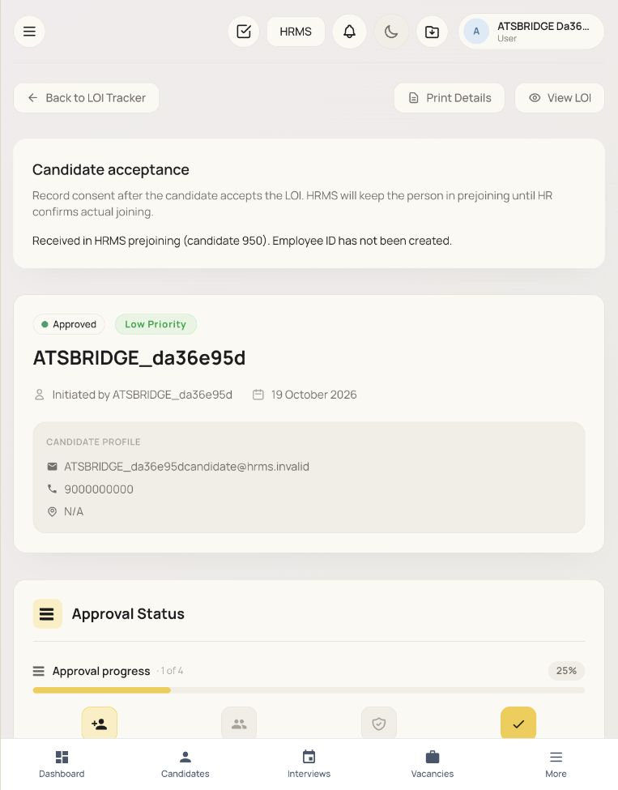
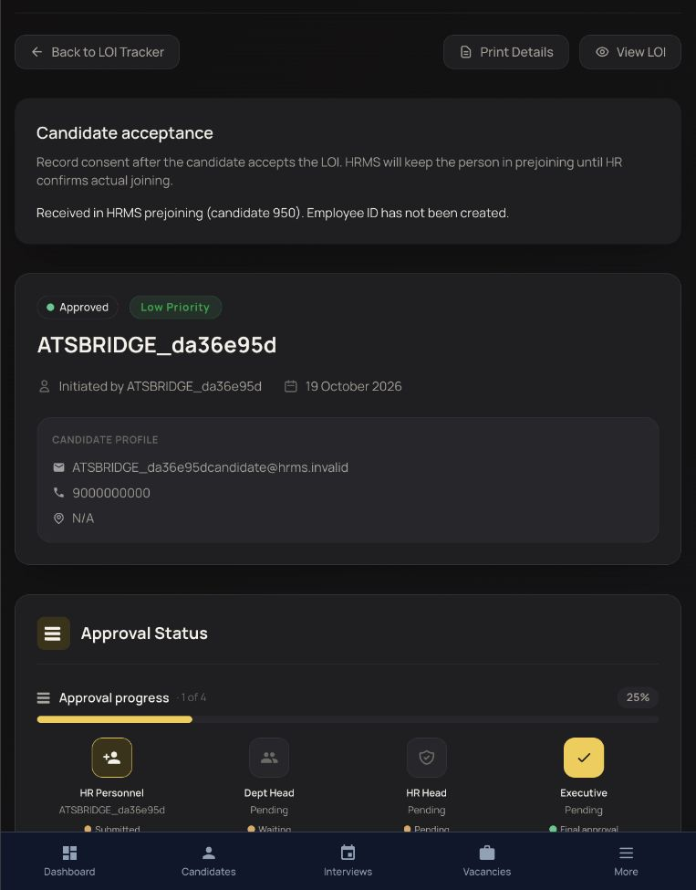

# ATS connection evidence —19 Oct2026

**Local integration implemented; deployment NO-GO.** Sponsor authorized HR-recorded candidate acceptance with date/evidence. See [pack34](../../plans/sow-completion/34-ATS-ACCEPTANCE-AND-CONNECTED-SIGNIN.md) for data/API/transaction ownership, schema purpose, applied local-only migrations, exact continuation and acceptance limits.

- Accepted approved LOI→immutable source acceptance/outbox→signed HTTP→separate HRMS prejoin candidate/receipt. Idempotent retry; changed snapshot409; no employee/e-code, exposed raw token or fake email delivery timestamp.
- Explicit verified local↔ATS account link; state/S256 PKCE/exact callback/one-use code; ATS's own permissions; live parent introspection; unlink nonce; linked logout ends current canonical session while preserving other logins.
- Browser used both actual frontends/backends with native rollback-only synthetic fixtures, normal login, ATS sign-in, accepted-candidate status and both-theme screenshots. It found four missing source read views, restored from existing contract. Signed out, closed proof tab and removed private credential fixture; cleanup counts are zero for bridge fixture people/candidates.
- Restored sponsor refresh replay policy after two failing native regressions. Replay remains rejected/audited; the winning current session remains usable.

Verified focused native43/4, HRMS full frontend321/41, ATS frontend62/10/build, ATS focused backend25/3; integration-owned lint passes. Full HRMS backend verify is RED in current travel/claims work; no current full coverage/build certification. React Doctor ATS flags legacy token web storage plus component complexity; HRMS new selected files has no diagnostics. Formal a11y and production acceptance remain open.

`native-http-proof.json` covers candidate transport only; its shared-login flag does not describe the separate completed sign-in proof. `linked-signin-native-http-proof.json` covers the HTTP sign-in boundaries. `browser-proof.json` and `cleanup-proof.json` specify browser scope/cleanup. Cross-app receipts were inside outer rollback fixtures, not a committed crash/restart test. Root concurrency/auth tests retain disabled synthetic audit parents, not employees.

Latest shared-checkout check: backend typecheck PASS, integration-owned lint PASS; full verify stops at18 financial travel/claims lint errors in `settlement.service.ts` and `travel-budget-reservations.test.ts`. Coverage/test/build gates after lint were not reached. HRMS frontend full321/41 PASS; ATS frontend62/10 and build PASS; ATS backend focused25/3 PASS; current native auth/bridge/SSO/joining43/4 PASS. No conflict markers remain in source. Claims/budget formula/policy changes by the concurrent editor are not accepted by this integration increment. See `backend-verify-current.log` for exact locations and `verification.json` for scope. No deploy/commit/push was performed here.
