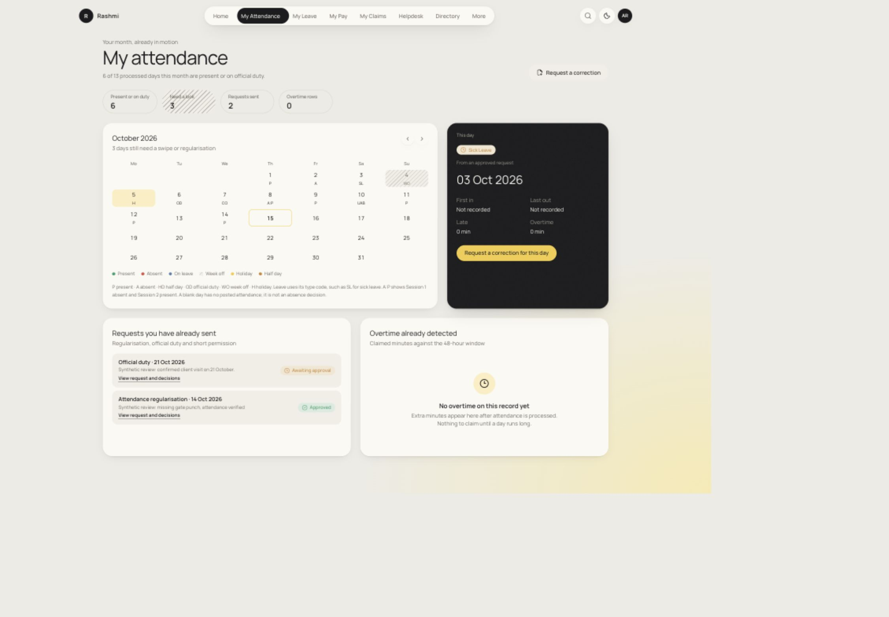

# Manager approval and attendance review — 15 Oct 2026

The checked AR/OD/leave approval and correction paths are repaired. This is a Phase1 Stage1.3 repair increment, with overall acceptance still open. **Backend: 486 tests in 65 files pass; separate build passes; full verify fails coverage. Frontend: full verify passes, 245 tests in 27 files.** Backend statements/lines are 76.37%, branches 71.50%, functions 80.45%; the global 80% floor is unchanged.

[The implementation/handoff plan](../../plans/sow-completion/20-MANAGER-APPROVAL-AND-ATTENDANCE-REVIEW.md) contains exact code entry points, screen→API→database/transaction connections, status meanings and the remaining theoretical/technical contracts. [Verification](verification.json), [findings](findings.json), [browser/database assertions](browser-proof.json), [cleanup](cleanup-proof.json) and [final source hashes](final-source-inventory.json) separate checked facts from outstanding work.

Manager authority now follows current scoped permissions and derived reporting roles. Old notification links open exactly that request. Required reject/send-back notes, intermediate approval language, per-item batch results and immediate badge refresh are covered. Sent-back AR/OD/permission/leave/CO details update the actual domain row and canonical workflow payload atomically. Locked months and HR manual overrides prevent final approval and roll back its ledger/day effects.

The employee calendar shows P, A, OD, actual leave codes, HD/leave type and ordered sessions. Missing posted data is explained rather than labelled absent. Leave history shows sent-back workflow status separately from its pending reservation and provides the exact correction link. Short permission collects real from/to times.

## Browser and native database proof

Synthetic employee/manager accounts exercised AR approval → P, OD send-back with reason, employee correction from 20 to 21 Oct, and manager approval of that revised request. Native queries confirmed OD only on 21 Oct, no day record on the superseded 20 Oct, and both requests approved. The screenshot below was taken **before the manager's final OD approval**, so it correctly shows the revised OD awaiting approval. Final committed facts are in browser-proof.json. Leave/SL/half-day and scope/lock conflicts were also covered by native/API and component tests; no claim is made that every leave path was browser-walked.

Both themes and desktop/mobile layouts were inspected. Requested mobile width was 390, but the browser's observed CSS viewport was 487px (scroll width also 487px); this is not 390px or narrower certification. Calendar cells measured approximately 44px. One native form sign-in attempt failed, supported DOM filling succeeded, and a direct local login/me probe returned 200. Development reloads required re-login. These observations are recorded rather than called production acceptance.

The fixture server and Vite were stopped; the agent-created tab was closed; viewport/theme restored. Read-only cleanup confirms zero active/attached checked fixture users, zero remaining scope-fixture employees and zero open fixture requests. Audited user identities and immutable month locks remain, as required. An initial test cleanup incorrectly tried to delete a month lock and failed; the test now retains/reuses it and all native tests pass. Date selection preserves distinct scenarios when skipping closed fixture months.

## Remaining decisions and limits

The genuine all-vacant chain policy still awaits the sponsor's answer; documented vacancy-skip behavior was preserved. Frozen chain/domain revision history, heterogeneous per-stage permission contracts, delegation limits, company-month completeness, exact session/partial-day payable policy, the complete leave concurrency/expiry/encashment protocol, real Kent and notification delivery, signed UAT and backend coverage remain open. Initial AR/OD submission can still accept a closed month with no day rows, then explicitly fail at final approval; improving that submission policy is recorded in the plan.

No tables, columns or migrations were added in this increment. This does not certify the earlier 1,379-field schema audit as clean. All 176 SOW rows and their broader remaining obligations are retained; claims/budgets are deferred, not completed. Payroll/statutory source in the dirty checkout predates this increment and was not edited here. No release gate advanced, and no PR, commit, migration or deployment was performed by this increment.

The focused React Doctor scan records seven warnings: three component-complexity, one component-size, two draft prop/state restoration effects and one repeated Intl formatter construction. No warnings were suppressed. Deterministic Impeccable scanning of approvals reports zero findings after the selected-row treatment repair. These tools do not prove full accessibility or architecture quality. The production build's existing large-chunk advisory remains.

## Reproduce and resume

Use Node24/npm and AGENTS/docs before code changes. The sponsor-authorized local database is `hrms` on loopback, PostgreSQL14.24; do not recreate `hrms_test` or imply the machine now runs the target16. Run native suites serially with explicit TEST_DATABASE_URL, NODE_ENV=test and LOCAL_TEST_DATABASE_NAME=hrms after privately checking its loopback host/name; otherwise integration tests skip. Never print the URL. Run backend `npm run verify`, separately `npm run build` while coverage blocks it, and frontend `npm run verify`.

The [context ZIP](HRMS-approval-context-2026-10-15.zip) contains current source/tests/migrations/configuration, canonical docs, plans, original SOW and this evidence. Read HANDOFF.txt and MANIFEST.json inside. It excludes environment files, dependencies, build/coverage output, employee recon exports, databases, private logs and temporary fixture credentials. Older output evidence linked by historical plans is not exhaustively included; current source is included to allow independent verification. Hashes capture a dirty working tree, not a pristine Git base or approval for unreviewed payroll code.
