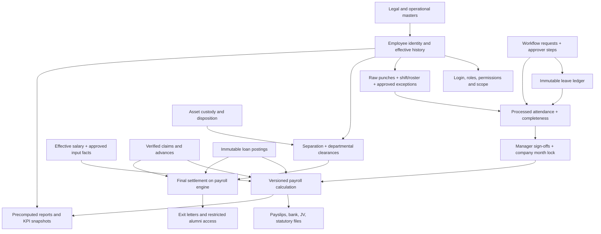

# SOW completion plan — AI handoff

**Latest approval/attendance repair, 15 Oct 2026:** start with [pack20](20-MANAGER-APPROVAL-AND-ATTENDANCE-REVIEW.md), then pack19 for all remaining HR domains. This increment repairs scoped manager flows, domain resubmission and employee attendance/history. It preserves all 176 SOW rows and the unresolved decisions; no release gate or zero-slop certificate is asserted.

**Latest backend scope and fixes, 14 Oct 2026:** start with [pack19](19-BACKEND-REPAIR-SCOPE-AND-PROGRESS.md). It records the current verified repair increment, current test limitations and the remaining HR work with claims/budgets deferred. All 176 original SOW rows remain in its linked machine-readable scope. It supersedes earlier lint/test counts, not the specs or unresolved acceptance obligations.

**Latest repair evidence, 14 Oct 2026:** read [pack17](17-REPAIR-STATUS-AND-CURRENT-SOW.md) and [pack18 — field purpose and schema audit](18-FIELD-PURPOSE-AND-SCHEMA-AUDIT.md) first. Current findings, schema recovery, fixes and remaining SOW scope supersede historical completion assumptions below. Pack18 inventories all 1,379 business fields and records duplicate-policy/contract/integrity issues plus recoverable missing historical runtime context; zero slop and SOW completion are not certified.

**Backend schema follow-up, 10 Oct 2026:** start with [13-BACKEND-SCHEMA-PLAN.md](13-BACKEND-SCHEMA-PLAN.md), then [14-BACKEND-TABLE-CATALOG.md](14-BACKEND-TABLE-CATALOG.md) and [15-BACKEND-SCHEMA-CHANGES.md](15-BACKEND-SCHEMA-CHANGES.md). They cover 46 proposed models and 44 table amendments, exact observed/specification fields, relationships and transaction ownership across all 176 scored SOW points. Read [16-CURRENT-CHECKOUT-ADDENDUM.md](16-CURRENT-CHECKOUT-ADDENDUM.md) before treating the historical code audit as current: new payroll code and a conflicting migration appeared during this work. The SQL drafts are guarded review artifacts and were not applied. No implementation gate is passed by this schema plan.

Prepared and expanded 09 Oct 2026, IST. This is an actual-code audit and completion plan, not implementation or a gate sign-off. Scope: all 176 scored points in `Documention_ProtiVity/SOW Tracker .xlsx`, all 119 canonical PRD requirements, all 60 numbered docs13 build tasks and the remaining HRMS modules, including T&E and ATS absorption. Source headings, exclusions and commercial/manual clauses remain relevant even when they have no score.

**Latest evidence:** 338 visible backend/frontend project files plus four root deployment/CI files were read/indexed, including 153 API declarations and 115 frontend HTTP/resource call sites. Critical screen→API→service→database/job paths were manually reviewed. [10-CODE-AUDIT-AND-GAPS.md](10-CODE-AUDIT-AND-GAPS.md) records 37 open source-backed gaps and their required repairs/tests. This systematic scan does not claim every line or deployed/external system is proven correct. Frontend full verify passed 233 tests; backend static gates and separate build passed, while full verify failed coverage with 164 DB tests skipped. See `verification-2026-10-09.json`.

## 1. Read this before starting

This pack distinguishes four things: **specified behavior**, **observed code**, **historical database evidence**, and **proposed completion design**. A proposal is never evidence that a table, endpoint or screen already exists. An old database audit is never evidence of today's database state. Historical SOW percentages describe the vendor, not the custom HRMS.

The original point checklist has 12 implemented capabilities, 43 partial, 86 pending, 29 manual/service duties and 6 scope decisions. These categories are preserved as the initial capability snapshot; open source repairs mean an implemented capability is not a safe completed flow. Every scored point now links its applicable deep-code obligations as well as exact wording, existing code, remaining work and execution cards in [07-SOW-CROSSWALK.md](07-SOW-CROSSWALK.md). The broader conservative requirement verdicts are in [11-REQUIREMENT-TO-CODE.md](11-REQUIREMENT-TO-CODE.md). The original workbook and assessment workbook accompany the share bundle.

Read the repository's AGENTS instructions, then docs 00, the relevant domain specifications, docs 13 and 14. For money read docs 04 and 10 **in full**; for screens read docs 05 and 12. The original specs and all phase trackers accompany the bundle. Their exact field and report catalogs are part of this plan's context, not optional references.

Authority: explicit sponsor decisions and AGENTS → applicable amended specs → requirement IDs and approved policy decisions. Code establishes current coverage, not desired behavior. When specs disagree, use the decision register in [08-DECISIONS-AND-OPERATIONS.md](08-DECISIONS-AND-OPERATIONS.md); do not choose silently. A statutory conflict cannot be resolved by preferring an old tenant configuration to applicable law.

## 2. Contents and where to resume

| Pack | Domains and purpose |
|---|---|
| [01-DATA-AND-FOUNDATIONS.md](01-DATA-AND-FOUNDATIONS.md) | Identity, DB links, migration/type reconciliation, security, notifications, documents, imports |
| [02-ATTENDANCE-LEAVE-WORKFLOWS.md](02-ATTENDANCE-LEAVE-WORKFLOWS.md) | Kent, shift/session policy, roster, requests, approvals, leave, locks, muster |
| [03-PAYROLL-LOANS-CLAIMS.md](03-PAYROLL-LOANS-CLAIMS.md) | Salary, inputs, immutable runs, statutory engines, outputs, loans, claims, year-end, parallel run |
| [04-LIFECYCLE-AND-FNF.md](04-LIFECYCLE-AND-FNF.md) | Join, confirmation, transfers, resignation, clearances, settlement, alumni |
| [05-WORKPLACE-AND-ANALYTICS.md](05-WORKPLACE-AND-ANALYTICS.md) | Assets, helpdesk, engagement, policies, R1–R31, CEO/BU dashboard formulas |
| [06-TRAVEL-ATS-AND-MOBILE.md](06-TRAVEL-ATS-AND-MOBILE.md) | T&E settlement/migration, booking, ATS/LOI, geo attendance |
| [07-SOW-CROSSWALK.md](07-SOW-CROSSWALK.md) | Every scored point, wording, coverage, remaining work, responsible task |
| [08-DECISIONS-AND-OPERATIONS.md](08-DECISIONS-AND-OPERATIONS.md) | Blocking ambiguities, manual service duties, owners, evidence and release controls |
| [09-CODE-INVENTORY.md](09-CODE-INVENTORY.md) and `code-inventory.json` | Actual routes, service symbols, screens, migration/type inventory and SHA-256 fingerprints |
| [10-CODE-AUDIT-AND-GAPS.md](10-CODE-AUDIT-AND-GAPS.md) | 37 actual source gaps, concrete repairs and independent acceptance scenarios; fresh verification limits |
| [11-REQUIREMENT-TO-CODE.md](11-REQUIREMENT-TO-CODE.md) | Every PRD ID/build task and cross-cutting SOP obligation mapped to code and remaining work |
| [12-TRANSACTION-AND-CONNECTION-MAP.md](12-TRANSACTION-AND-CONNECTION-MAP.md) | Existing screen/API/data/transaction boundaries and required end-to-end domain connections |
| `deep-code-index.json`, `api-contract-audit.json`, `screen-api-index.json`, `code-audit-findings.json`, `requirement-code-crosswalk.json` | Complete source fingerprints/DB-operation locators, contract and screen-route candidates, open repair backlog and machine-readable coverage |

Task labels F01, A01, P01 etc. below are **completion-work aliases**, not replacements for P0/P1/P2 requirement/task IDs or permission codes. Each card maps back to an existing phase/stage. Execute only one existing plan-stage per work session, announce it, finish/report and stop. A card spanning stages must be split at those boundaries. Do not mark a phase gate from a card's implementation checkbox.

**First resumable work:** Phase 0, Stage 0.2 — reproducibility and tooling, F01. Begin with a read-only comparison of source migrations, test setup, target versions and historical schema evidence. Current code already isolates test DB selection; validate that safeguard rather than recreate it. If migration provenance is unavailable, record the blocker and stop schema-changing work; other independent read-only planning can continue. Resume 0.4 security/delivery and 0.5 master readiness only in separate announced sessions. Do not start payroll until policy/data/G1/G2 preconditions are evidenced.

## 3. Existing implementation to preserve

| Area | Actual starting point | Missing completion boundary |
|---|---|---|
| Auth/RBAC/settings/audit | `backend/src/api/orpc.ts`, `core/rbac`, `modules/{auth,rbac,settings,audit}`; admin screens | Scope on every query, business permission alignment, deployed hash/schema parity, ATS SSO proof |
| Employee master | EMS seed/enrichment functions, e-code function, directory/profile reads, organization migration | Full CORE-08 validations, controlled editing, sanctioned real import and historical data |
| Attendance | Mock Kent, immutable swipe ingestion, per-door watermarks, day processor, AR/OD/permission/OT, roster/manager sign-offs | Real Kent protocol, approved session/rotation/flexible rules, payroll consuming approved OT |
| Leave/workflows | Ledger, accrual/expiry/year-end functions; leave/cancel/encash/RH APIs; generic workflow hooks | Admin configuration/register UI, year-end scheduling, encash payout linkage, concurrency/ownership proof |
| Letters/policies | Templates/signature/archive and ESS; policy publish/ack/nag/R30 | Production rendering/storage/delivery, derived salary/exit letter eligibility |
| Lifecycle | Boarding/exit query/export/send only | Onboarding, probation, transfer, resignation, clearance, F&F and alumni business flows |
| Payroll/loans/claims | Integer-paise Money utilities; frontend pending layouts; generic workflow definitions | No registered business modules for these flows in current `api/router.ts` |
| Assets/helpdesk/engagement | Working APIs and operational asset/helpdesk UI; announcement feed and poll/pulse APIs | Exact gaps in W01–W03; do not replace working services |
| Reports | R1–R6/R24/R27, asset/helpdesk/policy slices, CEO snapshots, BU API/UI | Full remaining catalog, exact formulas/scope/drilldowns and source reconciliation |
| T&E/ATS/mobile | Pending HRMS screens; EMS/ATS behavior documented | Absorption contracts, reproducible schemas, ported workflows/settlement, mobile submission API |

**Fresh source corrections to the 07 Oct audits:** `tests/setup-database.ts` uses `TEST_DATABASE_URL`, fails on a non-`*_test` name and clears `DATABASE_URL` when absent; import cleanup now filters fixture employees. `recomputeDay` now gates daily A **or any absent session** on readiness; regularization and whole-day leave clear stale session labels. These are present in code on 09 Oct. Their isolated tests/deployment and old database contamination remain to be reconciled. Do not present the previous bugs as unchanged source defects.

The deeper audit extends those findings with current actual code: OT approval/domain/CO commits can diverge; leave reservations/caps are not serialized; all-expired CO balance is missed by a NULL aggregate; dirty work can be lost after a crash; month lock omits dirty/expected-day completeness; locking itself can invalidate manager sign-off; not-returned assets become stock; policy tile/report eligibility differs; mock Kent writes under the real source key; and PM2 leaves the worker disabled. Permission/scope, source contract, audit atomicity, template identity and test baseline repairs also remain. Exact evidence and limits are in pack10; do not treat these as deployed incident claims or fabricate a fix for an unsigned policy.

## 4. The connected system — theory

An **employee** is the business person, a **user** is the actor/login, an **e-code** is an external business identifier, a **company** is the legal payer, and location/plant/cost-center/OU are different operational dimensions. Never substitute one ID for another. A manager may span entities; that does not grant access to all those entities' payroll. A company's payroll eligibility is explicit, not inferred from its e-code prefix.

Requests express intent. Approvals authorize it. Domain facts record its effect. Ledgers record conserved movements. Outputs are versioned representations of frozen results. Keeping these layers separate prevents an approval from becoming a second payment, or a PDF from becoming the payroll database.

Arrows express business dependencies, not a blanket permission for deep module imports. Backend services communicate through module `index.ts` public APIs; reporting uses designated query boundaries. Frontend talks over HTTP/OpenAPI only.

## 5. Execution sequence and release gates

| Order | Existing stage | Completion cards | Must already be true |
|---|---|---|---|
| 1 | 0.1 external decisions; 0.2 reproducibility/deploy | D01, F01 | Approved source access and recovered migration provenance before mutations |
| 2 | 0.4 security/delivery; 0.5 master; 0.6 spikes | F02–F04, A01 | Safe test target, audited migration chain, canonical source mapping |
| 3 | 1.1 ingestion; 1.2 processing | A01, A02 | Actual Kent completeness contract, real master, approved attendance policy |
| 4 | 1.3 workflows; 1.4 requests/OT; 1.5 leave | A03, A04 | Domain transaction/ownership controls and notification delivery |
| 5 | 1.6 letters/alerts; 1.7 reports/locks; 1.8 UAT | A05, applicable W03/W04 slices | Recompute drained, source freshness, signed attendance/leave behavior |
| 6 | 2.1 salary; 2.2 run; 2.3 statutory; 2.4 output | P01–P04 | G1, signed payroll policies, target-FY rules, restore evidence |
| 7 | 2.5 loans/claims; 2.6 annual/parallel | P05–P07 | Payout primitive, validated money engines, frozen real comparison exports |
| 8 | 3.1 join/confirm; 3.2 separation/F&F | L01/L02/L04/L05 | G2; salary/run engine and proven workflow delivery |
| 9 | 3.3 transfers/assets; 3.4 helpdesk/engagement; 3.5 executive | L03, W01–W04 | Respective domain prerequisites; extend existing implementations |
| 10 | T1–T4, then Phase 4 scoping | T01–T04, R01, X01 | G3/G3.5 as original trackers require; external schema/contract capture |

This does not erase work already landed ahead of its phase. Review/reuse it, but preserve the phase gates. G0 requires real validated master + Kent/SSO/deploy/scale proof; G1 requires full-month real attendance reconciliation; G2 requires ≥2 consecutive payroll comparisons, output acceptance and restore proof; G3 requires full real exit/F&F/letters and CEO review; G3.5 requires a real travel settlement with payroll and migration parity.

## 6. Mandatory task delivery contract

For each stage produce: requirement/SOW row IDs and applicable C findings; source/spec references; existing code reused; actual-vs-proposed schema diff; field provenance/ownership; transaction/state transition table; API permission and scope; screen field-to-API mapping; tests with independently derived expectations; verification output; unresolved decisions; and precise tracker changes. Use pack12's field/transaction contract. A schema migration and `core/db/types.ts` change travel together.

Never insert invented default DOB/grade/bank/manager values to make an import pass. Never calculate money on the frontend. Never use display name, department label, rounded dashboard total or mutable wallet balance as a transaction join key. Never overwrite a locked result to fix history. Never treat a queued message as delivered, a seeded workflow as a business module, or an existing table as a working screen.

All policies are typed audited settings; effective statutory rates are versioned data with official sources. Queries use Kysely; money uses existing integer-paise primitives and one rounding policy; immutable history is protected at DB level; object bytes use the storage adapter. Preserve nullable/unavailable metrics where inputs are absent. No silent row caps or changed export filters.

Screen contract: compose `frontend/src/ui` and `frontend/src/tokens`; seven interactive states; both themes; keyboard/focus/reduced motion; INR/IST/`DD MMM YYYY`; persisted filters and draft-safe forms; scoped field masking; clear loading/error/empty/unavailable states. Success shows the committed record/version and next action, not speculative values.

## 7. Copyable prompt for the next AI

> Work in the Rashmi Group HRMS repository. Read AGENTS, docs/00, plans/sow-completion/00-START-HERE.md, packs10/11/12, the selected domain pack, all governing specs, and docs/13/14 before edits. Revalidate both code inventories against the checkout. Work on **one existing plan-stage only**. Start with F01 under Phase 0 Stage 0.2 unless a documented completed prerequisite allows a later stage. Announce the stage. Reuse existing services/screens; do not infer completion from plans or table existence. Carry all applicable C repairs and PRD/SOW obligations into the stage. Resolve the card's blocking decisions before dependent implementation. Describe every DB relationship and enforce employee/company ownership, state transitions, idempotency and immutable result history. Use oRPC with zod input/output, one declared business permission and runtime scope; no cross-project imports. Run appropriate isolated checks and full verify for changed projects. The latest no-DB backend verify was red on coverage; do not call it passed or hide skipped suites. Update the phase tracker only to evidenced completion; leave gates unsigned without their criteria. Report and stop after the stage.

If the AI only receives the share bundle, it has planning context and fingerprints, **not a full runnable checkout**. It must obtain repository access before editing code; it must not recreate an HRMS from these descriptions. External EMS/ATS source and sanctioned data remain separate prerequisites, never silently presumed available.

## 8. Progress ledger

| Card | Status | Evidence required to close |
|---|---|---|
| F01–F04 / A01–A05 | Planned; existing slices credited | See domain card; neither old audit nor this plan closes it |
| P01–P07 / L01–L05 | Planned; policy/data dependencies apply | Exact calculations and connected transactions accepted |
| W01–W05 | Planned extensions/repairs/training | Existing APIs reused; code repairs, missing behavior, guides and UAT closed |
| T01–T04 / R01 / X01 | Planned or blocked on scope/schema | Approved source contracts and consolidation gates |
| M01 / D01–D12 | Operations/decision work | Named human owner and recorded evidence/sign-off |

No application code, migrations, business records or statutory rates were changed to prepare this plan.
