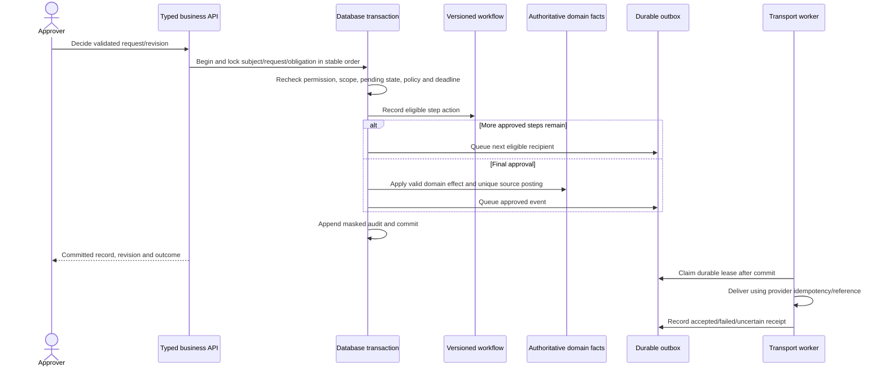

# Database, screen and transaction connection map

Read packs01–06 for the complete proposed domain contracts, pack10 for actual source defects, and pack11 for every requirement. This map connects the implementation layers. **Existing** means a source service/route/type/migration was inspected; it does not certify deployment. **Required/proposed** means specified completion work whose exact schema must first be reconciled with docs03, missing historical migrations and D11. Do not create a table merely because a responsibility is named below.

## 1. Identity and ownership invariants

| Concept | Connect using | Never substitute |
|---|---|---|
| Person/employee | Internal `core.employees.id`; external EMS `userid` / greytHR e-code through a reviewed mapping | User login ID, Mongo ObjectId, name, email or current department |
| Actor | `core.users.id` linked by `employee_id` where applicable; live permission and subject scope | Employee ID as approver user ID, role label as unrestricted authority |
| Legal payer | Approved effective company/entity of the obligation/run; explicit India-payroll eligibility | Plant, location, e-code prefix or the manager's company |
| Operational allocation | Effective location/plant/cost-center/OU/department/grade history | Current master placement when calculating historical wages |
| Request and revision | Workflow ID plus authoritative domain record/revision and validated subject | Free-form workflow JSON as the sole trusted financial record |
| Financial source | Unique source obligation/posting reference; approved version and amount | Displayed balance, detected OT, requested claim amount or a downloaded PDF |
| Document | Parent record entitlement → document metadata → immutable storage key/version | Global document ID or object URL as authorization |
| Policy | Approved effective settings/rate/structure version with provenance | In-code fallback, current web rate or live tenant configuration without sign-off |

All domain children must agree with their authoritative employee/payer/version. Both actor authorization and subject eligibility are rechecked on the server. A FK establishes that a parent exists; it does not establish that the chosen parent belongs to the correct person/company or is approved. Add those constraints and transactional checks explicitly.

## 2. Actual source connections and required repairs

The complete file/function/Kysely call index is `deep-code-index.json`. Raw SQL in migrations/services also needs inspection; a Kysely-call count is not a complete physical FK catalog. Exact baseline field/type definitions remain in docs03 and `core/db/types.ts`. Historical deployed relationships are in the dated recon, not asserted current.

| Flow / actual screen and endpoint | Existing record links and source entry | Transaction boundary now | Required connection / completion |
|---|---|---|---|
| Directory/profile: `/people`, `/people/:ecode`, `/me` → employee read APIs | employees→company/location/grade/department/designation/RM; user.employee_id; `employees.repository/service/router` | Read queries and separately resolved masking booleans; import services own their mutations | F02/F03: effective history, complete validated fields/editor and sanctioned import; C01/C31 scoped list/facets/profile/masking; align active/onboarding populations |
| Settings/access/audit: `/admin/settings`, `/admin/users`, `/admin/audit` | role/user/permission grants, typed settings, append-only audit; central `orpc` and `core/rbac` | Runtime grants/permission resolution exists; settings mutation and audit are separate commits | F03: one-code business procedure map, typed range/cross-setting validation, atomic settings/audit, historical scope and no missing-scope fallback |
| Kent/device: `/attendance/devices`, `/attendance/exceptions` → ingestion/config APIs | swipe employee_id nullable + immutable employee_no; device/door/location, source and per-device watermarks; quarantine | `ingestOnce` bulk events+watermarks in one transaction; source cursor calculated before it | A01: real connector and lossless contract; C14/C15 prevent mock-real contamination/regression; unmatched mapping preserves original immutable event and approved mapping history |
| Processed attendance: `/my/attendance`, `/my/team`, roster/config screens | swipes + roster(employee,date) + employee scheme + shift + location holiday → day_records(employee,date); recompute_queue | Individual recompute reads/writes; dirty claim DELETE precedes work; manual change/audit separate | A02: durable dirty revision/lease, effective schemes, exact sessions and policy; C12/C13/C37 preserve sign-offs and derived provenance |
| AR/Permission/OD: request drawer → `/attendance/requests` | regularization.employee_id / workflow_request_id → wf.request subject/actor; approved range→day rows | createRequest attaches domain row before advance; final hook runs in approval transaction | A03: keep atomic attachment; lock-safe intended/applied day checks; resolve D05's signed time-slice/payable interpretation before changing current whole-day-P behavior; C04/C08 revisions/precedence |
| OT: `/my/team/overtime`, `/my/attendance` → OT mine/pending/decide | overtime employee/date + workflow + manager + approved minutes + CO credit reference | Workflow act commits first; decision refinement and CO posting commit second | C06: final approval and domain posting in one transaction, deadline/authority/state recheck and unique source posting; payroll consumes approved pay choice once |
| Leave: `/my/leave`, `/leave` → balances/applications/admin | application→employee/type/workflow/ledger debit; lv.ledger(employee,type,delta,date); cancellation workflow; RH selection→holiday/workflow | Balance/cap/overlap checks before creation transaction; final hooks write ledger/day; jobs read then post | C07–C10: serialize reservation/overlap/caps; signed accrual/expiry; no-op protected attendance must not be called applied; actual encash debit becomes one payout obligation |
| Approvals: `/approvals/:id` → inbox/action/detail/resubmit | request→subject/actor/definition; request_steps→request/approver/delegator; notification queue | act locks open step and final hooks share its transaction; resubmit modifies workflow JSON only | A03/F03: domain schemas, revision/chain version, eligible scoped role queues/delegation; C02–C05/C24 exact deep-link record and truthful per-item outcomes |
| Month lock/muster: `/attendance/month-lock`, `/attendance/muster` | company/month lock + manager approval ledger + devices/completeness + day rows → reporting.muster_month | Company/month advisory lock, checklist, freeze and audit in one transaction; snapshot replacement uses a transaction | C08/C11/C37: same attendance fact revision, dirty/expected-day completeness and scope; no sign-off invalidation caused only by locking; half-day paid units correct before payroll |
| Absence/letters: `/attendance/absence-cases`, `/letters`, `/my/letters` | absence case→employee/letter; letter→employee/document/workflow/template; signature hook→issued_at | Case/letter/document/outbox operations have several separate boundaries; signature final issuance is transactional with workflow | A05/W03/F04: official eligible versioned letters, protected merges, staged object consistency, actual notification receipts; C20/C36 |
| Policy: `/policies`, HR catalog/R30 → publish/read/ack APIs | policy→document/audience; acknowledgement(policy,employee); targeted population/nag/report | Publish/file/audit/outbox separate; ack idempotent unique key; target checks differ between tile/report | C19/C21: same audience/permission/version population for read/ack/tile/export; atomic domain+audit+outbox and safe document access |
| Assets: `/assets` → registry/assign/return/maintenance/held | asset→company/location; assignment→asset and employee XOR third-party; maintenance→asset; users record actors | Assign/return/maintenance are transactions; registry upsert/audit separate; return lacks receipt distinction | C18/C21/C35: not_returned remains outstanding, valid concurrent custody state, scoped asset/employee links and exact costs; L04 clearance uses authoritative custody/recovery obligation |
| Helpdesk: `/helpdesk` → mine/queue/thread/reply/status/performance | ticket→raiser/assignee/category; messages→ticket/author; due/ack/escalation/resolution times | Creation includes ticket/audit/outbox transaction; reply/status/escalation split writes | C26/C27: participant/agent scope, immutable SLA cycles, atomic state/outbox and receipt; category routing/role holder obeys subject scope |
| Engagement: `/engagement` → feed/polls/respond/results | announcement/poll audience; response→poll, named user XOR anonymous HMAC; unique dedupe | Response insertion and DB uniqueness exist; creation/close audit separate | W03/F03: publisher/structured survey contract, scoped admin/results/exports, preserve anonymity and approved audience; C21/C34 |
| Dashboard/report catalog: role home, `/executive`, `/reports` | precomputed CEO KPI/muster rows plus supporting report queries; export audit | CEO snapshot replacement atomic; HR/BU live aggregation; many reads use current master | W04/C01/C25: effective population, exact denominator, approved OT, payable sessions, scoped snapshot/drilldown/export and measured freshness/scale |
| Notifications/files/background worker | wf.notifications/subscriptions; documents→owner/user/storage; jobs/worker | processQueue holds transaction through send; upload precedes metadata; worker schedules several missing-created queues | F04/C16/C17: short durable leases/outbox/receipt, staged objects/reconciliation; production worker and real adapters must run before scheduling is accepted |

## 3. Required end-to-end transaction contracts

These are completion designs, not claims that current code implements them. Confirm exact column/table names against docs03 and recovered models before migration. An approved schema amendment must list grain, required fields, FKs, same-subject/payer constraints, temporal exclusions, unique retry keys, append-only triggers, indices/partitions, retention and owner. Keep models in their owning modules and use public APIs over deep imports.

| Obligation / business theory | Required connection and atomic transition | Screen must show / acceptance |
|---|---|---|
| Prejoin/activation: candidate ≠ active employee | R01 accepted candidate/LOI version → L01 reviewed mapping → allocated e-code/employee/current placement → approved effective salary structure → stakeholder tasks/documents; atomically create authorized domain rows + workflow/outbox/audit. Candidate token grants only its specified scoped form; public access is a D03 design. | Source candidate/LOI reference, missing verified fields/documents, link delivery/completion, task owner/due date and activation readiness; duplicate handoff cannot create two employees/salaries. |
| Confirmation: approve a business-effective change | L02 review/request → final approval → confirmation effective history/date + P01 salary phase switch + letter eligibility/outbox. Pending review does not change paid salary. Future approved changes activate at the approved boundary. | Due/review/approval/effective date, probation→confirmed breakup and issued letter; duplicate approval/date worker switches once. |
| Transfer: person continuity, payer changes explicitly | L03 approved transfer → old assignment closed + new effective placement/history; e-code policy D09; shift/calendar/manager/scope/input dependencies invalidated; salary/payer/statutory/YTD continuity per approved entity-transfer policy. Preserve old locked runs. | Before/after company/plant/CC/OU/grade/managers and effective date, impact preview/pending obligations; historical payroll stays allocated to its actual payer. |
| Attendance readiness: source completeness precedes absence/pay | A01 raw immutable receipt/completeness → A02 derived day and source/policy revision → A03/A04 authorized exceptions/ledgers → manager approves same revision → A05 freezes complete company/month facts. Shared lock/revision protocol prevents concurrent finalization from crossing freeze. | Expected days, dirty/held days, source watermark/gaps, pending carried decisions, manager status, exact payable-session units and committed lock; incomplete source cannot become punitive absence. |
| Payroll run: calculation ≠ authorization ≠ disbursement | P02 run/result version → immutable locked attendance and effective salary/policy/input versions → items/lines with calc_note → maker/checker review → finalize. Source input/obligation consumption unique per accepted result/payment model. Retro creates recompute+delta in a later approved period; old result remains. | Input provenance/rejections/duplicates, state/versions, gross/deductions/net/ER cost, per-line explanation, variance and hold flags; all items reconcile exactly to control totals. |
| Statutory liability: rates depend on eligibility/date/jurisdiction | P03 finalized item/version → applicable approved policy/rate/FY/regime → liability/register/file version → reviewed human filing/challan/payment evidence (M01). Declaration amount and verified proof amount differ; same employee/FY/section ownership enforced. | Calculation trace, missing eligibility/rate/proof and verification window, official file/control total and filing receipt; generated file is not payment or portal acceptance. |
| Bank/JV/payslip: outputs represent one frozen result | P04 approved payment obligations/results → unique bank batch + rows + file/document checksum and GL allocation/JV → external acknowledgment/reconciliation. Payment hold keeps liability outstanding; release pays that liability once. Failed/uncertain bank submit is reconciled by reference before retry. | Frozen run/version/type, payee count/control sum, excluded holds/recovery exceptions, file/version/receipt, result-versus-paid state; payslip is generated from the same immutable lines. |
| Loan: balance is principal/opening/recovery/reversal SUM | P05 eligibility/application → approved loan schedule/principal obligation → disbursement proof → immutable loan postings/dated installment → P02 consumption → acknowledged recovery. Perquisite derives from signed applicable rate/base, not current outstanding counter. | Requested/approved/funded principal, rate/method, installment schedule and opening/collected/outstanding ledger; missed/partial/negative-net/reversal/F&F events explain the balance. |
| Salary reimbursement: claim ≠ verified bill ≠ paid amount | P06 type/entitlement/version → claim/line/document ownership → verified bill/approved amount → unique payable obligation → payroll run XOR off-cycle batch → acknowledgment. Reserve entitlement serially; unsubstantiated/unclaimed TDS uses approved year-end rule. | Claimed/verified/approved/paid amounts, available entitlement, partial rejection reasons, evidence and pay reference; two payout routes cannot consume one source twice. |
| Encashment: ledger debit determines payout units | A04 approved request → exact serialized encash debit/approved units → P02/P04/L05 money obligation using approved wage basis → one payout. Requested days or a clamped display value cannot override the actual debit. | Opening/requested/approved/debited days, rate/calc_note, payout status/reference; one source debit has one payable and no duplicate annual/F&F consumption. |
| Travel: budget authorizes, wallet accounts, settlement conserves | T01 trip/budget/line/currency/policy → T02 approved and evidenced funded advance → immutable wallet posting → verified approved expense/claim revision → clear attributable advance + net payable/recoverable obligation; commit settlement/wallet/reservation release/audit/outbox together. P02 recovery or P04 payout consumes net once. | Original currency/FX/version, budget/reserved/approved expenses, funded advance cleared, net payable/recoverable, carry/return/payment evidence; clear ₹10k advance against ₹8k expense yields ₹2k recoverable only after D10 confirms funding semantics. |
| Booking/cancellation: provider commit is external | T03 persisted operation intent/idempotency/provider reference → provider call after DB commit → authenticated receipt/callback/reconciliation → booking/cost/refund obligations. Timeout is uncertain, not a license to repeat booking/payment. Cancellation after settlement requires approved compensating effects. | Requisition/booking reference, provider status, own-arrangement reason, confirmed cancellation/refund/charges and settlement impact; repeated callback cannot create duplicate obligations. |
| Separation/clearance: resignation does not settle money | L04 approved resignation/notice/LWD → effective on_notice → departmental clearance tasks including W01 custody, P05 debt, P06/T02 advances/claims → reviewed recoveries/write-offs → L05 F&F version/cycle → P04 outputs/payment → authorized exit/letters/alumni projection. Each state is distinct and owned. | Complete approval timeline/receipt, LWD/notice/dues/department clearance, retained unreturned assets, settlement breakdown/hold/payment and letters; irreversible financial effects require controlled compensations. |
| F&F: use the same payroll primitives on bounded facts | L05 approved exit + clearance + locked payable units + effective salary + signed statutory/encash/notice/gratuity/loan/hold inputs → versioned settlement result/run key supporting two approved cycles → maker/checker → one payment/receipt. Wage deadlines vs vendor processing TAT are D01, not a guessed three-day legal rule. | Earned pay, each independently calculated due/recovery and final net, calc_note/source, approval/payment/deadline exceptions and relieving/experience eligibility; rerun changes version/delta without rewriting closed money. |
| Alumni: employment status and permitted login differ | L04/L05 once-only effective exit projection → F03 approved restricted alumni permissions → own payslip/Form16/eligible issued letters. Employee exited status excludes future active inputs; disable-vs-alumni D03 resolved centrally, not bypassed by document route. | Own historical document list/status and authorized download only; alumni cannot access active directory/approvals/admin or peer documents. |
| Reports: counts and amounts share their authoritative grain | W04 report/KPI version → source period/entity/population/policy/result revision → scoped detail rows/export; aggregate once per source grain before joining one-to-many data. Historical placement and half-day units remain explicit. | Formula/unit/period/refresh/completeness and underlying list; exported filters/control totals equal displayed source population; unavailable inputs stay unavailable. |

## 4. Atomic approval example and failure policy

Do not call a second transaction to refine money after an already committed final approval (current C06). Do not perform SMTP/storage/provider calls inside a long DB transaction and assume external rollback. Object/provider operations use intent/staging, stable references and reconciliation; ambiguous outcomes remain visible. A lease is acknowledged only after committed work; process death must leave replayable work (C12/C16).

Stable retry keys must identify a business occurrence/version, not a fresh random key on every retry. Immutable ledger adjustments reference the original posting and authorization. A successful conditional mutation must inspect affected rows; a zero-row protected write cannot be reported as applied. Compensating changes retain source history.

## 5. Screen field-to-data contract required before implementation

For **every** form/table/action in the selected existing stage, write this map before code. Existing cards provide the business columns; the implementer fills exact approved identifiers from the reconciled schema/OpenAPI rather than guessing.

| Field/action | Mandatory mapping |
|---|---|
| Input field | Canonical API name/type/schema; owning domain table/column or approved derived input; source provenance; required/optional/applicability; validation and effective date; edit permission/scope |
| Display value | Authoritative query/result/ledger revision; unit/currency/date/timezone; rounding/display only; null/unavailable semantics; field masking and coverage/freshness |
| Row identifier | Internal domain ID plus required version, employee and payer relationship; human reference separate; stable selection through filtering/navigation |
| Submit/approve/cancel/finalize | Exact procedure/method, one approved permission, ownership/eligibility, allowed prior state, lock/version, idempotency key, atomic writes/audit/outbox, committed response and error recovery |
| File upload/download/export | Owner/parent/version, MIME/size/checksum, storage key access, authorized source query/filters/control totals, failure/orphan reconciliation and export audit |
| Next action | Committed state, next eligible owner/approval/deadline, actual receipt/payment distinction; disable action only with a concrete policy/data/permission explanation |

Seven interaction states, both themes, keyboard/focus/reduced motion, IST/INR/date formats, draft/filters preservation and the daily-action click limit remain mandatory. Technical implementation details belong in this map, not employee-facing copy.

## 6. Independent checks that prevent data drift

Before any gate, test direct unauthorized IDs and scope changes; duplicate import/request/approval/job/payment; simultaneous reserve/lapse/lock/finalize; process death before/after commit; storage/provider uncertain outcome; empty/incomplete source periods; backdated/future/mid-period changes; exact hand-computed money/payable units; effective historical placement; and post-lock recompute+delta. Assertions must check actual domain/ledger/outbox/audit/control totals, not simply HTTP200 or that a row exists.

Link each result to requirement/SOW ID, source/spec version, input fixture provenance, dedicated test target, expected value author and observed evidence. Full `verify`, money human review and real UAT/sign-off remain separate. Preserve application/ledger history; no destructive test cleanup, fabricated mandatory fields or weakened triggers to force a green gate.
