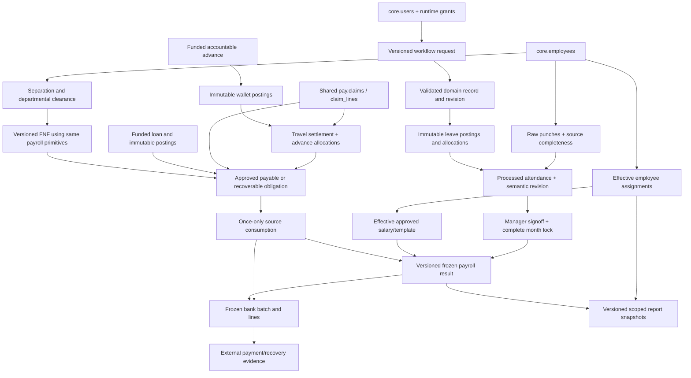

# Complete backend schema plan — start here

Prepared 10 Oct 2026. This pack covers every remaining completion card against actual source and the local database, with exact fields, relationships, constraints and transaction ownership. It includes **82 specification table definitions, 104 observed unpartitioned business relations, 46 proposed model designs and 44 amendments**, mapped to **33 completion cards, 119 PRD requirements, 176 SOW points and 60 numbered build tasks**. Names below are classified as existing, specified, proposed or blocked; none is silently treated as implemented.

The user confirmed all current local databases are test-only and explicitly requested removal of `hrms_test`. It was dropped; local test configuration now explicitly selects `hrms` using `TEST_DATABASE_URL` and `LOCAL_TEST_DATABASE_NAME=hrms`. Credentials stay in ignored local configuration. CI retains a dedicated test target. The catalog snapshot includes both databases **before deletion**; only its `DATABASE_URL` / `hrms` snapshot is authoritative for this design. The deleted database's schema remains metadata evidence, not a live target.

Both inspected databases ran PostgreSQL **14.24**, while docs14 targets PostgreSQL **16**. This pack changes neither database version nor business schema. Rehearse approved migrations on PostgreSQL16 before claiming target-stack acceptance. There were 13 applied migration sources absent from the checkout in `hrms`; recover them before changes to DB-only models. The removed test database also recorded a missing `1752210000000_notification-sending-state` migration; the checkout has a different 175221 attendance-session migration. **Do not assume equal timestamps mean equal migration contents.**

**Current source override:** [16-CURRENT-CHECKOUT-ADDENDUM.md](16-CURRENT-CHECKOUT-ADDENDUM.md) records newly added payroll implementation and a migration that conflicts with existing local claim tables. Reuse and review that code; older “backend absent” statements are historical. This schema pack is a design, not acceptance of the new migration.

## Files to use

| File | Exact purpose |
|---|---|
| [14-BACKEND-TABLE-CATALOG.md](14-BACKEND-TABLE-CATALOG.md) | Every baseline/current/proposed relation; exact observed columns, types, nullability, defaults, checks, FKs, indexes and triggers; source SQL with provenance |
| [15-BACKEND-SCHEMA-CHANGES.md](15-BACKEND-SCHEMA-CHANGES.md) | Detailed field purposes for all 46 proposed models and 44 table amendments, business grain, requirements, decisions, integrity and atomic transactions |
| [00-doc03-reference.sql](schema-drafts/00-doc03-reference.sql) | Original schema reference normalized from doc03 identity shorthand; existing canonical tables must never be blindly recreated |
| [01-proposed-models.sql](schema-drafts/01-proposed-models.sql) | Exact proposed CREATE definitions, SQL checks/unique/exclusions and deferred FK attachment; mandatory review guard |
| [02-proposed-expansions.sql](schema-drafts/02-proposed-expansions.sql) | Nullable expansion definitions and required backfill/validation/logic changes; mandatory review guard |
| `backend-schema-plan.json` | Full machine-readable schema, ownership/card mapping, all PRD/SOW/build obligations and current source fingerprints |
| `current-local-schema-2026-10-09.json` | Read-only physical catalog snapshot, no employee records or credentials |
| `schema-validation.json` | Coverage/definition/reference checks and explicit non-execution limits |

**SQL drafts are review artifacts outside `backend/migrations`.** Each begins a transaction and raises an exception before any DDL, preventing accidental application. They are not a compiled, deployment-ordered or approved migration chain. Technical same-subject/payer checks, cross-row conservation, business transition triggers and append-only grants remain mandatory stage work alongside the declared SQL constraints. No new statutory rates or policy values are seeded by these drafts. The doc03 reference preserves historical specification examples/defaults; any policy literal in that reference must be reconciled to signed, effective typed configuration before implementation. Column names/types/precision marked proposed must be signed under D11/D10 before becoming code.

## Canonical ownership — avoid duplicate models

| Responsibility | Canonical model / rule |
|---|---|
| Person / actor / legal payer | `core.employees` / `core.users` / `core.companies`; external IDs map explicitly. A user ID, e-code and employee PK are different identifiers. |
| Placement and historical allocation | Proposed `core.employee_assignments` plus existing audited `core.employee_history`; payroll/reporting freeze the approved effective assignment/version, never today's department/company. |
| Workflow and authoritative request | Existing `wf.requests/request_steps` plus proposed chain/request versions; domain record owns dates/units/amounts. Typed payload is a review snapshot, never a financial bypass. |
| Attendance and leave | Existing raw immutable events, processed day rows, roster and immutable leave ledger; durable recompute revisions, source completeness, reservations/credit allocations and compatible locks prevent drift. |
| Salary and payroll | Specified salary/components/results plus approved template/input/result versions. One deterministic calculation, immutable finalized result and later recompute+delta; no counters or rewritten closed periods. |
| Salary reimbursement and travel claim | **Reuse existing `pay.claims`, `pay.claim_lines`, `pay.claim_reservations`, `pay.budgets` and `pay.budget_categories`.** Do not create parallel `te.claims/te.budgets` or blindly apply doc03's simpler claim schema. Funding/entitlement/travel distinctions are explicit contract fields. |
| Loan / travel advance | Payroll loans and immutable loan postings remain distinct from accountable travel advances. Approved/funded/recovered are different states. No duplicate travel debt in both `pay.loans` and `te.advances` without an approved ownership boundary. |
| Settlement / payment | Proposed settlement and allocations determine conserved net obligations; one obligation/consumption model feeds payroll or off-cycle batch, with independent external receipts. Approved does not mean paid. |
| Files | Existing `core.documents` metadata, immutable S3-compatible objects and proposed staged operation intent. SeaweedFS adapter, no provider-specific URL as authorization. |
| Security/compliance/privacy/IR | Existing `sec/cmp/prv/ird/doc` tables are preserved and cataloged. Missing approved specifications and migration sources block adoption under D12; no invented MFA/POSH/privacy product. |
| Structured survey | Preserve working `eng.polls/poll_responses` with HMAC anonymity. Specified structured `eng.surveys/survey_responses` needs typed/versioned question design; no duplicated poll_votes model or guessed recommendations. |
| Training / manual services / future contractors | Explicit content/operations/source-scoping work, not automatically a new table. Contractor and full ATS field catalogs remain blocked until their approved PRD/source contracts exist. |

## Relationship spine

These arrows are domain dependencies, not permission to import another backend module's internal source. Modules expose public `index.ts` APIs; frontend communicates only through generated HTTP/OpenAPI contracts.

## Transaction and field contract for every feature

For each selected stage, fill the exact API/screen field mapping in pack12 from this schema: owning table/column, internal ID, subject/payer, requiredness/applicability, effective policy/source revision, Money/decimal DTO, mask, permission/scope, valid prior state, lock ordering, retry key, audit and outbox. Seven screen states and clear missing/unavailable data remain part of the existing UI contract.

Every child must belong to the same authoritative subject/payer/version. An ordinary FK proves existence, not ownership. Composite FKs/temporal references or transaction/constraint triggers establish alignment; polymorphic `source_kind/source_id` is explicitly allow-listed and validated, never claimed as a real FK. Historical employer assignment must be used instead of current employee company when linking a past result.

Approval finalization commits workflow action + authoritative domain effect + ledger/consumption + masked audit + outbox in one transaction. External SMTP/storage/bank/provider operations use durable intent, stable reference, short claim lease and receipt reconciliation. A zero-row protected write is a failed/held effect, not success. Process death leaves replayable work. Ledger corrections reference original postings; no destructive balance repair.

Amounts remain `NUMERIC` in PostgreSQL and integer paise through backend Money for INR. Original currency amount/FX evidence remains separate; proposed foreign precision requires D10 sign-off. Leave units and worked/approved OT units remain exact; do not use display-rounded amounts or detected OT as payout authority. Statutory applicability/rate/version and previous-employer/YTD sources are frozen and independently explainable.

## Migration order and what must happen first

| Order / existing stage | Schema responsibility | Hard prerequisite |
|---|---|---|
| 0.2 / F01 | Recover exact missing sources and catalog/type/trigger parity; target16 reproducibility and tests | No guessed migration or destructive rebuild of used `hrms`; acknowledge local test-only exception and keep production guard |
| 0.4 / F03-F04 | Approved scope, versioned workflow, durable delivery/file operations | D03/D04/D11, actual role grants/recipient semantics; preserve existing functioning services |
| 0.5 / F02 | Validated master, verified historical assignments/import mappings | Signed entity/identity mapping D09 and approved history D07 |
| 1.1–1.2 / A01-A02 | Source receipts, lossless raw fields, durable recompute, semantic fact revisions | Actual Kent protocol/completeness and signed attendance examples D05/D07 |
| 1.3–1.5 / A03-A04 | Revision-pinned approval/domain rows, serialized leave/OT/RH/encash and exact postings | D02/D04/D05/D06/D11; compatible lock protocol |
| 1.6–1.7 / A05/W04 slices | Locked complete input snapshot, absence/letters, scoped muster/KPI provenance | Full expected-day coverage, approved same-revision managers and actual notification proof |
| 2.1 / P01 | Component/template versions and effective salaries | Signed CTC/component/proration/statutory policies; independent fixtures |
| 2.2 / P02 | Run/result/input versions, obligations/consumptions and holds/retro | G1 and correct attendance/leave spine; D10; mandatory money review |
| 2.3–2.4 / P03-P04 | Eligibility/tax/rates/YTD, bank/JV/artifacts/payment receipts | D01 effective official rules and signed Finance formats; target16 constraints/goldens |
| 2.5–2.6 / P05-P07 | Loans, reimbursement buckets/shared claims, parallel reconciliation | One payout/consumption contract, signed opening imports and financial conservation |
| 3.1–3.2 / L01-L05 | Invitations/join/confirm/transfer/separate/clearance/versioned FNF | G2, approved payer/e-code/deadline/alumni decisions and shared payroll primitives |
| 3.3–3.5 / W01-W05 | Custody, ticket SLA history, policy/survey, snapshots and guides | Approved scope/version/audience, physical receipt and effective report denominators |
| T1–T4 / T01-T04 | Faithful travel model/policy/FX, funded advances/wallet/settlement/booking/source maps | Read-only sanctioned current EMS source; shared claim ownership; D10/D11; no dual writer |
| R01 / X01 | Approved ATS intake/absorption and mobile capture; contractor source-scoping only | Current ATS PRD/schema/contracts, mobile privacy/trust policy; deferred contractor PRD |

Execute one original plan-stage at a time, not this whole table in one session. Each actual migration adds source/types/checks/indexes/grants together: expand → verified backfill → validate → switch projections → approved contract cleanup. Large-table indices use safe concurrent strategy outside migration transactions; every DDL sets lock_timeout. Historical migrations are recovered, not renamed/replaced based on current tables. Recovery and down/up rehearsal run only on a explicitly disposable empty target, never on used `hrms`.

## Coverage and conservative boundaries

The machine file maps every PRD requirement and SOW point to cards and schema names, and carries every numbered build task. A decision/manual-only point may require signed evidence rather than a new table. All 37 source findings remain linked through the original cards; current source fixes must be rechecked because other backend edits are in the working tree. The 09 Oct code inventory is historical after these edits; use the new schema source fingerprints and current checkout before implementation.

Every report R1–R31 uses the authoritative domain sources in docs06, no independent financial data copy: R1–R6 attendance/request/OT/case and completeness; R7–R16 frozen payroll/results/rates/artifacts/JV; R17 loan postings; R18 separation/FNF results; R19 holds; R20 comparisons; R21–R22 captured ATS/LOI; R23 effective movement history; R24 join/exit facts; R25 probation; R26 effective exits/headcount; R27 historical placement/person eligibility; R28 actual custody; R29 immutable ticket SLA cycles; R30 versioned policy/audience acknowledgments; R31 claim verification/entitlement/obligation/payment. KPI counts, formula version, denominator/freshness and identical scoped drilldowns/exports are explicit.

**Blocked field sets are visible rather than invented:** full ATS screening/interview/offer schemas, contractor compliance, uncaptured EMS policy/budget/source fields, DB-only D12 modules and all unsigned statutory/FX/attendance policy branches. Known handoff fields and proposals are recorded; complete implementation requires those source/decision artifacts. A complete coverage map is not approval of unknown logic.

## Next AI handoff

> Read AGENTS, docs00/03/04/08/11/13/14, full docs04/10 for money, packs00/10/11/12/13/14/15 and the selected domain card. Use `backend-schema-plan.json`, the current local catalog and source hashes. Existing shared pay claim/budget/reservation and engagement/security models must be reconciled and reused. Work one original phase-stage only; recover missing migrations, resolve the stage's D decisions, then write only approved forward migrations/types/APIs/transactions and tests. SQL drafts raise an exception intentionally and must not be run against hrms. Never weaken coverage, invent a field/policy, recreate an existing table, replace immutable history, or claim approval/payment/production acceptance from schema presence. Report changed code, exact tests/verify, source exceptions and remaining sign-off; update only evidenced tracker tasks.

## Every completion card and its schema boundary

| Card | Existing/spec/proposed tables |
|---|---|
| F01 | All 104 existing business relations; complete catalog/source/type/constraint reconciliation |
| F02 | `core.companies`; `core.locations`; `core.plants`; `core.mis_codes`; `core.cost_centers`; `core.departments`; `core.designations`; `core.grades`; `core.org_units`; `core.employees`; `core.reporting_tree`; `core.employee_history`; `core.employee_family`; `core.employee_education`; `core.employee_prev_employment`; `core.profile_change_requests`; `core.employee_assignments`; `core.import_batches`; `core.source_mappings` |
| F03 | `core.users`; `core.roles`; `core.permissions`; `core.role_permissions`; `core.user_roles`; `core.audit_log`; `core.settings`; `sec.sessions`; `core.password_reset_tokens` |
| F04 | `wf.notifications`; `wf.notification_attempts`; `wf.event_subscriptions`; `core.documents`; `core.document_operations`; `core.letters`; `core.letter_templates` |
| A01 | `att.devices`; `att.device_watermarks`; `att.ingest_watermarks`; `att.swipe_events`; `att.quarantined_swipes`; `att.source_receipts` |
| A02 | `att.shifts`; `att.employee_shifts`; `att.shift_patterns`; `att.rosters`; `att.roster_revisions`; `att.roster_publications`; `att.shift_swaps`; `att.holidays`; `att.coverage_targets`; `att.day_records`; `att.recompute_queue`; `core.employee_assignments` |
| A03 | `wf.definitions`; `wf.definition_versions`; `wf.requests`; `wf.request_revisions`; `wf.request_steps`; `wf.delegations`; `att.regularizations`; `att.overtime_entries`; `wf.notifications` |
| A04 | `lv.leave_types`; `lv.ledger`; `lv.applications`; `lv.restricted_holidays`; `lv.rh_selections`; `lv.credit_allocations`; `lv.operation_keys`; `pay.payment_obligations` |
| A05 | `att.month_locks`; `att.manager_month_approvals`; `att.day_records`; `att.absence_cases`; `core.letters`; `reporting.muster_month`; `reporting.snapshot_builds` |
| P01 | `pay.salary_components`; `pay.salary_structures`; `pay.salary_structure_versions`; `pay.employee_salaries`; `core.employee_assignments`; `core.probation_reviews` |
| P02 | `pay.payroll_runs`; `pay.payroll_items`; `pay.payroll_item_lines`; `pay.inputs`; `pay.salary_holds`; `pay.arrears`; `pay.run_input_refs`; `pay.source_consumptions`; `pay.payment_obligations`; `att.month_locks`; `att.overtime_entries` |
| P03 | `pay.statutory_rates`; `pay.pt_slabs`; `pay.it_slabs`; `pay.investment_declarations`; `pay.tds_challans`; `pay.statutory_memberships`; `pay.tax_elections`; `pay.previous_employer_income`; `pay.statutory_postings`; `pay.output_artifacts` |
| P04 | `pay.bank_batches`; `pay.bank_batch_lines`; `pay.payment_obligations`; `pay.payment_events`; `pay.gl_accounts`; `pay.journal_batches`; `pay.journal_lines`; `pay.output_artifacts`; `core.documents` |
| P05 | `pay.loans`; `pay.loan_postings`; `pay.loan_installments`; `pay.payment_obligations`; `pay.payment_events`; `pay.source_consumptions` |
| P06 | `pay.claim_types`; `pay.claim_entitlements`; `pay.claims`; `pay.claim_lines`; `pay.claim_bills`; `pay.claim_reservations`; `pay.budgets`; `pay.budget_categories`; `pay.payment_obligations`; `pay.source_consumptions`; `core.documents` |
| P07 | `pay.parallel_comparisons`; `pay.parallel_comparison_lines`; `pay.statutory_postings`; `pay.output_artifacts`; `pay.arrears`; `core.import_batches`; `pay.payroll_runs` |
| L01 | `core.onboarding_candidates`; `core.onboarding_tasks`; `core.prejoin_invitations`; `core.employees`; `core.employee_assignments`; `pay.employee_salaries`; `core.documents`; `core.source_mappings` |
| L02 | `core.probation_reviews`; `core.employee_history`; `pay.employee_salaries`; `core.letters`; `wf.requests` |
| L03 | `core.transfer_requests`; `core.employee_assignments`; `core.employee_history`; `pay.employee_salaries`; `wf.requests` |
| L04 | `core.separations`; `core.clearances`; `ast.assignments`; `ast.custody_events`; `pay.loans`; `pay.loan_postings`; `pay.claims`; `te.advances`; `te.wallet_postings` |
| L05 | `pay.fnf_settlements`; `core.separations`; `core.clearances`; `pay.payroll_runs`; `pay.payroll_items`; `pay.payroll_item_lines`; `pay.payment_obligations`; `lv.ledger`; `core.letters` |
| W01 | `ast.assets`; `ast.assignments`; `ast.maintenance`; `ast.custody_events`; `pay.payment_obligations` |
| W02 | `hd.categories`; `hd.tickets`; `hd.ticket_messages`; `hd.ticket_events`; `hd.escalation_rules`; `wf.notifications` |
| W03 | `eng.announcements`; `eng.polls`; `eng.poll_responses`; `eng.surveys`; `eng.survey_responses`; `core.policies`; `core.policy_versions`; `core.policy_acknowledgments`; `core.letters`; `core.letter_templates` |
| W04 | `reporting.kpi_daily`; `reporting.muster_month`; `reporting.snapshot_builds`; `core.employee_assignments`; `pay.payroll_items`; `pay.payroll_item_lines`; `pay.source_consumptions` |
| W05 | No extra DB table; content/source-scoping boundary explicit |
| T01 | `te.trips`; `te.itinerary_segments`; `te.travel_levels`; `te.employee_travel_levels`; `te.policy_versions`; `te.currency_rates`; `pay.budgets`; `pay.budget_categories`; `pay.claims`; `pay.claim_lines`; `pay.claim_reservations` |
| T02 | `te.advances`; `te.wallet_postings`; `te.settlements`; `te.settlement_advances`; `pay.claims`; `pay.claim_lines`; `pay.claim_reservations`; `pay.payment_obligations`; `pay.source_consumptions` |
| T03 | `te.booking_operations`; `te.booking_events`; `te.itinerary_segments`; `te.settlements` |
| T04 | `core.import_batches`; `core.source_mappings`; `core.documents`; `te.trips`; `te.wallet_postings`; `te.settlements` |
| R01 | `recruit.candidates`; `recruit.vacancies`; `recruit.offers`; `core.onboarding_candidates`; `core.source_mappings` |
| X01 | `att.mobile_submissions`; `att.swipe_events`; `att.quarantined_swipes`; `att.day_records` |
| M01 | `cmp.calendar_items`; `cmp.filing_evidence`; `cmp.registrations`; `core.documents`; `pay.output_artifacts` |

## All 119 canonical PRD requirements

| Requirement | Completion cards | Schema boundary |
|---|---|---|
| CORE-01 | F02, F03 | `core.audit_log`; `core.companies`; `core.cost_centers`; `core.departments`; `core.designations`; `core.employee_assignments`; `core.employee_education`; `core.employee_family`; `core.employee_history`; `core.employee_prev_employment`; `core.employees`; `core.grades`; `core.import_batches`; `core.locations`; `core.mis_codes`; `core.org_units`; `core.password_reset_tokens`; `core.permissions`; `core.plants`; `core.profile_change_requests`; `core.reporting_tree`; `core.role_permissions`; `core.roles`; `core.settings`; `core.source_mappings`; `core.user_roles`; `core.users`; `sec.sessions` |
| CORE-02 | F02 | `core.companies`; `core.cost_centers`; `core.departments`; `core.designations`; `core.employee_assignments`; `core.employee_education`; `core.employee_family`; `core.employee_history`; `core.employee_prev_employment`; `core.employees`; `core.grades`; `core.import_batches`; `core.locations`; `core.mis_codes`; `core.org_units`; `core.plants`; `core.profile_change_requests`; `core.reporting_tree`; `core.source_mappings` |
| CORE-03 | F02, F03 | `core.audit_log`; `core.companies`; `core.cost_centers`; `core.departments`; `core.designations`; `core.employee_assignments`; `core.employee_education`; `core.employee_family`; `core.employee_history`; `core.employee_prev_employment`; `core.employees`; `core.grades`; `core.import_batches`; `core.locations`; `core.mis_codes`; `core.org_units`; `core.password_reset_tokens`; `core.permissions`; `core.plants`; `core.profile_change_requests`; `core.reporting_tree`; `core.role_permissions`; `core.roles`; `core.settings`; `core.source_mappings`; `core.user_roles`; `core.users`; `sec.sessions` |
| CORE-04 | F02, F03 | `core.audit_log`; `core.companies`; `core.cost_centers`; `core.departments`; `core.designations`; `core.employee_assignments`; `core.employee_education`; `core.employee_family`; `core.employee_history`; `core.employee_prev_employment`; `core.employees`; `core.grades`; `core.import_batches`; `core.locations`; `core.mis_codes`; `core.org_units`; `core.password_reset_tokens`; `core.permissions`; `core.plants`; `core.profile_change_requests`; `core.reporting_tree`; `core.role_permissions`; `core.roles`; `core.settings`; `core.source_mappings`; `core.user_roles`; `core.users`; `sec.sessions` |
| CORE-05 | F02, F03 | `core.audit_log`; `core.companies`; `core.cost_centers`; `core.departments`; `core.designations`; `core.employee_assignments`; `core.employee_education`; `core.employee_family`; `core.employee_history`; `core.employee_prev_employment`; `core.employees`; `core.grades`; `core.import_batches`; `core.locations`; `core.mis_codes`; `core.org_units`; `core.password_reset_tokens`; `core.permissions`; `core.plants`; `core.profile_change_requests`; `core.reporting_tree`; `core.role_permissions`; `core.roles`; `core.settings`; `core.source_mappings`; `core.user_roles`; `core.users`; `sec.sessions` |
| CORE-06 | F02, L04, L05 | `ast.assignments`; `ast.custody_events`; `core.clearances`; `core.companies`; `core.cost_centers`; `core.departments`; `core.designations`; `core.employee_assignments`; `core.employee_education`; `core.employee_family`; `core.employee_history`; `core.employee_prev_employment`; `core.employees`; `core.grades`; `core.import_batches`; `core.letters`; `core.locations`; `core.mis_codes`; `core.org_units`; `core.plants`; `core.profile_change_requests`; `core.reporting_tree`; `core.separations`; `core.source_mappings`; `lv.ledger`; `pay.claims`; `pay.fnf_settlements`; `pay.loan_postings`; `pay.loans`; `pay.payment_obligations`; `pay.payroll_item_lines`; `pay.payroll_items`; `pay.payroll_runs`; `te.advances`; `te.wallet_postings` |
| CORE-07 | F02, F03 | `core.audit_log`; `core.companies`; `core.cost_centers`; `core.departments`; `core.designations`; `core.employee_assignments`; `core.employee_education`; `core.employee_family`; `core.employee_history`; `core.employee_prev_employment`; `core.employees`; `core.grades`; `core.import_batches`; `core.locations`; `core.mis_codes`; `core.org_units`; `core.password_reset_tokens`; `core.permissions`; `core.plants`; `core.profile_change_requests`; `core.reporting_tree`; `core.role_permissions`; `core.roles`; `core.settings`; `core.source_mappings`; `core.user_roles`; `core.users`; `sec.sessions` |
| CORE-08 | F02, F03 | `core.audit_log`; `core.companies`; `core.cost_centers`; `core.departments`; `core.designations`; `core.employee_assignments`; `core.employee_education`; `core.employee_family`; `core.employee_history`; `core.employee_prev_employment`; `core.employees`; `core.grades`; `core.import_batches`; `core.locations`; `core.mis_codes`; `core.org_units`; `core.password_reset_tokens`; `core.permissions`; `core.plants`; `core.profile_change_requests`; `core.reporting_tree`; `core.role_permissions`; `core.roles`; `core.settings`; `core.source_mappings`; `core.user_roles`; `core.users`; `sec.sessions` |
| CORE-09 | W03, F04, L01, L02, L05 | `core.clearances`; `core.document_operations`; `core.documents`; `core.employee_assignments`; `core.employee_history`; `core.employees`; `core.letter_templates`; `core.letters`; `core.onboarding_candidates`; `core.onboarding_tasks`; `core.policies`; `core.policy_acknowledgments`; `core.policy_versions`; `core.prejoin_invitations`; `core.probation_reviews`; `core.separations`; `core.source_mappings`; `eng.announcements`; `eng.poll_responses`; `eng.polls`; `eng.survey_responses`; `eng.surveys`; `lv.ledger`; `pay.employee_salaries`; `pay.fnf_settlements`; `pay.payment_obligations`; `pay.payroll_item_lines`; `pay.payroll_items`; `pay.payroll_runs`; `wf.event_subscriptions`; `wf.notification_attempts`; `wf.notifications`; `wf.requests` |
| CORE-10 | F03, A03 | `att.overtime_entries`; `att.regularizations`; `core.audit_log`; `core.password_reset_tokens`; `core.permissions`; `core.role_permissions`; `core.roles`; `core.settings`; `core.user_roles`; `core.users`; `sec.sessions`; `wf.definition_versions`; `wf.definitions`; `wf.delegations`; `wf.notifications`; `wf.request_revisions`; `wf.request_steps`; `wf.requests` |
| CORE-11 | F03 | `core.audit_log`; `core.password_reset_tokens`; `core.permissions`; `core.role_permissions`; `core.roles`; `core.settings`; `core.user_roles`; `core.users`; `sec.sessions` |
| CORE-12 | F02, F01, P07, T04 | `ast.assets`; `ast.assignments`; `ast.maintenance`; `att.absence_cases`; `att.coverage_targets`; `att.day_records`; `att.device_watermarks`; `att.devices`; `att.employee_shifts`; `att.holidays`; `att.ingest_watermarks`; `att.leave_blackouts`; `att.manager_month_approvals`; `att.month_locks`; `att.overtime_entries`; `att.quarantined_swipes`; `att.recompute_queue`; `att.regularizations`; `att.roster_publications`; `att.roster_revisions`; `att.rosters`; `att.shift_patterns`; `att.shift_swaps`; `att.shifts`; `att.swipe_events`; `cmp.calendar_items`; `cmp.filing_evidence`; `cmp.registrations`; `core.audit_log`; `core.companies`; `core.cost_centers`; `core.departments`; `core.designations`; `core.documents`; `core.employee_assignments`; `core.employee_education`; `core.employee_family`; `core.employee_history`; `core.employee_prev_employment`; `core.employees`; `core.grades`; `core.import_batches`; `core.letter_templates`; `core.letters`; `core.locations`; `core.mis_codes`; `core.org_units`; `core.password_reset_tokens`; `core.permissions`; `core.plants`; `core.policies`; `core.policy_acknowledgments`; `core.profile_change_requests`; `core.reporting_tree`; `core.role_permissions`; `core.roles`; `core.settings`; `core.source_mappings`; `core.user_roles`; `core.users`; `doc.types`; `eng.announcements`; `eng.poll_responses`; `eng.polls`; `hd.categories`; `hd.ticket_messages`; `hd.tickets`; `ird.grievances`; `ird.ic_members`; `ird.posh_case_access_log`; `ird.posh_cases`; `ird.whistleblower_reports`; `lv.applications`; `lv.leave_types`; `lv.ledger`; `lv.restricted_holidays`; `lv.rh_selections`; `pay.arrears`; `pay.budget_categories`; `pay.budgets`; `pay.claim_lines`; `pay.claim_reservations`; `pay.claim_types`; `pay.claims`; `pay.gl_accounts`; `pay.output_artifacts`; `pay.parallel_comparison_lines`; `pay.parallel_comparisons`; `pay.payroll_runs`; `pay.statutory_postings`; `prv.breach_register`; `prv.consent_events`; `prv.consents`; `prv.legal_holds`; `prv.notice_acks`; `prv.notices`; `prv.processing_register`; `prv.processors`; `prv.purge_log`; `prv.purge_proposals`; `prv.retention_rules`; `prv.rights_requests`; `reporting.kpi_daily`; `reporting.muster_month`; `sec.access_events`; `sec.mfa_enrolments`; `sec.mfa_recovery_codes`; `sec.password_history`; `sec.sessions`; `te.settlements`; `te.trips`; `te.wallet_postings`; `wf.definitions`; `wf.delegations`; `wf.event_subscriptions`; `wf.notifications`; `wf.request_steps`; `wf.requests` |
| CORE-13 | W03, F04, W04 | `core.document_operations`; `core.documents`; `core.employee_assignments`; `core.letter_templates`; `core.letters`; `core.policies`; `core.policy_acknowledgments`; `core.policy_versions`; `eng.announcements`; `eng.poll_responses`; `eng.polls`; `eng.survey_responses`; `eng.surveys`; `pay.payroll_item_lines`; `pay.payroll_items`; `pay.source_consumptions`; `reporting.kpi_daily`; `reporting.muster_month`; `reporting.snapshot_builds`; `wf.event_subscriptions`; `wf.notification_attempts`; `wf.notifications` |
| CORE-14 | W05 |  |
| ATT-01 | A01, F04 | `att.device_watermarks`; `att.devices`; `att.ingest_watermarks`; `att.quarantined_swipes`; `att.source_receipts`; `att.swipe_events`; `core.document_operations`; `core.documents`; `core.letter_templates`; `core.letters`; `wf.event_subscriptions`; `wf.notification_attempts`; `wf.notifications` |
| ATT-02 | A01, F04 | `att.device_watermarks`; `att.devices`; `att.ingest_watermarks`; `att.quarantined_swipes`; `att.source_receipts`; `att.swipe_events`; `core.document_operations`; `core.documents`; `core.letter_templates`; `core.letters`; `wf.event_subscriptions`; `wf.notification_attempts`; `wf.notifications` |
| ATT-03 | A01, A02, A03, A05 | `att.absence_cases`; `att.coverage_targets`; `att.day_records`; `att.device_watermarks`; `att.devices`; `att.employee_shifts`; `att.holidays`; `att.ingest_watermarks`; `att.manager_month_approvals`; `att.month_locks`; `att.overtime_entries`; `att.quarantined_swipes`; `att.recompute_queue`; `att.regularizations`; `att.roster_publications`; `att.roster_revisions`; `att.rosters`; `att.shift_patterns`; `att.shift_swaps`; `att.shifts`; `att.source_receipts`; `att.swipe_events`; `core.employee_assignments`; `core.letters`; `reporting.muster_month`; `reporting.snapshot_builds`; `wf.definition_versions`; `wf.definitions`; `wf.delegations`; `wf.notifications`; `wf.request_revisions`; `wf.request_steps`; `wf.requests` |
| ATT-04 | A02, F04 | `att.coverage_targets`; `att.day_records`; `att.employee_shifts`; `att.holidays`; `att.recompute_queue`; `att.roster_publications`; `att.roster_revisions`; `att.rosters`; `att.shift_patterns`; `att.shift_swaps`; `att.shifts`; `core.document_operations`; `core.documents`; `core.employee_assignments`; `core.letter_templates`; `core.letters`; `wf.event_subscriptions`; `wf.notification_attempts`; `wf.notifications` |
| ATT-05 | A02, A04 | `att.coverage_targets`; `att.day_records`; `att.employee_shifts`; `att.holidays`; `att.recompute_queue`; `att.roster_publications`; `att.roster_revisions`; `att.rosters`; `att.shift_patterns`; `att.shift_swaps`; `att.shifts`; `core.employee_assignments`; `lv.applications`; `lv.credit_allocations`; `lv.leave_types`; `lv.ledger`; `lv.operation_keys`; `lv.restricted_holidays`; `lv.rh_selections`; `pay.payment_obligations` |
| ATT-06 | A01, A02, A03, A05 | `att.absence_cases`; `att.coverage_targets`; `att.day_records`; `att.device_watermarks`; `att.devices`; `att.employee_shifts`; `att.holidays`; `att.ingest_watermarks`; `att.manager_month_approvals`; `att.month_locks`; `att.overtime_entries`; `att.quarantined_swipes`; `att.recompute_queue`; `att.regularizations`; `att.roster_publications`; `att.roster_revisions`; `att.rosters`; `att.shift_patterns`; `att.shift_swaps`; `att.shifts`; `att.source_receipts`; `att.swipe_events`; `core.employee_assignments`; `core.letters`; `reporting.muster_month`; `reporting.snapshot_builds`; `wf.definition_versions`; `wf.definitions`; `wf.delegations`; `wf.notifications`; `wf.request_revisions`; `wf.request_steps`; `wf.requests` |
| ATT-07 | A01, A02, A03, A05 | `att.absence_cases`; `att.coverage_targets`; `att.day_records`; `att.device_watermarks`; `att.devices`; `att.employee_shifts`; `att.holidays`; `att.ingest_watermarks`; `att.manager_month_approvals`; `att.month_locks`; `att.overtime_entries`; `att.quarantined_swipes`; `att.recompute_queue`; `att.regularizations`; `att.roster_publications`; `att.roster_revisions`; `att.rosters`; `att.shift_patterns`; `att.shift_swaps`; `att.shifts`; `att.source_receipts`; `att.swipe_events`; `core.employee_assignments`; `core.letters`; `reporting.muster_month`; `reporting.snapshot_builds`; `wf.definition_versions`; `wf.definitions`; `wf.delegations`; `wf.notifications`; `wf.request_revisions`; `wf.request_steps`; `wf.requests` |
| ATT-08 | A03, A04, P02 | `att.month_locks`; `att.overtime_entries`; `att.regularizations`; `lv.applications`; `lv.credit_allocations`; `lv.leave_types`; `lv.ledger`; `lv.operation_keys`; `lv.restricted_holidays`; `lv.rh_selections`; `pay.arrears`; `pay.inputs`; `pay.payment_obligations`; `pay.payroll_item_lines`; `pay.payroll_items`; `pay.payroll_runs`; `pay.run_input_refs`; `pay.salary_holds`; `pay.source_consumptions`; `wf.definition_versions`; `wf.definitions`; `wf.delegations`; `wf.notifications`; `wf.request_revisions`; `wf.request_steps`; `wf.requests` |
| ATT-09 | A01, A02, A03, A05 | `att.absence_cases`; `att.coverage_targets`; `att.day_records`; `att.device_watermarks`; `att.devices`; `att.employee_shifts`; `att.holidays`; `att.ingest_watermarks`; `att.manager_month_approvals`; `att.month_locks`; `att.overtime_entries`; `att.quarantined_swipes`; `att.recompute_queue`; `att.regularizations`; `att.roster_publications`; `att.roster_revisions`; `att.rosters`; `att.shift_patterns`; `att.shift_swaps`; `att.shifts`; `att.source_receipts`; `att.swipe_events`; `core.employee_assignments`; `core.letters`; `reporting.muster_month`; `reporting.snapshot_builds`; `wf.definition_versions`; `wf.definitions`; `wf.delegations`; `wf.notifications`; `wf.request_revisions`; `wf.request_steps`; `wf.requests` |
| ATT-10 | A05, W03, F04 | `att.absence_cases`; `att.day_records`; `att.manager_month_approvals`; `att.month_locks`; `core.document_operations`; `core.documents`; `core.letter_templates`; `core.letters`; `core.policies`; `core.policy_acknowledgments`; `core.policy_versions`; `eng.announcements`; `eng.poll_responses`; `eng.polls`; `eng.survey_responses`; `eng.surveys`; `reporting.muster_month`; `reporting.snapshot_builds`; `wf.event_subscriptions`; `wf.notification_attempts`; `wf.notifications` |
| ATT-11 | A05, F04 | `att.absence_cases`; `att.day_records`; `att.manager_month_approvals`; `att.month_locks`; `core.document_operations`; `core.documents`; `core.letter_templates`; `core.letters`; `reporting.muster_month`; `reporting.snapshot_builds`; `wf.event_subscriptions`; `wf.notification_attempts`; `wf.notifications` |
| ATT-12 | A05, A04 | `att.absence_cases`; `att.day_records`; `att.manager_month_approvals`; `att.month_locks`; `core.letters`; `lv.applications`; `lv.credit_allocations`; `lv.leave_types`; `lv.ledger`; `lv.operation_keys`; `lv.restricted_holidays`; `lv.rh_selections`; `pay.payment_obligations`; `reporting.muster_month`; `reporting.snapshot_builds` |
| ATT-13 | A01, A02, A03, A05 | `att.absence_cases`; `att.coverage_targets`; `att.day_records`; `att.device_watermarks`; `att.devices`; `att.employee_shifts`; `att.holidays`; `att.ingest_watermarks`; `att.manager_month_approvals`; `att.month_locks`; `att.overtime_entries`; `att.quarantined_swipes`; `att.recompute_queue`; `att.regularizations`; `att.roster_publications`; `att.roster_revisions`; `att.rosters`; `att.shift_patterns`; `att.shift_swaps`; `att.shifts`; `att.source_receipts`; `att.swipe_events`; `core.employee_assignments`; `core.letters`; `reporting.muster_month`; `reporting.snapshot_builds`; `wf.definition_versions`; `wf.definitions`; `wf.delegations`; `wf.notifications`; `wf.request_revisions`; `wf.request_steps`; `wf.requests` |
| ATT-14 | X01, A01 | `att.day_records`; `att.device_watermarks`; `att.devices`; `att.ingest_watermarks`; `att.mobile_submissions`; `att.quarantined_swipes`; `att.source_receipts`; `att.swipe_events` |
| ATT-15 | A05, P02 | `att.absence_cases`; `att.day_records`; `att.manager_month_approvals`; `att.month_locks`; `att.overtime_entries`; `core.letters`; `pay.arrears`; `pay.inputs`; `pay.payment_obligations`; `pay.payroll_item_lines`; `pay.payroll_items`; `pay.payroll_runs`; `pay.run_input_refs`; `pay.salary_holds`; `pay.source_consumptions`; `reporting.muster_month`; `reporting.snapshot_builds` |
| ATT-16 | A01, A02, A03, A05 | `att.absence_cases`; `att.coverage_targets`; `att.day_records`; `att.device_watermarks`; `att.devices`; `att.employee_shifts`; `att.holidays`; `att.ingest_watermarks`; `att.manager_month_approvals`; `att.month_locks`; `att.overtime_entries`; `att.quarantined_swipes`; `att.recompute_queue`; `att.regularizations`; `att.roster_publications`; `att.roster_revisions`; `att.rosters`; `att.shift_patterns`; `att.shift_swaps`; `att.shifts`; `att.source_receipts`; `att.swipe_events`; `core.employee_assignments`; `core.letters`; `reporting.muster_month`; `reporting.snapshot_builds`; `wf.definition_versions`; `wf.definitions`; `wf.delegations`; `wf.notifications`; `wf.request_revisions`; `wf.request_steps`; `wf.requests` |
| ATT-17 | A02, F03 | `att.coverage_targets`; `att.day_records`; `att.employee_shifts`; `att.holidays`; `att.recompute_queue`; `att.roster_publications`; `att.roster_revisions`; `att.rosters`; `att.shift_patterns`; `att.shift_swaps`; `att.shifts`; `core.audit_log`; `core.employee_assignments`; `core.password_reset_tokens`; `core.permissions`; `core.role_permissions`; `core.roles`; `core.settings`; `core.user_roles`; `core.users`; `sec.sessions` |
| ATT-18 | A02 | `att.coverage_targets`; `att.day_records`; `att.employee_shifts`; `att.holidays`; `att.recompute_queue`; `att.roster_publications`; `att.roster_revisions`; `att.rosters`; `att.shift_patterns`; `att.shift_swaps`; `att.shifts`; `core.employee_assignments` |
| LV-01 | A04 | `lv.applications`; `lv.credit_allocations`; `lv.leave_types`; `lv.ledger`; `lv.operation_keys`; `lv.restricted_holidays`; `lv.rh_selections`; `pay.payment_obligations` |
| LV-02 | A04, F04 | `core.document_operations`; `core.documents`; `core.letter_templates`; `core.letters`; `lv.applications`; `lv.credit_allocations`; `lv.leave_types`; `lv.ledger`; `lv.operation_keys`; `lv.restricted_holidays`; `lv.rh_selections`; `pay.payment_obligations`; `wf.event_subscriptions`; `wf.notification_attempts`; `wf.notifications` |
| LV-03 | A04, A05 | `att.absence_cases`; `att.day_records`; `att.manager_month_approvals`; `att.month_locks`; `core.letters`; `lv.applications`; `lv.credit_allocations`; `lv.leave_types`; `lv.ledger`; `lv.operation_keys`; `lv.restricted_holidays`; `lv.rh_selections`; `pay.payment_obligations`; `reporting.muster_month`; `reporting.snapshot_builds` |
| LV-04 | A04, A03 | `att.overtime_entries`; `att.regularizations`; `lv.applications`; `lv.credit_allocations`; `lv.leave_types`; `lv.ledger`; `lv.operation_keys`; `lv.restricted_holidays`; `lv.rh_selections`; `pay.payment_obligations`; `wf.definition_versions`; `wf.definitions`; `wf.delegations`; `wf.notifications`; `wf.request_revisions`; `wf.request_steps`; `wf.requests` |
| LV-05 | A04, F01 | `ast.assets`; `ast.assignments`; `ast.maintenance`; `att.absence_cases`; `att.coverage_targets`; `att.day_records`; `att.device_watermarks`; `att.devices`; `att.employee_shifts`; `att.holidays`; `att.ingest_watermarks`; `att.leave_blackouts`; `att.manager_month_approvals`; `att.month_locks`; `att.overtime_entries`; `att.quarantined_swipes`; `att.recompute_queue`; `att.regularizations`; `att.roster_publications`; `att.roster_revisions`; `att.rosters`; `att.shift_patterns`; `att.shift_swaps`; `att.shifts`; `att.swipe_events`; `cmp.calendar_items`; `cmp.filing_evidence`; `cmp.registrations`; `core.audit_log`; `core.companies`; `core.cost_centers`; `core.departments`; `core.designations`; `core.documents`; `core.employee_family`; `core.employee_history`; `core.employees`; `core.grades`; `core.letter_templates`; `core.letters`; `core.locations`; `core.mis_codes`; `core.org_units`; `core.password_reset_tokens`; `core.permissions`; `core.plants`; `core.policies`; `core.policy_acknowledgments`; `core.profile_change_requests`; `core.reporting_tree`; `core.role_permissions`; `core.roles`; `core.settings`; `core.user_roles`; `core.users`; `doc.types`; `eng.announcements`; `eng.poll_responses`; `eng.polls`; `hd.categories`; `hd.ticket_messages`; `hd.tickets`; `ird.grievances`; `ird.ic_members`; `ird.posh_case_access_log`; `ird.posh_cases`; `ird.whistleblower_reports`; `lv.applications`; `lv.credit_allocations`; `lv.leave_types`; `lv.ledger`; `lv.operation_keys`; `lv.restricted_holidays`; `lv.rh_selections`; `pay.budget_categories`; `pay.budgets`; `pay.claim_lines`; `pay.claim_reservations`; `pay.claim_types`; `pay.claims`; `pay.gl_accounts`; `pay.payment_obligations`; `prv.breach_register`; `prv.consent_events`; `prv.consents`; `prv.legal_holds`; `prv.notice_acks`; `prv.notices`; `prv.processing_register`; `prv.processors`; `prv.purge_log`; `prv.purge_proposals`; `prv.retention_rules`; `prv.rights_requests`; `reporting.kpi_daily`; `reporting.muster_month`; `sec.access_events`; `sec.mfa_enrolments`; `sec.mfa_recovery_codes`; `sec.password_history`; `sec.sessions`; `wf.definitions`; `wf.delegations`; `wf.event_subscriptions`; `wf.notifications`; `wf.request_steps`; `wf.requests` |
| LV-06 | A04, P02, L05 | `att.month_locks`; `att.overtime_entries`; `core.clearances`; `core.letters`; `core.separations`; `lv.applications`; `lv.credit_allocations`; `lv.leave_types`; `lv.ledger`; `lv.operation_keys`; `lv.restricted_holidays`; `lv.rh_selections`; `pay.arrears`; `pay.fnf_settlements`; `pay.inputs`; `pay.payment_obligations`; `pay.payroll_item_lines`; `pay.payroll_items`; `pay.payroll_runs`; `pay.run_input_refs`; `pay.salary_holds`; `pay.source_consumptions` |
| LV-07 | A04, A05 | `att.absence_cases`; `att.day_records`; `att.manager_month_approvals`; `att.month_locks`; `core.letters`; `lv.applications`; `lv.credit_allocations`; `lv.leave_types`; `lv.ledger`; `lv.operation_keys`; `lv.restricted_holidays`; `lv.rh_selections`; `pay.payment_obligations`; `reporting.muster_month`; `reporting.snapshot_builds` |
| LV-08 | A04, A05 | `att.absence_cases`; `att.day_records`; `att.manager_month_approvals`; `att.month_locks`; `core.letters`; `lv.applications`; `lv.credit_allocations`; `lv.leave_types`; `lv.ledger`; `lv.operation_keys`; `lv.restricted_holidays`; `lv.rh_selections`; `pay.payment_obligations`; `reporting.muster_month`; `reporting.snapshot_builds` |
| LV-09 | A04, A05 | `att.absence_cases`; `att.day_records`; `att.manager_month_approvals`; `att.month_locks`; `core.letters`; `lv.applications`; `lv.credit_allocations`; `lv.leave_types`; `lv.ledger`; `lv.operation_keys`; `lv.restricted_holidays`; `lv.rh_selections`; `pay.payment_obligations`; `reporting.muster_month`; `reporting.snapshot_builds` |
| PAY-01 | P01 | `core.employee_assignments`; `core.probation_reviews`; `pay.employee_salaries`; `pay.salary_components`; `pay.salary_structure_versions`; `pay.salary_structures` |
| PAY-02 | P01, L02 | `core.employee_assignments`; `core.employee_history`; `core.letters`; `core.probation_reviews`; `pay.employee_salaries`; `pay.salary_components`; `pay.salary_structure_versions`; `pay.salary_structures`; `wf.requests` |
| PAY-03 | P01, P02, P03, P04, P07 | `att.month_locks`; `att.overtime_entries`; `core.documents`; `core.employee_assignments`; `core.import_batches`; `core.probation_reviews`; `pay.arrears`; `pay.bank_batch_lines`; `pay.bank_batches`; `pay.employee_salaries`; `pay.gl_accounts`; `pay.inputs`; `pay.investment_declarations`; `pay.it_slabs`; `pay.journal_batches`; `pay.journal_lines`; `pay.output_artifacts`; `pay.parallel_comparison_lines`; `pay.parallel_comparisons`; `pay.payment_events`; `pay.payment_obligations`; `pay.payroll_item_lines`; `pay.payroll_items`; `pay.payroll_runs`; `pay.previous_employer_income`; `pay.pt_slabs`; `pay.run_input_refs`; `pay.salary_components`; `pay.salary_holds`; `pay.salary_structure_versions`; `pay.salary_structures`; `pay.source_consumptions`; `pay.statutory_memberships`; `pay.statutory_postings`; `pay.statutory_rates`; `pay.tax_elections`; `pay.tds_challans` |
| PAY-04 | P01, P02, P03, P04, P07 | `att.month_locks`; `att.overtime_entries`; `core.documents`; `core.employee_assignments`; `core.import_batches`; `core.probation_reviews`; `pay.arrears`; `pay.bank_batch_lines`; `pay.bank_batches`; `pay.employee_salaries`; `pay.gl_accounts`; `pay.inputs`; `pay.investment_declarations`; `pay.it_slabs`; `pay.journal_batches`; `pay.journal_lines`; `pay.output_artifacts`; `pay.parallel_comparison_lines`; `pay.parallel_comparisons`; `pay.payment_events`; `pay.payment_obligations`; `pay.payroll_item_lines`; `pay.payroll_items`; `pay.payroll_runs`; `pay.previous_employer_income`; `pay.pt_slabs`; `pay.run_input_refs`; `pay.salary_components`; `pay.salary_holds`; `pay.salary_structure_versions`; `pay.salary_structures`; `pay.source_consumptions`; `pay.statutory_memberships`; `pay.statutory_postings`; `pay.statutory_rates`; `pay.tax_elections`; `pay.tds_challans` |
| PAY-05 | P04, W04 | `core.documents`; `core.employee_assignments`; `pay.bank_batch_lines`; `pay.bank_batches`; `pay.gl_accounts`; `pay.journal_batches`; `pay.journal_lines`; `pay.output_artifacts`; `pay.payment_events`; `pay.payment_obligations`; `pay.payroll_item_lines`; `pay.payroll_items`; `pay.source_consumptions`; `reporting.kpi_daily`; `reporting.muster_month`; `reporting.snapshot_builds` |
| PAY-06 | P04, F04 | `core.document_operations`; `core.documents`; `core.letter_templates`; `core.letters`; `pay.bank_batch_lines`; `pay.bank_batches`; `pay.gl_accounts`; `pay.journal_batches`; `pay.journal_lines`; `pay.output_artifacts`; `pay.payment_events`; `pay.payment_obligations`; `wf.event_subscriptions`; `wf.notification_attempts`; `wf.notifications` |
| PAY-07 | P01, L01, R01 | `core.documents`; `core.employee_assignments`; `core.employees`; `core.onboarding_candidates`; `core.onboarding_tasks`; `core.prejoin_invitations`; `core.probation_reviews`; `core.source_mappings`; `pay.employee_salaries`; `pay.salary_components`; `pay.salary_structure_versions`; `pay.salary_structures`; `recruit.candidates`; `recruit.offers`; `recruit.vacancies` |
| PAY-08 | P02, P04 | `att.month_locks`; `att.overtime_entries`; `core.documents`; `pay.arrears`; `pay.bank_batch_lines`; `pay.bank_batches`; `pay.gl_accounts`; `pay.inputs`; `pay.journal_batches`; `pay.journal_lines`; `pay.output_artifacts`; `pay.payment_events`; `pay.payment_obligations`; `pay.payroll_item_lines`; `pay.payroll_items`; `pay.payroll_runs`; `pay.run_input_refs`; `pay.salary_holds`; `pay.source_consumptions` |
| PAY-09 | P03 | `pay.investment_declarations`; `pay.it_slabs`; `pay.output_artifacts`; `pay.previous_employer_income`; `pay.pt_slabs`; `pay.statutory_memberships`; `pay.statutory_postings`; `pay.statutory_rates`; `pay.tax_elections`; `pay.tds_challans` |
| PAY-10 | P03 | `pay.investment_declarations`; `pay.it_slabs`; `pay.output_artifacts`; `pay.previous_employer_income`; `pay.pt_slabs`; `pay.statutory_memberships`; `pay.statutory_postings`; `pay.statutory_rates`; `pay.tax_elections`; `pay.tds_challans` |
| PAY-11 | P03 | `pay.investment_declarations`; `pay.it_slabs`; `pay.output_artifacts`; `pay.previous_employer_income`; `pay.pt_slabs`; `pay.statutory_memberships`; `pay.statutory_postings`; `pay.statutory_rates`; `pay.tax_elections`; `pay.tds_challans` |
| PAY-12 | P03 | `pay.investment_declarations`; `pay.it_slabs`; `pay.output_artifacts`; `pay.previous_employer_income`; `pay.pt_slabs`; `pay.statutory_memberships`; `pay.statutory_postings`; `pay.statutory_rates`; `pay.tax_elections`; `pay.tds_challans` |
| PAY-13 | P03, P06, P07 | `core.documents`; `core.import_batches`; `pay.arrears`; `pay.budget_categories`; `pay.budgets`; `pay.claim_bills`; `pay.claim_entitlements`; `pay.claim_lines`; `pay.claim_reservations`; `pay.claim_types`; `pay.claims`; `pay.investment_declarations`; `pay.it_slabs`; `pay.output_artifacts`; `pay.parallel_comparison_lines`; `pay.parallel_comparisons`; `pay.payment_obligations`; `pay.payroll_runs`; `pay.previous_employer_income`; `pay.pt_slabs`; `pay.source_consumptions`; `pay.statutory_memberships`; `pay.statutory_postings`; `pay.statutory_rates`; `pay.tax_elections`; `pay.tds_challans` |
| PAY-14 | P01, P03 | `core.employee_assignments`; `core.probation_reviews`; `pay.employee_salaries`; `pay.investment_declarations`; `pay.it_slabs`; `pay.output_artifacts`; `pay.previous_employer_income`; `pay.pt_slabs`; `pay.salary_components`; `pay.salary_structure_versions`; `pay.salary_structures`; `pay.statutory_memberships`; `pay.statutory_postings`; `pay.statutory_rates`; `pay.tax_elections`; `pay.tds_challans` |
| PAY-15 | L04, L05, P02, P04 | `ast.assignments`; `ast.custody_events`; `att.month_locks`; `att.overtime_entries`; `core.clearances`; `core.documents`; `core.letters`; `core.separations`; `lv.ledger`; `pay.arrears`; `pay.bank_batch_lines`; `pay.bank_batches`; `pay.claims`; `pay.fnf_settlements`; `pay.gl_accounts`; `pay.inputs`; `pay.journal_batches`; `pay.journal_lines`; `pay.loan_postings`; `pay.loans`; `pay.output_artifacts`; `pay.payment_events`; `pay.payment_obligations`; `pay.payroll_item_lines`; `pay.payroll_items`; `pay.payroll_runs`; `pay.run_input_refs`; `pay.salary_holds`; `pay.source_consumptions`; `te.advances`; `te.wallet_postings` |
| PAY-16 | P01, P02, P03, P04, P07 | `att.month_locks`; `att.overtime_entries`; `core.documents`; `core.employee_assignments`; `core.import_batches`; `core.probation_reviews`; `pay.arrears`; `pay.bank_batch_lines`; `pay.bank_batches`; `pay.employee_salaries`; `pay.gl_accounts`; `pay.inputs`; `pay.investment_declarations`; `pay.it_slabs`; `pay.journal_batches`; `pay.journal_lines`; `pay.output_artifacts`; `pay.parallel_comparison_lines`; `pay.parallel_comparisons`; `pay.payment_events`; `pay.payment_obligations`; `pay.payroll_item_lines`; `pay.payroll_items`; `pay.payroll_runs`; `pay.previous_employer_income`; `pay.pt_slabs`; `pay.run_input_refs`; `pay.salary_components`; `pay.salary_holds`; `pay.salary_structure_versions`; `pay.salary_structures`; `pay.source_consumptions`; `pay.statutory_memberships`; `pay.statutory_postings`; `pay.statutory_rates`; `pay.tax_elections`; `pay.tds_challans` |
| PAY-17 | P07, P01, P03 | `core.employee_assignments`; `core.import_batches`; `core.probation_reviews`; `pay.arrears`; `pay.employee_salaries`; `pay.investment_declarations`; `pay.it_slabs`; `pay.output_artifacts`; `pay.parallel_comparison_lines`; `pay.parallel_comparisons`; `pay.payroll_runs`; `pay.previous_employer_income`; `pay.pt_slabs`; `pay.salary_components`; `pay.salary_structure_versions`; `pay.salary_structures`; `pay.statutory_memberships`; `pay.statutory_postings`; `pay.statutory_rates`; `pay.tax_elections`; `pay.tds_challans` |
| PAY-18 | P01, P02, P03, P04, P07 | `att.month_locks`; `att.overtime_entries`; `core.documents`; `core.employee_assignments`; `core.import_batches`; `core.probation_reviews`; `pay.arrears`; `pay.bank_batch_lines`; `pay.bank_batches`; `pay.employee_salaries`; `pay.gl_accounts`; `pay.inputs`; `pay.investment_declarations`; `pay.it_slabs`; `pay.journal_batches`; `pay.journal_lines`; `pay.output_artifacts`; `pay.parallel_comparison_lines`; `pay.parallel_comparisons`; `pay.payment_events`; `pay.payment_obligations`; `pay.payroll_item_lines`; `pay.payroll_items`; `pay.payroll_runs`; `pay.previous_employer_income`; `pay.pt_slabs`; `pay.run_input_refs`; `pay.salary_components`; `pay.salary_holds`; `pay.salary_structure_versions`; `pay.salary_structures`; `pay.source_consumptions`; `pay.statutory_memberships`; `pay.statutory_postings`; `pay.statutory_rates`; `pay.tax_elections`; `pay.tds_challans` |
| LC-01 | L01, R01, P01, F04 | `core.document_operations`; `core.documents`; `core.employee_assignments`; `core.employees`; `core.letter_templates`; `core.letters`; `core.onboarding_candidates`; `core.onboarding_tasks`; `core.prejoin_invitations`; `core.probation_reviews`; `core.source_mappings`; `pay.employee_salaries`; `pay.salary_components`; `pay.salary_structure_versions`; `pay.salary_structures`; `recruit.candidates`; `recruit.offers`; `recruit.vacancies`; `wf.event_subscriptions`; `wf.notification_attempts`; `wf.notifications` |
| LC-02 | L01, F04, W01 | `ast.assets`; `ast.assignments`; `ast.custody_events`; `ast.maintenance`; `core.document_operations`; `core.documents`; `core.employee_assignments`; `core.employees`; `core.letter_templates`; `core.letters`; `core.onboarding_candidates`; `core.onboarding_tasks`; `core.prejoin_invitations`; `core.source_mappings`; `pay.employee_salaries`; `pay.payment_obligations`; `wf.event_subscriptions`; `wf.notification_attempts`; `wf.notifications` |
| LC-03 | A05, F04 | `att.absence_cases`; `att.day_records`; `att.manager_month_approvals`; `att.month_locks`; `core.document_operations`; `core.documents`; `core.letter_templates`; `core.letters`; `reporting.muster_month`; `reporting.snapshot_builds`; `wf.event_subscriptions`; `wf.notification_attempts`; `wf.notifications` |
| LC-04 | L02, P01, W03 | `core.employee_assignments`; `core.employee_history`; `core.letter_templates`; `core.letters`; `core.policies`; `core.policy_acknowledgments`; `core.policy_versions`; `core.probation_reviews`; `eng.announcements`; `eng.poll_responses`; `eng.polls`; `eng.survey_responses`; `eng.surveys`; `pay.employee_salaries`; `pay.salary_components`; `pay.salary_structure_versions`; `pay.salary_structures`; `wf.requests` |
| LC-05 | L03, P01, A02 | `att.coverage_targets`; `att.day_records`; `att.employee_shifts`; `att.holidays`; `att.recompute_queue`; `att.roster_publications`; `att.roster_revisions`; `att.rosters`; `att.shift_patterns`; `att.shift_swaps`; `att.shifts`; `core.employee_assignments`; `core.employee_history`; `core.probation_reviews`; `core.transfer_requests`; `pay.employee_salaries`; `pay.salary_components`; `pay.salary_structure_versions`; `pay.salary_structures`; `wf.requests` |
| LC-06 | L04, L05, W01, F04 | `ast.assets`; `ast.assignments`; `ast.custody_events`; `ast.maintenance`; `core.clearances`; `core.document_operations`; `core.documents`; `core.letter_templates`; `core.letters`; `core.separations`; `lv.ledger`; `pay.claims`; `pay.fnf_settlements`; `pay.loan_postings`; `pay.loans`; `pay.payment_obligations`; `pay.payroll_item_lines`; `pay.payroll_items`; `pay.payroll_runs`; `te.advances`; `te.wallet_postings`; `wf.event_subscriptions`; `wf.notification_attempts`; `wf.notifications` |
| LC-07 | L04, L05, F03 | `ast.assignments`; `ast.custody_events`; `core.audit_log`; `core.clearances`; `core.letters`; `core.password_reset_tokens`; `core.permissions`; `core.role_permissions`; `core.roles`; `core.separations`; `core.settings`; `core.user_roles`; `core.users`; `lv.ledger`; `pay.claims`; `pay.fnf_settlements`; `pay.loan_postings`; `pay.loans`; `pay.payment_obligations`; `pay.payroll_item_lines`; `pay.payroll_items`; `pay.payroll_runs`; `sec.sessions`; `te.advances`; `te.wallet_postings` |
| WF-01 | A03, F04, F03 | `att.overtime_entries`; `att.regularizations`; `core.audit_log`; `core.document_operations`; `core.documents`; `core.letter_templates`; `core.letters`; `core.password_reset_tokens`; `core.permissions`; `core.role_permissions`; `core.roles`; `core.settings`; `core.user_roles`; `core.users`; `sec.sessions`; `wf.definition_versions`; `wf.definitions`; `wf.delegations`; `wf.event_subscriptions`; `wf.notification_attempts`; `wf.notifications`; `wf.request_revisions`; `wf.request_steps`; `wf.requests` |
| WF-02 | A03, F04, F03 | `att.overtime_entries`; `att.regularizations`; `core.audit_log`; `core.document_operations`; `core.documents`; `core.letter_templates`; `core.letters`; `core.password_reset_tokens`; `core.permissions`; `core.role_permissions`; `core.roles`; `core.settings`; `core.user_roles`; `core.users`; `sec.sessions`; `wf.definition_versions`; `wf.definitions`; `wf.delegations`; `wf.event_subscriptions`; `wf.notification_attempts`; `wf.notifications`; `wf.request_revisions`; `wf.request_steps`; `wf.requests` |
| WF-03 | A03, F04, F03 | `att.overtime_entries`; `att.regularizations`; `core.audit_log`; `core.document_operations`; `core.documents`; `core.letter_templates`; `core.letters`; `core.password_reset_tokens`; `core.permissions`; `core.role_permissions`; `core.roles`; `core.settings`; `core.user_roles`; `core.users`; `sec.sessions`; `wf.definition_versions`; `wf.definitions`; `wf.delegations`; `wf.event_subscriptions`; `wf.notification_attempts`; `wf.notifications`; `wf.request_revisions`; `wf.request_steps`; `wf.requests` |
| WF-04 | A03, F04, F03 | `att.overtime_entries`; `att.regularizations`; `core.audit_log`; `core.document_operations`; `core.documents`; `core.letter_templates`; `core.letters`; `core.password_reset_tokens`; `core.permissions`; `core.role_permissions`; `core.roles`; `core.settings`; `core.user_roles`; `core.users`; `sec.sessions`; `wf.definition_versions`; `wf.definitions`; `wf.delegations`; `wf.event_subscriptions`; `wf.notification_attempts`; `wf.notifications`; `wf.request_revisions`; `wf.request_steps`; `wf.requests` |
| RPT-01 | W04, A05, A04 | `att.absence_cases`; `att.day_records`; `att.manager_month_approvals`; `att.month_locks`; `core.employee_assignments`; `core.letters`; `lv.applications`; `lv.credit_allocations`; `lv.leave_types`; `lv.ledger`; `lv.operation_keys`; `lv.restricted_holidays`; `lv.rh_selections`; `pay.payment_obligations`; `pay.payroll_item_lines`; `pay.payroll_items`; `pay.source_consumptions`; `reporting.kpi_daily`; `reporting.muster_month`; `reporting.snapshot_builds` |
| RPT-02 | W04, R01 | `core.employee_assignments`; `core.onboarding_candidates`; `core.source_mappings`; `pay.payroll_item_lines`; `pay.payroll_items`; `pay.source_consumptions`; `recruit.candidates`; `recruit.offers`; `recruit.vacancies`; `reporting.kpi_daily`; `reporting.muster_month`; `reporting.snapshot_builds` |
| RPT-03 | W04, P02 | `att.month_locks`; `att.overtime_entries`; `core.employee_assignments`; `pay.arrears`; `pay.inputs`; `pay.payment_obligations`; `pay.payroll_item_lines`; `pay.payroll_items`; `pay.payroll_runs`; `pay.run_input_refs`; `pay.salary_holds`; `pay.source_consumptions`; `reporting.kpi_daily`; `reporting.muster_month`; `reporting.snapshot_builds` |
| RPT-04 | W04, F03 | `core.audit_log`; `core.employee_assignments`; `core.password_reset_tokens`; `core.permissions`; `core.role_permissions`; `core.roles`; `core.settings`; `core.user_roles`; `core.users`; `pay.payroll_item_lines`; `pay.payroll_items`; `pay.source_consumptions`; `reporting.kpi_daily`; `reporting.muster_month`; `reporting.snapshot_builds`; `sec.sessions` |
| RPT-05 | W04, R01, L03 | `core.employee_assignments`; `core.employee_history`; `core.onboarding_candidates`; `core.source_mappings`; `core.transfer_requests`; `pay.employee_salaries`; `pay.payroll_item_lines`; `pay.payroll_items`; `pay.source_consumptions`; `recruit.candidates`; `recruit.offers`; `recruit.vacancies`; `reporting.kpi_daily`; `reporting.muster_month`; `reporting.snapshot_builds`; `wf.requests` |
| RPT-06 | W04 | `core.employee_assignments`; `pay.payroll_item_lines`; `pay.payroll_items`; `pay.source_consumptions`; `reporting.kpi_daily`; `reporting.muster_month`; `reporting.snapshot_builds` |
| AST-01 | W01, L04 | `ast.assets`; `ast.assignments`; `ast.custody_events`; `ast.maintenance`; `core.clearances`; `core.separations`; `pay.claims`; `pay.loan_postings`; `pay.loans`; `pay.payment_obligations`; `te.advances`; `te.wallet_postings` |
| AST-02 | W01 | `ast.assets`; `ast.assignments`; `ast.custody_events`; `ast.maintenance`; `pay.payment_obligations` |
| AST-03 | W01 | `ast.assets`; `ast.assignments`; `ast.custody_events`; `ast.maintenance`; `pay.payment_obligations` |
| AST-04 | W01, L04 | `ast.assets`; `ast.assignments`; `ast.custody_events`; `ast.maintenance`; `core.clearances`; `core.separations`; `pay.claims`; `pay.loan_postings`; `pay.loans`; `pay.payment_obligations`; `te.advances`; `te.wallet_postings` |
| AST-05 | W01, W04 | `ast.assets`; `ast.assignments`; `ast.custody_events`; `ast.maintenance`; `core.employee_assignments`; `pay.payment_obligations`; `pay.payroll_item_lines`; `pay.payroll_items`; `pay.source_consumptions`; `reporting.kpi_daily`; `reporting.muster_month`; `reporting.snapshot_builds` |
| AST-06 | W01, L04 | `ast.assets`; `ast.assignments`; `ast.custody_events`; `ast.maintenance`; `core.clearances`; `core.separations`; `pay.claims`; `pay.loan_postings`; `pay.loans`; `pay.payment_obligations`; `te.advances`; `te.wallet_postings` |
| HD-01 | W02, F03, F04 | `core.audit_log`; `core.document_operations`; `core.documents`; `core.letter_templates`; `core.letters`; `core.password_reset_tokens`; `core.permissions`; `core.role_permissions`; `core.roles`; `core.settings`; `core.user_roles`; `core.users`; `hd.categories`; `hd.escalation_rules`; `hd.ticket_events`; `hd.ticket_messages`; `hd.tickets`; `sec.sessions`; `wf.event_subscriptions`; `wf.notification_attempts`; `wf.notifications` |
| EN-01 | W03, F03 | `core.audit_log`; `core.letter_templates`; `core.letters`; `core.password_reset_tokens`; `core.permissions`; `core.policies`; `core.policy_acknowledgments`; `core.policy_versions`; `core.role_permissions`; `core.roles`; `core.settings`; `core.user_roles`; `core.users`; `eng.announcements`; `eng.poll_responses`; `eng.polls`; `eng.survey_responses`; `eng.surveys`; `sec.sessions` |
| EN-02 | W03, F03 | `core.audit_log`; `core.letter_templates`; `core.letters`; `core.password_reset_tokens`; `core.permissions`; `core.policies`; `core.policy_acknowledgments`; `core.policy_versions`; `core.role_permissions`; `core.roles`; `core.settings`; `core.user_roles`; `core.users`; `eng.announcements`; `eng.poll_responses`; `eng.polls`; `eng.survey_responses`; `eng.surveys`; `sec.sessions` |
| EN-03 | W03 | `core.letter_templates`; `core.letters`; `core.policies`; `core.policy_acknowledgments`; `core.policy_versions`; `eng.announcements`; `eng.poll_responses`; `eng.polls`; `eng.survey_responses`; `eng.surveys` |
| EN-04 | W03, F04, W04 | `core.document_operations`; `core.documents`; `core.employee_assignments`; `core.letter_templates`; `core.letters`; `core.policies`; `core.policy_acknowledgments`; `core.policy_versions`; `eng.announcements`; `eng.poll_responses`; `eng.polls`; `eng.survey_responses`; `eng.surveys`; `pay.payroll_item_lines`; `pay.payroll_items`; `pay.source_consumptions`; `reporting.kpi_daily`; `reporting.muster_month`; `reporting.snapshot_builds`; `wf.event_subscriptions`; `wf.notification_attempts`; `wf.notifications` |
| LN-01 | P05, T02 | `pay.claim_lines`; `pay.claim_reservations`; `pay.claims`; `pay.loan_installments`; `pay.loan_postings`; `pay.loans`; `pay.payment_events`; `pay.payment_obligations`; `pay.source_consumptions`; `te.advances`; `te.settlement_advances`; `te.settlements`; `te.wallet_postings` |
| LN-02 | P05, T02 | `pay.claim_lines`; `pay.claim_reservations`; `pay.claims`; `pay.loan_installments`; `pay.loan_postings`; `pay.loans`; `pay.payment_events`; `pay.payment_obligations`; `pay.source_consumptions`; `te.advances`; `te.settlement_advances`; `te.settlements`; `te.wallet_postings` |
| LN-03 | P05, T02 | `pay.claim_lines`; `pay.claim_reservations`; `pay.claims`; `pay.loan_installments`; `pay.loan_postings`; `pay.loans`; `pay.payment_events`; `pay.payment_obligations`; `pay.source_consumptions`; `te.advances`; `te.settlement_advances`; `te.settlements`; `te.wallet_postings` |
| LN-04 | P05, T02 | `pay.claim_lines`; `pay.claim_reservations`; `pay.claims`; `pay.loan_installments`; `pay.loan_postings`; `pay.loans`; `pay.payment_events`; `pay.payment_obligations`; `pay.source_consumptions`; `te.advances`; `te.settlement_advances`; `te.settlements`; `te.wallet_postings` |
| CLM-01 | P06, T02 | `core.documents`; `pay.budget_categories`; `pay.budgets`; `pay.claim_bills`; `pay.claim_entitlements`; `pay.claim_lines`; `pay.claim_reservations`; `pay.claim_types`; `pay.claims`; `pay.payment_obligations`; `pay.source_consumptions`; `te.advances`; `te.settlement_advances`; `te.settlements`; `te.wallet_postings` |
| CLM-02 | P06, T02 | `core.documents`; `pay.budget_categories`; `pay.budgets`; `pay.claim_bills`; `pay.claim_entitlements`; `pay.claim_lines`; `pay.claim_reservations`; `pay.claim_types`; `pay.claims`; `pay.payment_obligations`; `pay.source_consumptions`; `te.advances`; `te.settlement_advances`; `te.settlements`; `te.wallet_postings` |
| CLM-03 | P06, T02 | `core.documents`; `pay.budget_categories`; `pay.budgets`; `pay.claim_bills`; `pay.claim_entitlements`; `pay.claim_lines`; `pay.claim_reservations`; `pay.claim_types`; `pay.claims`; `pay.payment_obligations`; `pay.source_consumptions`; `te.advances`; `te.settlement_advances`; `te.settlements`; `te.wallet_postings` |
| CLM-04 | P06, P04, T02 | `core.documents`; `pay.bank_batch_lines`; `pay.bank_batches`; `pay.budget_categories`; `pay.budgets`; `pay.claim_bills`; `pay.claim_entitlements`; `pay.claim_lines`; `pay.claim_reservations`; `pay.claim_types`; `pay.claims`; `pay.gl_accounts`; `pay.journal_batches`; `pay.journal_lines`; `pay.output_artifacts`; `pay.payment_events`; `pay.payment_obligations`; `pay.source_consumptions`; `te.advances`; `te.settlement_advances`; `te.settlements`; `te.wallet_postings` |
| CLM-05 | P06, T02 | `core.documents`; `pay.budget_categories`; `pay.budgets`; `pay.claim_bills`; `pay.claim_entitlements`; `pay.claim_lines`; `pay.claim_reservations`; `pay.claim_types`; `pay.claims`; `pay.payment_obligations`; `pay.source_consumptions`; `te.advances`; `te.settlement_advances`; `te.settlements`; `te.wallet_postings` |
| CLM-06 | P06, T02 | `core.documents`; `pay.budget_categories`; `pay.budgets`; `pay.claim_bills`; `pay.claim_entitlements`; `pay.claim_lines`; `pay.claim_reservations`; `pay.claim_types`; `pay.claims`; `pay.payment_obligations`; `pay.source_consumptions`; `te.advances`; `te.settlement_advances`; `te.settlements`; `te.wallet_postings` |
| CLM-07 | P06, T02, P02 | `att.month_locks`; `att.overtime_entries`; `core.documents`; `pay.arrears`; `pay.budget_categories`; `pay.budgets`; `pay.claim_bills`; `pay.claim_entitlements`; `pay.claim_lines`; `pay.claim_reservations`; `pay.claim_types`; `pay.claims`; `pay.inputs`; `pay.payment_obligations`; `pay.payroll_item_lines`; `pay.payroll_items`; `pay.payroll_runs`; `pay.run_input_refs`; `pay.salary_holds`; `pay.source_consumptions`; `te.advances`; `te.settlement_advances`; `te.settlements`; `te.wallet_postings` |
| TE-01 | T01, T02, T03, T04 | `core.documents`; `core.import_batches`; `core.source_mappings`; `pay.budget_categories`; `pay.budgets`; `pay.claim_lines`; `pay.claim_reservations`; `pay.claims`; `pay.payment_obligations`; `pay.source_consumptions`; `te.advances`; `te.booking_events`; `te.booking_operations`; `te.currency_rates`; `te.employee_travel_levels`; `te.itinerary_segments`; `te.policy_versions`; `te.settlement_advances`; `te.settlements`; `te.travel_levels`; `te.trips`; `te.wallet_postings` |
| TE-02 | T01, T02, T03, T04 | `core.documents`; `core.import_batches`; `core.source_mappings`; `pay.budget_categories`; `pay.budgets`; `pay.claim_lines`; `pay.claim_reservations`; `pay.claims`; `pay.payment_obligations`; `pay.source_consumptions`; `te.advances`; `te.booking_events`; `te.booking_operations`; `te.currency_rates`; `te.employee_travel_levels`; `te.itinerary_segments`; `te.policy_versions`; `te.settlement_advances`; `te.settlements`; `te.travel_levels`; `te.trips`; `te.wallet_postings` |
| TE-03 | T03 | `te.booking_events`; `te.booking_operations`; `te.itinerary_segments`; `te.settlements` |
| TE-04 | T01, T02, T03, T04 | `core.documents`; `core.import_batches`; `core.source_mappings`; `pay.budget_categories`; `pay.budgets`; `pay.claim_lines`; `pay.claim_reservations`; `pay.claims`; `pay.payment_obligations`; `pay.source_consumptions`; `te.advances`; `te.booking_events`; `te.booking_operations`; `te.currency_rates`; `te.employee_travel_levels`; `te.itinerary_segments`; `te.policy_versions`; `te.settlement_advances`; `te.settlements`; `te.travel_levels`; `te.trips`; `te.wallet_postings` |
| TE-05 | T01, T02, T03, T04 | `core.documents`; `core.import_batches`; `core.source_mappings`; `pay.budget_categories`; `pay.budgets`; `pay.claim_lines`; `pay.claim_reservations`; `pay.claims`; `pay.payment_obligations`; `pay.source_consumptions`; `te.advances`; `te.booking_events`; `te.booking_operations`; `te.currency_rates`; `te.employee_travel_levels`; `te.itinerary_segments`; `te.policy_versions`; `te.settlement_advances`; `te.settlements`; `te.travel_levels`; `te.trips`; `te.wallet_postings` |
| TE-06 | T01, T02, T03, T04 | `core.documents`; `core.import_batches`; `core.source_mappings`; `pay.budget_categories`; `pay.budgets`; `pay.claim_lines`; `pay.claim_reservations`; `pay.claims`; `pay.payment_obligations`; `pay.source_consumptions`; `te.advances`; `te.booking_events`; `te.booking_operations`; `te.currency_rates`; `te.employee_travel_levels`; `te.itinerary_segments`; `te.policy_versions`; `te.settlement_advances`; `te.settlements`; `te.travel_levels`; `te.trips`; `te.wallet_postings` |
| TE-07 | T01, T02, T03, T04 | `core.documents`; `core.import_batches`; `core.source_mappings`; `pay.budget_categories`; `pay.budgets`; `pay.claim_lines`; `pay.claim_reservations`; `pay.claims`; `pay.payment_obligations`; `pay.source_consumptions`; `te.advances`; `te.booking_events`; `te.booking_operations`; `te.currency_rates`; `te.employee_travel_levels`; `te.itinerary_segments`; `te.policy_versions`; `te.settlement_advances`; `te.settlements`; `te.travel_levels`; `te.trips`; `te.wallet_postings` |
| TE-08 | T02 | `pay.claim_lines`; `pay.claim_reservations`; `pay.claims`; `pay.payment_obligations`; `pay.source_consumptions`; `te.advances`; `te.settlement_advances`; `te.settlements`; `te.wallet_postings` |
| TE-09 | T02, P02, P06 | `att.month_locks`; `att.overtime_entries`; `core.documents`; `pay.arrears`; `pay.budget_categories`; `pay.budgets`; `pay.claim_bills`; `pay.claim_entitlements`; `pay.claim_lines`; `pay.claim_reservations`; `pay.claim_types`; `pay.claims`; `pay.inputs`; `pay.payment_obligations`; `pay.payroll_item_lines`; `pay.payroll_items`; `pay.payroll_runs`; `pay.run_input_refs`; `pay.salary_holds`; `pay.source_consumptions`; `te.advances`; `te.settlement_advances`; `te.settlements`; `te.wallet_postings` |
| TE-10 | T01, T02, T03, T04 | `core.documents`; `core.import_batches`; `core.source_mappings`; `pay.budget_categories`; `pay.budgets`; `pay.claim_lines`; `pay.claim_reservations`; `pay.claims`; `pay.payment_obligations`; `pay.source_consumptions`; `te.advances`; `te.booking_events`; `te.booking_operations`; `te.currency_rates`; `te.employee_travel_levels`; `te.itinerary_segments`; `te.policy_versions`; `te.settlement_advances`; `te.settlements`; `te.travel_levels`; `te.trips`; `te.wallet_postings` |
| TE-11 | T01, T02, T03, T04 | `core.documents`; `core.import_batches`; `core.source_mappings`; `pay.budget_categories`; `pay.budgets`; `pay.claim_lines`; `pay.claim_reservations`; `pay.claims`; `pay.payment_obligations`; `pay.source_consumptions`; `te.advances`; `te.booking_events`; `te.booking_operations`; `te.currency_rates`; `te.employee_travel_levels`; `te.itinerary_segments`; `te.policy_versions`; `te.settlement_advances`; `te.settlements`; `te.travel_levels`; `te.trips`; `te.wallet_postings` |
| TE-12 | T04, F01, F02 | `ast.assets`; `ast.assignments`; `ast.maintenance`; `att.absence_cases`; `att.coverage_targets`; `att.day_records`; `att.device_watermarks`; `att.devices`; `att.employee_shifts`; `att.holidays`; `att.ingest_watermarks`; `att.leave_blackouts`; `att.manager_month_approvals`; `att.month_locks`; `att.overtime_entries`; `att.quarantined_swipes`; `att.recompute_queue`; `att.regularizations`; `att.roster_publications`; `att.roster_revisions`; `att.rosters`; `att.shift_patterns`; `att.shift_swaps`; `att.shifts`; `att.swipe_events`; `cmp.calendar_items`; `cmp.filing_evidence`; `cmp.registrations`; `core.audit_log`; `core.companies`; `core.cost_centers`; `core.departments`; `core.designations`; `core.documents`; `core.employee_assignments`; `core.employee_education`; `core.employee_family`; `core.employee_history`; `core.employee_prev_employment`; `core.employees`; `core.grades`; `core.import_batches`; `core.letter_templates`; `core.letters`; `core.locations`; `core.mis_codes`; `core.org_units`; `core.password_reset_tokens`; `core.permissions`; `core.plants`; `core.policies`; `core.policy_acknowledgments`; `core.profile_change_requests`; `core.reporting_tree`; `core.role_permissions`; `core.roles`; `core.settings`; `core.source_mappings`; `core.user_roles`; `core.users`; `doc.types`; `eng.announcements`; `eng.poll_responses`; `eng.polls`; `hd.categories`; `hd.ticket_messages`; `hd.tickets`; `ird.grievances`; `ird.ic_members`; `ird.posh_case_access_log`; `ird.posh_cases`; `ird.whistleblower_reports`; `lv.applications`; `lv.leave_types`; `lv.ledger`; `lv.restricted_holidays`; `lv.rh_selections`; `pay.budget_categories`; `pay.budgets`; `pay.claim_lines`; `pay.claim_reservations`; `pay.claim_types`; `pay.claims`; `pay.gl_accounts`; `prv.breach_register`; `prv.consent_events`; `prv.consents`; `prv.legal_holds`; `prv.notice_acks`; `prv.notices`; `prv.processing_register`; `prv.processors`; `prv.purge_log`; `prv.purge_proposals`; `prv.retention_rules`; `prv.rights_requests`; `reporting.kpi_daily`; `reporting.muster_month`; `sec.access_events`; `sec.mfa_enrolments`; `sec.mfa_recovery_codes`; `sec.password_history`; `sec.sessions`; `te.settlements`; `te.trips`; `te.wallet_postings`; `wf.definitions`; `wf.delegations`; `wf.event_subscriptions`; `wf.notifications`; `wf.request_steps`; `wf.requests` |
| NFR-01 | F01, F03, F04, W04, P07 | `ast.assets`; `ast.assignments`; `ast.maintenance`; `att.absence_cases`; `att.coverage_targets`; `att.day_records`; `att.device_watermarks`; `att.devices`; `att.employee_shifts`; `att.holidays`; `att.ingest_watermarks`; `att.leave_blackouts`; `att.manager_month_approvals`; `att.month_locks`; `att.overtime_entries`; `att.quarantined_swipes`; `att.recompute_queue`; `att.regularizations`; `att.roster_publications`; `att.roster_revisions`; `att.rosters`; `att.shift_patterns`; `att.shift_swaps`; `att.shifts`; `att.swipe_events`; `cmp.calendar_items`; `cmp.filing_evidence`; `cmp.registrations`; `core.audit_log`; `core.companies`; `core.cost_centers`; `core.departments`; `core.designations`; `core.document_operations`; `core.documents`; `core.employee_assignments`; `core.employee_family`; `core.employee_history`; `core.employees`; `core.grades`; `core.import_batches`; `core.letter_templates`; `core.letters`; `core.locations`; `core.mis_codes`; `core.org_units`; `core.password_reset_tokens`; `core.permissions`; `core.plants`; `core.policies`; `core.policy_acknowledgments`; `core.profile_change_requests`; `core.reporting_tree`; `core.role_permissions`; `core.roles`; `core.settings`; `core.user_roles`; `core.users`; `doc.types`; `eng.announcements`; `eng.poll_responses`; `eng.polls`; `hd.categories`; `hd.ticket_messages`; `hd.tickets`; `ird.grievances`; `ird.ic_members`; `ird.posh_case_access_log`; `ird.posh_cases`; `ird.whistleblower_reports`; `lv.applications`; `lv.leave_types`; `lv.ledger`; `lv.restricted_holidays`; `lv.rh_selections`; `pay.arrears`; `pay.budget_categories`; `pay.budgets`; `pay.claim_lines`; `pay.claim_reservations`; `pay.claim_types`; `pay.claims`; `pay.gl_accounts`; `pay.output_artifacts`; `pay.parallel_comparison_lines`; `pay.parallel_comparisons`; `pay.payroll_item_lines`; `pay.payroll_items`; `pay.payroll_runs`; `pay.source_consumptions`; `pay.statutory_postings`; `prv.breach_register`; `prv.consent_events`; `prv.consents`; `prv.legal_holds`; `prv.notice_acks`; `prv.notices`; `prv.processing_register`; `prv.processors`; `prv.purge_log`; `prv.purge_proposals`; `prv.retention_rules`; `prv.rights_requests`; `reporting.kpi_daily`; `reporting.muster_month`; `reporting.snapshot_builds`; `sec.access_events`; `sec.mfa_enrolments`; `sec.mfa_recovery_codes`; `sec.password_history`; `sec.sessions`; `wf.definitions`; `wf.delegations`; `wf.event_subscriptions`; `wf.notification_attempts`; `wf.notifications`; `wf.request_steps`; `wf.requests` |
| NFR-02 | F01, F03, F04, W04, P07 | `ast.assets`; `ast.assignments`; `ast.maintenance`; `att.absence_cases`; `att.coverage_targets`; `att.day_records`; `att.device_watermarks`; `att.devices`; `att.employee_shifts`; `att.holidays`; `att.ingest_watermarks`; `att.leave_blackouts`; `att.manager_month_approvals`; `att.month_locks`; `att.overtime_entries`; `att.quarantined_swipes`; `att.recompute_queue`; `att.regularizations`; `att.roster_publications`; `att.roster_revisions`; `att.rosters`; `att.shift_patterns`; `att.shift_swaps`; `att.shifts`; `att.swipe_events`; `cmp.calendar_items`; `cmp.filing_evidence`; `cmp.registrations`; `core.audit_log`; `core.companies`; `core.cost_centers`; `core.departments`; `core.designations`; `core.document_operations`; `core.documents`; `core.employee_assignments`; `core.employee_family`; `core.employee_history`; `core.employees`; `core.grades`; `core.import_batches`; `core.letter_templates`; `core.letters`; `core.locations`; `core.mis_codes`; `core.org_units`; `core.password_reset_tokens`; `core.permissions`; `core.plants`; `core.policies`; `core.policy_acknowledgments`; `core.profile_change_requests`; `core.reporting_tree`; `core.role_permissions`; `core.roles`; `core.settings`; `core.user_roles`; `core.users`; `doc.types`; `eng.announcements`; `eng.poll_responses`; `eng.polls`; `hd.categories`; `hd.ticket_messages`; `hd.tickets`; `ird.grievances`; `ird.ic_members`; `ird.posh_case_access_log`; `ird.posh_cases`; `ird.whistleblower_reports`; `lv.applications`; `lv.leave_types`; `lv.ledger`; `lv.restricted_holidays`; `lv.rh_selections`; `pay.arrears`; `pay.budget_categories`; `pay.budgets`; `pay.claim_lines`; `pay.claim_reservations`; `pay.claim_types`; `pay.claims`; `pay.gl_accounts`; `pay.output_artifacts`; `pay.parallel_comparison_lines`; `pay.parallel_comparisons`; `pay.payroll_item_lines`; `pay.payroll_items`; `pay.payroll_runs`; `pay.source_consumptions`; `pay.statutory_postings`; `prv.breach_register`; `prv.consent_events`; `prv.consents`; `prv.legal_holds`; `prv.notice_acks`; `prv.notices`; `prv.processing_register`; `prv.processors`; `prv.purge_log`; `prv.purge_proposals`; `prv.retention_rules`; `prv.rights_requests`; `reporting.kpi_daily`; `reporting.muster_month`; `reporting.snapshot_builds`; `sec.access_events`; `sec.mfa_enrolments`; `sec.mfa_recovery_codes`; `sec.password_history`; `sec.sessions`; `wf.definitions`; `wf.delegations`; `wf.event_subscriptions`; `wf.notification_attempts`; `wf.notifications`; `wf.request_steps`; `wf.requests` |
| NFR-03 | F03, F01, F04 | `ast.assets`; `ast.assignments`; `ast.maintenance`; `att.absence_cases`; `att.coverage_targets`; `att.day_records`; `att.device_watermarks`; `att.devices`; `att.employee_shifts`; `att.holidays`; `att.ingest_watermarks`; `att.leave_blackouts`; `att.manager_month_approvals`; `att.month_locks`; `att.overtime_entries`; `att.quarantined_swipes`; `att.recompute_queue`; `att.regularizations`; `att.roster_publications`; `att.roster_revisions`; `att.rosters`; `att.shift_patterns`; `att.shift_swaps`; `att.shifts`; `att.swipe_events`; `cmp.calendar_items`; `cmp.filing_evidence`; `cmp.registrations`; `core.audit_log`; `core.companies`; `core.cost_centers`; `core.departments`; `core.designations`; `core.document_operations`; `core.documents`; `core.employee_family`; `core.employee_history`; `core.employees`; `core.grades`; `core.letter_templates`; `core.letters`; `core.locations`; `core.mis_codes`; `core.org_units`; `core.password_reset_tokens`; `core.permissions`; `core.plants`; `core.policies`; `core.policy_acknowledgments`; `core.profile_change_requests`; `core.reporting_tree`; `core.role_permissions`; `core.roles`; `core.settings`; `core.user_roles`; `core.users`; `doc.types`; `eng.announcements`; `eng.poll_responses`; `eng.polls`; `hd.categories`; `hd.ticket_messages`; `hd.tickets`; `ird.grievances`; `ird.ic_members`; `ird.posh_case_access_log`; `ird.posh_cases`; `ird.whistleblower_reports`; `lv.applications`; `lv.leave_types`; `lv.ledger`; `lv.restricted_holidays`; `lv.rh_selections`; `pay.budget_categories`; `pay.budgets`; `pay.claim_lines`; `pay.claim_reservations`; `pay.claim_types`; `pay.claims`; `pay.gl_accounts`; `prv.breach_register`; `prv.consent_events`; `prv.consents`; `prv.legal_holds`; `prv.notice_acks`; `prv.notices`; `prv.processing_register`; `prv.processors`; `prv.purge_log`; `prv.purge_proposals`; `prv.retention_rules`; `prv.rights_requests`; `reporting.kpi_daily`; `reporting.muster_month`; `sec.access_events`; `sec.mfa_enrolments`; `sec.mfa_recovery_codes`; `sec.password_history`; `sec.sessions`; `wf.definitions`; `wf.delegations`; `wf.event_subscriptions`; `wf.notification_attempts`; `wf.notifications`; `wf.request_steps`; `wf.requests` |
| NFR-04 | F01, F03, F04, W04, P07 | `ast.assets`; `ast.assignments`; `ast.maintenance`; `att.absence_cases`; `att.coverage_targets`; `att.day_records`; `att.device_watermarks`; `att.devices`; `att.employee_shifts`; `att.holidays`; `att.ingest_watermarks`; `att.leave_blackouts`; `att.manager_month_approvals`; `att.month_locks`; `att.overtime_entries`; `att.quarantined_swipes`; `att.recompute_queue`; `att.regularizations`; `att.roster_publications`; `att.roster_revisions`; `att.rosters`; `att.shift_patterns`; `att.shift_swaps`; `att.shifts`; `att.swipe_events`; `cmp.calendar_items`; `cmp.filing_evidence`; `cmp.registrations`; `core.audit_log`; `core.companies`; `core.cost_centers`; `core.departments`; `core.designations`; `core.document_operations`; `core.documents`; `core.employee_assignments`; `core.employee_family`; `core.employee_history`; `core.employees`; `core.grades`; `core.import_batches`; `core.letter_templates`; `core.letters`; `core.locations`; `core.mis_codes`; `core.org_units`; `core.password_reset_tokens`; `core.permissions`; `core.plants`; `core.policies`; `core.policy_acknowledgments`; `core.profile_change_requests`; `core.reporting_tree`; `core.role_permissions`; `core.roles`; `core.settings`; `core.user_roles`; `core.users`; `doc.types`; `eng.announcements`; `eng.poll_responses`; `eng.polls`; `hd.categories`; `hd.ticket_messages`; `hd.tickets`; `ird.grievances`; `ird.ic_members`; `ird.posh_case_access_log`; `ird.posh_cases`; `ird.whistleblower_reports`; `lv.applications`; `lv.leave_types`; `lv.ledger`; `lv.restricted_holidays`; `lv.rh_selections`; `pay.arrears`; `pay.budget_categories`; `pay.budgets`; `pay.claim_lines`; `pay.claim_reservations`; `pay.claim_types`; `pay.claims`; `pay.gl_accounts`; `pay.output_artifacts`; `pay.parallel_comparison_lines`; `pay.parallel_comparisons`; `pay.payroll_item_lines`; `pay.payroll_items`; `pay.payroll_runs`; `pay.source_consumptions`; `pay.statutory_postings`; `prv.breach_register`; `prv.consent_events`; `prv.consents`; `prv.legal_holds`; `prv.notice_acks`; `prv.notices`; `prv.processing_register`; `prv.processors`; `prv.purge_log`; `prv.purge_proposals`; `prv.retention_rules`; `prv.rights_requests`; `reporting.kpi_daily`; `reporting.muster_month`; `reporting.snapshot_builds`; `sec.access_events`; `sec.mfa_enrolments`; `sec.mfa_recovery_codes`; `sec.password_history`; `sec.sessions`; `wf.definitions`; `wf.delegations`; `wf.event_subscriptions`; `wf.notification_attempts`; `wf.notifications`; `wf.request_steps`; `wf.requests` |
| NFR-05 | F01, F04, P07 | `ast.assets`; `ast.assignments`; `ast.maintenance`; `att.absence_cases`; `att.coverage_targets`; `att.day_records`; `att.device_watermarks`; `att.devices`; `att.employee_shifts`; `att.holidays`; `att.ingest_watermarks`; `att.leave_blackouts`; `att.manager_month_approvals`; `att.month_locks`; `att.overtime_entries`; `att.quarantined_swipes`; `att.recompute_queue`; `att.regularizations`; `att.roster_publications`; `att.roster_revisions`; `att.rosters`; `att.shift_patterns`; `att.shift_swaps`; `att.shifts`; `att.swipe_events`; `cmp.calendar_items`; `cmp.filing_evidence`; `cmp.registrations`; `core.audit_log`; `core.companies`; `core.cost_centers`; `core.departments`; `core.designations`; `core.document_operations`; `core.documents`; `core.employee_family`; `core.employee_history`; `core.employees`; `core.grades`; `core.import_batches`; `core.letter_templates`; `core.letters`; `core.locations`; `core.mis_codes`; `core.org_units`; `core.password_reset_tokens`; `core.permissions`; `core.plants`; `core.policies`; `core.policy_acknowledgments`; `core.profile_change_requests`; `core.reporting_tree`; `core.role_permissions`; `core.roles`; `core.settings`; `core.user_roles`; `core.users`; `doc.types`; `eng.announcements`; `eng.poll_responses`; `eng.polls`; `hd.categories`; `hd.ticket_messages`; `hd.tickets`; `ird.grievances`; `ird.ic_members`; `ird.posh_case_access_log`; `ird.posh_cases`; `ird.whistleblower_reports`; `lv.applications`; `lv.leave_types`; `lv.ledger`; `lv.restricted_holidays`; `lv.rh_selections`; `pay.arrears`; `pay.budget_categories`; `pay.budgets`; `pay.claim_lines`; `pay.claim_reservations`; `pay.claim_types`; `pay.claims`; `pay.gl_accounts`; `pay.output_artifacts`; `pay.parallel_comparison_lines`; `pay.parallel_comparisons`; `pay.payroll_runs`; `pay.statutory_postings`; `prv.breach_register`; `prv.consent_events`; `prv.consents`; `prv.legal_holds`; `prv.notice_acks`; `prv.notices`; `prv.processing_register`; `prv.processors`; `prv.purge_log`; `prv.purge_proposals`; `prv.retention_rules`; `prv.rights_requests`; `reporting.kpi_daily`; `reporting.muster_month`; `sec.access_events`; `sec.mfa_enrolments`; `sec.mfa_recovery_codes`; `sec.password_history`; `sec.sessions`; `wf.definitions`; `wf.delegations`; `wf.event_subscriptions`; `wf.notification_attempts`; `wf.notifications`; `wf.request_steps`; `wf.requests` |
| NFR-06 | F01, F04 | `ast.assets`; `ast.assignments`; `ast.maintenance`; `att.absence_cases`; `att.coverage_targets`; `att.day_records`; `att.device_watermarks`; `att.devices`; `att.employee_shifts`; `att.holidays`; `att.ingest_watermarks`; `att.leave_blackouts`; `att.manager_month_approvals`; `att.month_locks`; `att.overtime_entries`; `att.quarantined_swipes`; `att.recompute_queue`; `att.regularizations`; `att.roster_publications`; `att.roster_revisions`; `att.rosters`; `att.shift_patterns`; `att.shift_swaps`; `att.shifts`; `att.swipe_events`; `cmp.calendar_items`; `cmp.filing_evidence`; `cmp.registrations`; `core.audit_log`; `core.companies`; `core.cost_centers`; `core.departments`; `core.designations`; `core.document_operations`; `core.documents`; `core.employee_family`; `core.employee_history`; `core.employees`; `core.grades`; `core.letter_templates`; `core.letters`; `core.locations`; `core.mis_codes`; `core.org_units`; `core.password_reset_tokens`; `core.permissions`; `core.plants`; `core.policies`; `core.policy_acknowledgments`; `core.profile_change_requests`; `core.reporting_tree`; `core.role_permissions`; `core.roles`; `core.settings`; `core.user_roles`; `core.users`; `doc.types`; `eng.announcements`; `eng.poll_responses`; `eng.polls`; `hd.categories`; `hd.ticket_messages`; `hd.tickets`; `ird.grievances`; `ird.ic_members`; `ird.posh_case_access_log`; `ird.posh_cases`; `ird.whistleblower_reports`; `lv.applications`; `lv.leave_types`; `lv.ledger`; `lv.restricted_holidays`; `lv.rh_selections`; `pay.budget_categories`; `pay.budgets`; `pay.claim_lines`; `pay.claim_reservations`; `pay.claim_types`; `pay.claims`; `pay.gl_accounts`; `prv.breach_register`; `prv.consent_events`; `prv.consents`; `prv.legal_holds`; `prv.notice_acks`; `prv.notices`; `prv.processing_register`; `prv.processors`; `prv.purge_log`; `prv.purge_proposals`; `prv.retention_rules`; `prv.rights_requests`; `reporting.kpi_daily`; `reporting.muster_month`; `sec.access_events`; `sec.mfa_enrolments`; `sec.mfa_recovery_codes`; `sec.password_history`; `sec.sessions`; `wf.definitions`; `wf.delegations`; `wf.event_subscriptions`; `wf.notification_attempts`; `wf.notifications`; `wf.request_steps`; `wf.requests` |
| NFR-07 | F01, F03, F04, W04, P07 | `ast.assets`; `ast.assignments`; `ast.maintenance`; `att.absence_cases`; `att.coverage_targets`; `att.day_records`; `att.device_watermarks`; `att.devices`; `att.employee_shifts`; `att.holidays`; `att.ingest_watermarks`; `att.leave_blackouts`; `att.manager_month_approvals`; `att.month_locks`; `att.overtime_entries`; `att.quarantined_swipes`; `att.recompute_queue`; `att.regularizations`; `att.roster_publications`; `att.roster_revisions`; `att.rosters`; `att.shift_patterns`; `att.shift_swaps`; `att.shifts`; `att.swipe_events`; `cmp.calendar_items`; `cmp.filing_evidence`; `cmp.registrations`; `core.audit_log`; `core.companies`; `core.cost_centers`; `core.departments`; `core.designations`; `core.document_operations`; `core.documents`; `core.employee_assignments`; `core.employee_family`; `core.employee_history`; `core.employees`; `core.grades`; `core.import_batches`; `core.letter_templates`; `core.letters`; `core.locations`; `core.mis_codes`; `core.org_units`; `core.password_reset_tokens`; `core.permissions`; `core.plants`; `core.policies`; `core.policy_acknowledgments`; `core.profile_change_requests`; `core.reporting_tree`; `core.role_permissions`; `core.roles`; `core.settings`; `core.user_roles`; `core.users`; `doc.types`; `eng.announcements`; `eng.poll_responses`; `eng.polls`; `hd.categories`; `hd.ticket_messages`; `hd.tickets`; `ird.grievances`; `ird.ic_members`; `ird.posh_case_access_log`; `ird.posh_cases`; `ird.whistleblower_reports`; `lv.applications`; `lv.leave_types`; `lv.ledger`; `lv.restricted_holidays`; `lv.rh_selections`; `pay.arrears`; `pay.budget_categories`; `pay.budgets`; `pay.claim_lines`; `pay.claim_reservations`; `pay.claim_types`; `pay.claims`; `pay.gl_accounts`; `pay.output_artifacts`; `pay.parallel_comparison_lines`; `pay.parallel_comparisons`; `pay.payroll_item_lines`; `pay.payroll_items`; `pay.payroll_runs`; `pay.source_consumptions`; `pay.statutory_postings`; `prv.breach_register`; `prv.consent_events`; `prv.consents`; `prv.legal_holds`; `prv.notice_acks`; `prv.notices`; `prv.processing_register`; `prv.processors`; `prv.purge_log`; `prv.purge_proposals`; `prv.retention_rules`; `prv.rights_requests`; `reporting.kpi_daily`; `reporting.muster_month`; `reporting.snapshot_builds`; `sec.access_events`; `sec.mfa_enrolments`; `sec.mfa_recovery_codes`; `sec.password_history`; `sec.sessions`; `wf.definitions`; `wf.delegations`; `wf.event_subscriptions`; `wf.notification_attempts`; `wf.notifications`; `wf.request_steps`; `wf.requests` |
| NFR-08 | F02, P07, T04 | `core.companies`; `core.cost_centers`; `core.departments`; `core.designations`; `core.documents`; `core.employee_assignments`; `core.employee_education`; `core.employee_family`; `core.employee_history`; `core.employee_prev_employment`; `core.employees`; `core.grades`; `core.import_batches`; `core.locations`; `core.mis_codes`; `core.org_units`; `core.plants`; `core.profile_change_requests`; `core.reporting_tree`; `core.source_mappings`; `pay.arrears`; `pay.output_artifacts`; `pay.parallel_comparison_lines`; `pay.parallel_comparisons`; `pay.payroll_runs`; `pay.statutory_postings`; `te.settlements`; `te.trips`; `te.wallet_postings` |
| NFR-09 | F01, A02, W04 | `ast.assets`; `ast.assignments`; `ast.maintenance`; `att.absence_cases`; `att.coverage_targets`; `att.day_records`; `att.device_watermarks`; `att.devices`; `att.employee_shifts`; `att.holidays`; `att.ingest_watermarks`; `att.leave_blackouts`; `att.manager_month_approvals`; `att.month_locks`; `att.overtime_entries`; `att.quarantined_swipes`; `att.recompute_queue`; `att.regularizations`; `att.roster_publications`; `att.roster_revisions`; `att.rosters`; `att.shift_patterns`; `att.shift_swaps`; `att.shifts`; `att.swipe_events`; `cmp.calendar_items`; `cmp.filing_evidence`; `cmp.registrations`; `core.audit_log`; `core.companies`; `core.cost_centers`; `core.departments`; `core.designations`; `core.documents`; `core.employee_assignments`; `core.employee_family`; `core.employee_history`; `core.employees`; `core.grades`; `core.letter_templates`; `core.letters`; `core.locations`; `core.mis_codes`; `core.org_units`; `core.password_reset_tokens`; `core.permissions`; `core.plants`; `core.policies`; `core.policy_acknowledgments`; `core.profile_change_requests`; `core.reporting_tree`; `core.role_permissions`; `core.roles`; `core.settings`; `core.user_roles`; `core.users`; `doc.types`; `eng.announcements`; `eng.poll_responses`; `eng.polls`; `hd.categories`; `hd.ticket_messages`; `hd.tickets`; `ird.grievances`; `ird.ic_members`; `ird.posh_case_access_log`; `ird.posh_cases`; `ird.whistleblower_reports`; `lv.applications`; `lv.leave_types`; `lv.ledger`; `lv.restricted_holidays`; `lv.rh_selections`; `pay.budget_categories`; `pay.budgets`; `pay.claim_lines`; `pay.claim_reservations`; `pay.claim_types`; `pay.claims`; `pay.gl_accounts`; `pay.payroll_item_lines`; `pay.payroll_items`; `pay.source_consumptions`; `prv.breach_register`; `prv.consent_events`; `prv.consents`; `prv.legal_holds`; `prv.notice_acks`; `prv.notices`; `prv.processing_register`; `prv.processors`; `prv.purge_log`; `prv.purge_proposals`; `prv.retention_rules`; `prv.rights_requests`; `reporting.kpi_daily`; `reporting.muster_month`; `reporting.snapshot_builds`; `sec.access_events`; `sec.mfa_enrolments`; `sec.mfa_recovery_codes`; `sec.password_history`; `sec.sessions`; `wf.definitions`; `wf.delegations`; `wf.event_subscriptions`; `wf.notifications`; `wf.request_steps`; `wf.requests` |

## All 176 exact SOW points

Exact source wording/status/evidence remains in pack07 and the original workbooks. This added mapping never changes a vendor percentage or completion verdict.

| Point / source row | Cards | Canonical schema / explicit decision boundary |
|---|---|---|
| SOW-003 / 3 | P02, W03, D01 | `att.month_locks`; `att.overtime_entries`; `core.letter_templates`; `core.letters`; `core.policies`; `core.policy_acknowledgments`; `core.policy_versions`; `eng.announcements`; `eng.poll_responses`; `eng.polls`; `eng.survey_responses`; `eng.surveys`; `pay.arrears`; `pay.inputs`; `pay.payment_obligations`; `pay.payroll_item_lines`; `pay.payroll_items`; `pay.payroll_runs`; `pay.run_input_refs`; `pay.salary_holds`; `pay.source_consumptions` |
| SOW-004 / 4 | F02, P01, L01, D07, D09 | `core.companies`; `core.cost_centers`; `core.departments`; `core.designations`; `core.documents`; `core.employee_assignments`; `core.employee_education`; `core.employee_family`; `core.employee_history`; `core.employee_prev_employment`; `core.employees`; `core.grades`; `core.import_batches`; `core.locations`; `core.mis_codes`; `core.onboarding_candidates`; `core.onboarding_tasks`; `core.org_units`; `core.plants`; `core.prejoin_invitations`; `core.probation_reviews`; `core.profile_change_requests`; `core.reporting_tree`; `core.source_mappings`; `pay.employee_salaries`; `pay.salary_components`; `pay.salary_structure_versions`; `pay.salary_structures` |
| SOW-005 / 5 | F01, P07, T04, D11, D12 | `ast.assets`; `ast.assignments`; `ast.maintenance`; `att.absence_cases`; `att.coverage_targets`; `att.day_records`; `att.device_watermarks`; `att.devices`; `att.employee_shifts`; `att.holidays`; `att.ingest_watermarks`; `att.leave_blackouts`; `att.manager_month_approvals`; `att.month_locks`; `att.overtime_entries`; `att.quarantined_swipes`; `att.recompute_queue`; `att.regularizations`; `att.roster_publications`; `att.roster_revisions`; `att.rosters`; `att.shift_patterns`; `att.shift_swaps`; `att.shifts`; `att.swipe_events`; `cmp.calendar_items`; `cmp.filing_evidence`; `cmp.registrations`; `core.audit_log`; `core.companies`; `core.cost_centers`; `core.departments`; `core.designations`; `core.documents`; `core.employee_family`; `core.employee_history`; `core.employees`; `core.grades`; `core.import_batches`; `core.letter_templates`; `core.letters`; `core.locations`; `core.mis_codes`; `core.org_units`; `core.password_reset_tokens`; `core.permissions`; `core.plants`; `core.policies`; `core.policy_acknowledgments`; `core.profile_change_requests`; `core.reporting_tree`; `core.role_permissions`; `core.roles`; `core.settings`; `core.source_mappings`; `core.user_roles`; `core.users`; `doc.types`; `eng.announcements`; `eng.poll_responses`; `eng.polls`; `hd.categories`; `hd.ticket_messages`; `hd.tickets`; `ird.grievances`; `ird.ic_members`; `ird.posh_case_access_log`; `ird.posh_cases`; `ird.whistleblower_reports`; `lv.applications`; `lv.leave_types`; `lv.ledger`; `lv.restricted_holidays`; `lv.rh_selections`; `pay.arrears`; `pay.budget_categories`; `pay.budgets`; `pay.claim_lines`; `pay.claim_reservations`; `pay.claim_types`; `pay.claims`; `pay.gl_accounts`; `pay.output_artifacts`; `pay.parallel_comparison_lines`; `pay.parallel_comparisons`; `pay.payroll_runs`; `pay.statutory_postings`; `prv.breach_register`; `prv.consent_events`; `prv.consents`; `prv.legal_holds`; `prv.notice_acks`; `prv.notices`; `prv.processing_register`; `prv.processors`; `prv.purge_log`; `prv.purge_proposals`; `prv.retention_rules`; `prv.rights_requests`; `reporting.kpi_daily`; `reporting.muster_month`; `sec.access_events`; `sec.mfa_enrolments`; `sec.mfa_recovery_codes`; `sec.password_history`; `sec.sessions`; `te.settlements`; `te.trips`; `te.wallet_postings`; `wf.definitions`; `wf.delegations`; `wf.event_subscriptions`; `wf.notifications`; `wf.request_steps`; `wf.requests` |
| SOW-008 / 8 | F02, D09 | `core.companies`; `core.cost_centers`; `core.departments`; `core.designations`; `core.employee_assignments`; `core.employee_education`; `core.employee_family`; `core.employee_history`; `core.employee_prev_employment`; `core.employees`; `core.grades`; `core.import_batches`; `core.locations`; `core.mis_codes`; `core.org_units`; `core.plants`; `core.profile_change_requests`; `core.reporting_tree`; `core.source_mappings` |
| SOW-009 / 9 | F03, D03, D11 | `core.audit_log`; `core.password_reset_tokens`; `core.permissions`; `core.role_permissions`; `core.roles`; `core.settings`; `core.user_roles`; `core.users`; `sec.sessions` |
| SOW-010 / 10 | F04, T01, T03, T04, R01, X01 | `att.day_records`; `att.mobile_submissions`; `att.quarantined_swipes`; `att.swipe_events`; `core.document_operations`; `core.documents`; `core.import_batches`; `core.letter_templates`; `core.letters`; `core.onboarding_candidates`; `core.source_mappings`; `pay.budget_categories`; `pay.budgets`; `pay.claim_lines`; `pay.claim_reservations`; `pay.claims`; `recruit.candidates`; `recruit.offers`; `recruit.vacancies`; `te.booking_events`; `te.booking_operations`; `te.currency_rates`; `te.employee_travel_levels`; `te.itinerary_segments`; `te.policy_versions`; `te.settlements`; `te.travel_levels`; `te.trips`; `te.wallet_postings`; `wf.event_subscriptions`; `wf.notification_attempts`; `wf.notifications` |
| SOW-012 / 12 | P01, D10 | `core.employee_assignments`; `core.probation_reviews`; `pay.employee_salaries`; `pay.salary_components`; `pay.salary_structure_versions`; `pay.salary_structures` |
| SOW-013 / 13 | P01, P02, P06, D10 | `att.month_locks`; `att.overtime_entries`; `core.documents`; `core.employee_assignments`; `core.probation_reviews`; `pay.arrears`; `pay.budget_categories`; `pay.budgets`; `pay.claim_bills`; `pay.claim_entitlements`; `pay.claim_lines`; `pay.claim_reservations`; `pay.claim_types`; `pay.claims`; `pay.employee_salaries`; `pay.inputs`; `pay.payment_obligations`; `pay.payroll_item_lines`; `pay.payroll_items`; `pay.payroll_runs`; `pay.run_input_refs`; `pay.salary_components`; `pay.salary_holds`; `pay.salary_structure_versions`; `pay.salary_structures`; `pay.source_consumptions` |
| SOW-014 / 14 | P01, P03, P06, T01, D01, D10 | `core.documents`; `core.employee_assignments`; `core.probation_reviews`; `pay.budget_categories`; `pay.budgets`; `pay.claim_bills`; `pay.claim_entitlements`; `pay.claim_lines`; `pay.claim_reservations`; `pay.claim_types`; `pay.claims`; `pay.employee_salaries`; `pay.investment_declarations`; `pay.it_slabs`; `pay.output_artifacts`; `pay.payment_obligations`; `pay.previous_employer_income`; `pay.pt_slabs`; `pay.salary_components`; `pay.salary_structure_versions`; `pay.salary_structures`; `pay.source_consumptions`; `pay.statutory_memberships`; `pay.statutory_postings`; `pay.statutory_rates`; `pay.tax_elections`; `pay.tds_challans`; `te.currency_rates`; `te.employee_travel_levels`; `te.itinerary_segments`; `te.policy_versions`; `te.travel_levels`; `te.trips` |
| SOW-016 / 16 | F04, W03 | `core.document_operations`; `core.documents`; `core.letter_templates`; `core.letters`; `core.policies`; `core.policy_acknowledgments`; `core.policy_versions`; `eng.announcements`; `eng.poll_responses`; `eng.polls`; `eng.survey_responses`; `eng.surveys`; `wf.event_subscriptions`; `wf.notification_attempts`; `wf.notifications` |
| SOW-017 / 17 | W03, D08 | `core.letter_templates`; `core.letters`; `core.policies`; `core.policy_acknowledgments`; `core.policy_versions`; `eng.announcements`; `eng.poll_responses`; `eng.polls`; `eng.survey_responses`; `eng.surveys` |
| SOW-018 / 18 | F04, W03, D04 | `core.document_operations`; `core.documents`; `core.letter_templates`; `core.letters`; `core.policies`; `core.policy_acknowledgments`; `core.policy_versions`; `eng.announcements`; `eng.poll_responses`; `eng.polls`; `eng.survey_responses`; `eng.surveys`; `wf.event_subscriptions`; `wf.notification_attempts`; `wf.notifications` |
| SOW-019 / 19 | W04 | `core.employee_assignments`; `pay.payroll_item_lines`; `pay.payroll_items`; `pay.source_consumptions`; `reporting.kpi_daily`; `reporting.muster_month`; `reporting.snapshot_builds` |
| SOW-022 / 22 | L01, R01 | `core.documents`; `core.employee_assignments`; `core.employees`; `core.onboarding_candidates`; `core.onboarding_tasks`; `core.prejoin_invitations`; `core.source_mappings`; `pay.employee_salaries`; `recruit.candidates`; `recruit.offers`; `recruit.vacancies` |
| SOW-023 / 23 | P04, L01, W03 | `core.documents`; `core.employee_assignments`; `core.employees`; `core.letter_templates`; `core.letters`; `core.onboarding_candidates`; `core.onboarding_tasks`; `core.policies`; `core.policy_acknowledgments`; `core.policy_versions`; `core.prejoin_invitations`; `core.source_mappings`; `eng.announcements`; `eng.poll_responses`; `eng.polls`; `eng.survey_responses`; `eng.surveys`; `pay.bank_batch_lines`; `pay.bank_batches`; `pay.employee_salaries`; `pay.gl_accounts`; `pay.journal_batches`; `pay.journal_lines`; `pay.output_artifacts`; `pay.payment_events`; `pay.payment_obligations` |
| SOW-025 / 25 | F04, L01, R01, D03, D11 | `core.document_operations`; `core.documents`; `core.employee_assignments`; `core.employees`; `core.letter_templates`; `core.letters`; `core.onboarding_candidates`; `core.onboarding_tasks`; `core.prejoin_invitations`; `core.source_mappings`; `pay.employee_salaries`; `recruit.candidates`; `recruit.offers`; `recruit.vacancies`; `wf.event_subscriptions`; `wf.notification_attempts`; `wf.notifications` |
| SOW-026 / 26 | P01, L01, R01, D10 | `core.documents`; `core.employee_assignments`; `core.employees`; `core.onboarding_candidates`; `core.onboarding_tasks`; `core.prejoin_invitations`; `core.probation_reviews`; `core.source_mappings`; `pay.employee_salaries`; `pay.salary_components`; `pay.salary_structure_versions`; `pay.salary_structures`; `recruit.candidates`; `recruit.offers`; `recruit.vacancies` |
| SOW-027 / 27 | P06, T01, D10 | `core.documents`; `pay.budget_categories`; `pay.budgets`; `pay.claim_bills`; `pay.claim_entitlements`; `pay.claim_lines`; `pay.claim_reservations`; `pay.claim_types`; `pay.claims`; `pay.payment_obligations`; `pay.source_consumptions`; `te.currency_rates`; `te.employee_travel_levels`; `te.itinerary_segments`; `te.policy_versions`; `te.travel_levels`; `te.trips` |
| SOW-028 / 28 | P03, D01 | `pay.investment_declarations`; `pay.it_slabs`; `pay.output_artifacts`; `pay.previous_employer_income`; `pay.pt_slabs`; `pay.statutory_memberships`; `pay.statutory_postings`; `pay.statutory_rates`; `pay.tax_elections`; `pay.tds_challans` |
| SOW-029 / 29 | P05, T02 | `pay.claim_lines`; `pay.claim_reservations`; `pay.claims`; `pay.loan_installments`; `pay.loan_postings`; `pay.loans`; `pay.payment_events`; `pay.payment_obligations`; `pay.source_consumptions`; `te.advances`; `te.settlement_advances`; `te.settlements`; `te.wallet_postings` |
| SOW-030 / 30 | P01, P04, L01 | `core.documents`; `core.employee_assignments`; `core.employees`; `core.onboarding_candidates`; `core.onboarding_tasks`; `core.prejoin_invitations`; `core.probation_reviews`; `core.source_mappings`; `pay.bank_batch_lines`; `pay.bank_batches`; `pay.employee_salaries`; `pay.gl_accounts`; `pay.journal_batches`; `pay.journal_lines`; `pay.output_artifacts`; `pay.payment_events`; `pay.payment_obligations`; `pay.salary_components`; `pay.salary_structure_versions`; `pay.salary_structures` |
| SOW-031 / 31 | F02, L01 | `core.companies`; `core.cost_centers`; `core.departments`; `core.designations`; `core.documents`; `core.employee_assignments`; `core.employee_education`; `core.employee_family`; `core.employee_history`; `core.employee_prev_employment`; `core.employees`; `core.grades`; `core.import_batches`; `core.locations`; `core.mis_codes`; `core.onboarding_candidates`; `core.onboarding_tasks`; `core.org_units`; `core.plants`; `core.prejoin_invitations`; `core.profile_change_requests`; `core.reporting_tree`; `core.source_mappings`; `pay.employee_salaries` |
| SOW-033 / 33 | F04, L02, D04, D11 | `core.document_operations`; `core.documents`; `core.employee_history`; `core.letter_templates`; `core.letters`; `core.probation_reviews`; `pay.employee_salaries`; `wf.event_subscriptions`; `wf.notification_attempts`; `wf.notifications`; `wf.requests` |
| SOW-034 / 34 | F04, L02, D04, D11 | `core.document_operations`; `core.documents`; `core.employee_history`; `core.letter_templates`; `core.letters`; `core.probation_reviews`; `pay.employee_salaries`; `wf.event_subscriptions`; `wf.notification_attempts`; `wf.notifications`; `wf.requests` |
| SOW-036 / 36 | L03, D07, D11 | `core.employee_assignments`; `core.employee_history`; `core.transfer_requests`; `pay.employee_salaries`; `wf.requests` |
| SOW-037 / 37 | L03, D07, D11 | `core.employee_assignments`; `core.employee_history`; `core.transfer_requests`; `pay.employee_salaries`; `wf.requests` |
| SOW-038 / 38 | P01, L02, L03, D07, D10, D11 | `core.employee_assignments`; `core.employee_history`; `core.letters`; `core.probation_reviews`; `core.transfer_requests`; `pay.employee_salaries`; `pay.salary_components`; `pay.salary_structure_versions`; `pay.salary_structures`; `wf.requests` |
| SOW-040 / 40 | L04, D11 | `ast.assignments`; `ast.custody_events`; `core.clearances`; `core.separations`; `pay.claims`; `pay.loan_postings`; `pay.loans`; `te.advances`; `te.wallet_postings` |
| SOW-041 / 41 | L04, D11 | `ast.assignments`; `ast.custody_events`; `core.clearances`; `core.separations`; `pay.claims`; `pay.loan_postings`; `pay.loans`; `te.advances`; `te.wallet_postings` |
| SOW-042 / 42 | L04, L05, D01, D11 | `ast.assignments`; `ast.custody_events`; `core.clearances`; `core.letters`; `core.separations`; `lv.ledger`; `pay.claims`; `pay.fnf_settlements`; `pay.loan_postings`; `pay.loans`; `pay.payment_obligations`; `pay.payroll_item_lines`; `pay.payroll_items`; `pay.payroll_runs`; `te.advances`; `te.wallet_postings` |
| SOW-044 / 44 | F04, P04, L05, W03 | `core.clearances`; `core.document_operations`; `core.documents`; `core.letter_templates`; `core.letters`; `core.policies`; `core.policy_acknowledgments`; `core.policy_versions`; `core.separations`; `eng.announcements`; `eng.poll_responses`; `eng.polls`; `eng.survey_responses`; `eng.surveys`; `lv.ledger`; `pay.bank_batch_lines`; `pay.bank_batches`; `pay.fnf_settlements`; `pay.gl_accounts`; `pay.journal_batches`; `pay.journal_lines`; `pay.output_artifacts`; `pay.payment_events`; `pay.payment_obligations`; `pay.payroll_item_lines`; `pay.payroll_items`; `pay.payroll_runs`; `wf.event_subscriptions`; `wf.notification_attempts`; `wf.notifications` |
| SOW-047 / 47 | A02, D05, D07 | `att.coverage_targets`; `att.day_records`; `att.employee_shifts`; `att.holidays`; `att.recompute_queue`; `att.roster_publications`; `att.roster_revisions`; `att.rosters`; `att.shift_patterns`; `att.shift_swaps`; `att.shifts`; `core.employee_assignments` |
| SOW-048 / 48 | A02, D05, D07 | `att.coverage_targets`; `att.day_records`; `att.employee_shifts`; `att.holidays`; `att.recompute_queue`; `att.roster_publications`; `att.roster_revisions`; `att.rosters`; `att.shift_patterns`; `att.shift_swaps`; `att.shifts`; `core.employee_assignments` |
| SOW-049 / 49 | F04, A01, D07 | `att.device_watermarks`; `att.devices`; `att.ingest_watermarks`; `att.quarantined_swipes`; `att.source_receipts`; `att.swipe_events`; `core.document_operations`; `core.documents`; `core.letter_templates`; `core.letters`; `wf.event_subscriptions`; `wf.notification_attempts`; `wf.notifications` |
| SOW-051 / 51 | F04, A01, D07 | `att.device_watermarks`; `att.devices`; `att.ingest_watermarks`; `att.quarantined_swipes`; `att.source_receipts`; `att.swipe_events`; `core.document_operations`; `core.documents`; `core.letter_templates`; `core.letters`; `wf.event_subscriptions`; `wf.notification_attempts`; `wf.notifications` |
| SOW-052 / 52 | F04, A01, D07 | `att.device_watermarks`; `att.devices`; `att.ingest_watermarks`; `att.quarantined_swipes`; `att.source_receipts`; `att.swipe_events`; `core.document_operations`; `core.documents`; `core.letter_templates`; `core.letters`; `wf.event_subscriptions`; `wf.notification_attempts`; `wf.notifications` |
| SOW-053 / 53 | A02, W04, D05 | `att.coverage_targets`; `att.day_records`; `att.employee_shifts`; `att.holidays`; `att.recompute_queue`; `att.roster_publications`; `att.roster_revisions`; `att.rosters`; `att.shift_patterns`; `att.shift_swaps`; `att.shifts`; `core.employee_assignments`; `pay.payroll_item_lines`; `pay.payroll_items`; `pay.source_consumptions`; `reporting.kpi_daily`; `reporting.muster_month`; `reporting.snapshot_builds` |
| SOW-054 / 54 | F04, A05, W03, D04 | `att.absence_cases`; `att.day_records`; `att.manager_month_approvals`; `att.month_locks`; `core.document_operations`; `core.documents`; `core.letter_templates`; `core.letters`; `core.policies`; `core.policy_acknowledgments`; `core.policy_versions`; `eng.announcements`; `eng.poll_responses`; `eng.polls`; `eng.survey_responses`; `eng.surveys`; `reporting.muster_month`; `reporting.snapshot_builds`; `wf.event_subscriptions`; `wf.notification_attempts`; `wf.notifications` |
| SOW-056 / 56 | A04 | `lv.applications`; `lv.credit_allocations`; `lv.leave_types`; `lv.ledger`; `lv.operation_keys`; `lv.restricted_holidays`; `lv.rh_selections`; `pay.payment_obligations` |
| SOW-057 / 57 | A02, D07, D08 | `att.coverage_targets`; `att.day_records`; `att.employee_shifts`; `att.holidays`; `att.recompute_queue`; `att.roster_publications`; `att.roster_revisions`; `att.rosters`; `att.shift_patterns`; `att.shift_swaps`; `att.shifts`; `core.employee_assignments` |
| SOW-058 / 58 | A03, A04 | `att.overtime_entries`; `att.regularizations`; `lv.applications`; `lv.credit_allocations`; `lv.leave_types`; `lv.ledger`; `lv.operation_keys`; `lv.restricted_holidays`; `lv.rh_selections`; `pay.payment_obligations`; `wf.definition_versions`; `wf.definitions`; `wf.delegations`; `wf.notifications`; `wf.request_revisions`; `wf.request_steps`; `wf.requests` |
| SOW-059 / 59 | A04, D02, D11 | `lv.applications`; `lv.credit_allocations`; `lv.leave_types`; `lv.ledger`; `lv.operation_keys`; `lv.restricted_holidays`; `lv.rh_selections`; `pay.payment_obligations` |
| SOW-060 / 60 | A04, L05, D06, D11 | `core.clearances`; `core.letters`; `core.separations`; `lv.applications`; `lv.credit_allocations`; `lv.leave_types`; `lv.ledger`; `lv.operation_keys`; `lv.restricted_holidays`; `lv.rh_selections`; `pay.fnf_settlements`; `pay.payment_obligations`; `pay.payroll_item_lines`; `pay.payroll_items`; `pay.payroll_runs` |
| SOW-062 / 62 | A03, D04, D06 | `att.overtime_entries`; `att.regularizations`; `wf.definition_versions`; `wf.definitions`; `wf.delegations`; `wf.notifications`; `wf.request_revisions`; `wf.request_steps`; `wf.requests` |
| SOW-063 / 63 | A02, A03, A04, D05, D06 | `att.coverage_targets`; `att.day_records`; `att.employee_shifts`; `att.holidays`; `att.overtime_entries`; `att.recompute_queue`; `att.regularizations`; `att.roster_publications`; `att.roster_revisions`; `att.rosters`; `att.shift_patterns`; `att.shift_swaps`; `att.shifts`; `core.employee_assignments`; `lv.applications`; `lv.credit_allocations`; `lv.leave_types`; `lv.ledger`; `lv.operation_keys`; `lv.restricted_holidays`; `lv.rh_selections`; `pay.payment_obligations`; `wf.definition_versions`; `wf.definitions`; `wf.delegations`; `wf.notifications`; `wf.request_revisions`; `wf.request_steps`; `wf.requests` |
| SOW-064 / 64 | A03, D04, D06 | `att.overtime_entries`; `att.regularizations`; `wf.definition_versions`; `wf.definitions`; `wf.delegations`; `wf.notifications`; `wf.request_revisions`; `wf.request_steps`; `wf.requests` |
| SOW-065 / 65 | A03, P02, D06 | `att.month_locks`; `att.overtime_entries`; `att.regularizations`; `pay.arrears`; `pay.inputs`; `pay.payment_obligations`; `pay.payroll_item_lines`; `pay.payroll_items`; `pay.payroll_runs`; `pay.run_input_refs`; `pay.salary_holds`; `pay.source_consumptions`; `wf.definition_versions`; `wf.definitions`; `wf.delegations`; `wf.notifications`; `wf.request_revisions`; `wf.request_steps`; `wf.requests` |
| SOW-067 / 67 | A02, D05 | `att.coverage_targets`; `att.day_records`; `att.employee_shifts`; `att.holidays`; `att.recompute_queue`; `att.roster_publications`; `att.roster_revisions`; `att.rosters`; `att.shift_patterns`; `att.shift_swaps`; `att.shifts`; `core.employee_assignments` |
| SOW-068 / 68 | A02, P02, D05, D10 | `att.coverage_targets`; `att.day_records`; `att.employee_shifts`; `att.holidays`; `att.month_locks`; `att.overtime_entries`; `att.recompute_queue`; `att.roster_publications`; `att.roster_revisions`; `att.rosters`; `att.shift_patterns`; `att.shift_swaps`; `att.shifts`; `core.employee_assignments`; `pay.arrears`; `pay.inputs`; `pay.payment_obligations`; `pay.payroll_item_lines`; `pay.payroll_items`; `pay.payroll_runs`; `pay.run_input_refs`; `pay.salary_holds`; `pay.source_consumptions` |
| SOW-069 / 69 | A05, W04, D05 | `att.absence_cases`; `att.day_records`; `att.manager_month_approvals`; `att.month_locks`; `core.employee_assignments`; `core.letters`; `pay.payroll_item_lines`; `pay.payroll_items`; `pay.source_consumptions`; `reporting.kpi_daily`; `reporting.muster_month`; `reporting.snapshot_builds` |
| SOW-072 / 72 | A05, P02, D11 | `att.absence_cases`; `att.day_records`; `att.manager_month_approvals`; `att.month_locks`; `att.overtime_entries`; `core.letters`; `pay.arrears`; `pay.inputs`; `pay.payment_obligations`; `pay.payroll_item_lines`; `pay.payroll_items`; `pay.payroll_runs`; `pay.run_input_refs`; `pay.salary_holds`; `pay.source_consumptions`; `reporting.muster_month`; `reporting.snapshot_builds` |
| SOW-073 / 73 | P03, P06, D01 | `core.documents`; `pay.budget_categories`; `pay.budgets`; `pay.claim_bills`; `pay.claim_entitlements`; `pay.claim_lines`; `pay.claim_reservations`; `pay.claim_types`; `pay.claims`; `pay.investment_declarations`; `pay.it_slabs`; `pay.output_artifacts`; `pay.payment_obligations`; `pay.previous_employer_income`; `pay.pt_slabs`; `pay.source_consumptions`; `pay.statutory_memberships`; `pay.statutory_postings`; `pay.statutory_rates`; `pay.tax_elections`; `pay.tds_challans` |
| SOW-074 / 74 | P02, D11 | `att.month_locks`; `att.overtime_entries`; `pay.arrears`; `pay.inputs`; `pay.payment_obligations`; `pay.payroll_item_lines`; `pay.payroll_items`; `pay.payroll_runs`; `pay.run_input_refs`; `pay.salary_holds`; `pay.source_consumptions` |
| SOW-075 / 75 | P04, W04 | `core.documents`; `core.employee_assignments`; `pay.bank_batch_lines`; `pay.bank_batches`; `pay.gl_accounts`; `pay.journal_batches`; `pay.journal_lines`; `pay.output_artifacts`; `pay.payment_events`; `pay.payment_obligations`; `pay.payroll_item_lines`; `pay.payroll_items`; `pay.source_consumptions`; `reporting.kpi_daily`; `reporting.muster_month`; `reporting.snapshot_builds` |
| SOW-076 / 76 | P03, P04, P07, W04, D01 | `core.documents`; `core.employee_assignments`; `core.import_batches`; `pay.arrears`; `pay.bank_batch_lines`; `pay.bank_batches`; `pay.gl_accounts`; `pay.investment_declarations`; `pay.it_slabs`; `pay.journal_batches`; `pay.journal_lines`; `pay.output_artifacts`; `pay.parallel_comparison_lines`; `pay.parallel_comparisons`; `pay.payment_events`; `pay.payment_obligations`; `pay.payroll_item_lines`; `pay.payroll_items`; `pay.payroll_runs`; `pay.previous_employer_income`; `pay.pt_slabs`; `pay.source_consumptions`; `pay.statutory_memberships`; `pay.statutory_postings`; `pay.statutory_rates`; `pay.tax_elections`; `pay.tds_challans`; `reporting.kpi_daily`; `reporting.muster_month`; `reporting.snapshot_builds` |
| SOW-077 / 77 | A03, P02, D06, D10 | `att.month_locks`; `att.overtime_entries`; `att.regularizations`; `pay.arrears`; `pay.inputs`; `pay.payment_obligations`; `pay.payroll_item_lines`; `pay.payroll_items`; `pay.payroll_runs`; `pay.run_input_refs`; `pay.salary_holds`; `pay.source_consumptions`; `wf.definition_versions`; `wf.definitions`; `wf.delegations`; `wf.notifications`; `wf.request_revisions`; `wf.request_steps`; `wf.requests` |
| SOW-078 / 78 | F04, W02 | `core.document_operations`; `core.documents`; `core.letter_templates`; `core.letters`; `hd.categories`; `hd.escalation_rules`; `hd.ticket_events`; `hd.ticket_messages`; `hd.tickets`; `wf.event_subscriptions`; `wf.notification_attempts`; `wf.notifications` |
| SOW-079 / 79 | A01, A02, A05, D05, D07 | `att.absence_cases`; `att.coverage_targets`; `att.day_records`; `att.device_watermarks`; `att.devices`; `att.employee_shifts`; `att.holidays`; `att.ingest_watermarks`; `att.manager_month_approvals`; `att.month_locks`; `att.quarantined_swipes`; `att.recompute_queue`; `att.roster_publications`; `att.roster_revisions`; `att.rosters`; `att.shift_patterns`; `att.shift_swaps`; `att.shifts`; `att.source_receipts`; `att.swipe_events`; `core.employee_assignments`; `core.letters`; `reporting.muster_month`; `reporting.snapshot_builds` |
| SOW-081 / 81 | P02, P07 | `att.month_locks`; `att.overtime_entries`; `core.import_batches`; `pay.arrears`; `pay.inputs`; `pay.output_artifacts`; `pay.parallel_comparison_lines`; `pay.parallel_comparisons`; `pay.payment_obligations`; `pay.payroll_item_lines`; `pay.payroll_items`; `pay.payroll_runs`; `pay.run_input_refs`; `pay.salary_holds`; `pay.source_consumptions`; `pay.statutory_postings` |
| SOW-082 / 82 | P01, P02, L02, L03, D10 | `att.month_locks`; `att.overtime_entries`; `core.employee_assignments`; `core.employee_history`; `core.letters`; `core.probation_reviews`; `core.transfer_requests`; `pay.arrears`; `pay.employee_salaries`; `pay.inputs`; `pay.payment_obligations`; `pay.payroll_item_lines`; `pay.payroll_items`; `pay.payroll_runs`; `pay.run_input_refs`; `pay.salary_components`; `pay.salary_holds`; `pay.salary_structure_versions`; `pay.salary_structures`; `pay.source_consumptions`; `wf.requests` |
| SOW-083 / 83 | F02, D09 | `core.companies`; `core.cost_centers`; `core.departments`; `core.designations`; `core.employee_assignments`; `core.employee_education`; `core.employee_family`; `core.employee_history`; `core.employee_prev_employment`; `core.employees`; `core.grades`; `core.import_batches`; `core.locations`; `core.mis_codes`; `core.org_units`; `core.plants`; `core.profile_change_requests`; `core.reporting_tree`; `core.source_mappings` |
| SOW-084 / 84 | F02, D09 | `core.companies`; `core.cost_centers`; `core.departments`; `core.designations`; `core.employee_assignments`; `core.employee_education`; `core.employee_family`; `core.employee_history`; `core.employee_prev_employment`; `core.employees`; `core.grades`; `core.import_batches`; `core.locations`; `core.mis_codes`; `core.org_units`; `core.plants`; `core.profile_change_requests`; `core.reporting_tree`; `core.source_mappings` |
| SOW-085 / 85 | F02, D09 | `core.companies`; `core.cost_centers`; `core.departments`; `core.designations`; `core.employee_assignments`; `core.employee_education`; `core.employee_family`; `core.employee_history`; `core.employee_prev_employment`; `core.employees`; `core.grades`; `core.import_batches`; `core.locations`; `core.mis_codes`; `core.org_units`; `core.plants`; `core.profile_change_requests`; `core.reporting_tree`; `core.source_mappings` |
| SOW-086 / 86 | F02, D09 | `core.companies`; `core.cost_centers`; `core.departments`; `core.designations`; `core.employee_assignments`; `core.employee_education`; `core.employee_family`; `core.employee_history`; `core.employee_prev_employment`; `core.employees`; `core.grades`; `core.import_batches`; `core.locations`; `core.mis_codes`; `core.org_units`; `core.plants`; `core.profile_change_requests`; `core.reporting_tree`; `core.source_mappings` |
| SOW-087 / 87 | F02, D09 | `core.companies`; `core.cost_centers`; `core.departments`; `core.designations`; `core.employee_assignments`; `core.employee_education`; `core.employee_family`; `core.employee_history`; `core.employee_prev_employment`; `core.employees`; `core.grades`; `core.import_batches`; `core.locations`; `core.mis_codes`; `core.org_units`; `core.plants`; `core.profile_change_requests`; `core.reporting_tree`; `core.source_mappings` |
| SOW-088 / 88 | F02, D09 | `core.companies`; `core.cost_centers`; `core.departments`; `core.designations`; `core.employee_assignments`; `core.employee_education`; `core.employee_family`; `core.employee_history`; `core.employee_prev_employment`; `core.employees`; `core.grades`; `core.import_batches`; `core.locations`; `core.mis_codes`; `core.org_units`; `core.plants`; `core.profile_change_requests`; `core.reporting_tree`; `core.source_mappings` |
| SOW-089 / 89 | F02, D09 | `core.companies`; `core.cost_centers`; `core.departments`; `core.designations`; `core.employee_assignments`; `core.employee_education`; `core.employee_family`; `core.employee_history`; `core.employee_prev_employment`; `core.employees`; `core.grades`; `core.import_batches`; `core.locations`; `core.mis_codes`; `core.org_units`; `core.plants`; `core.profile_change_requests`; `core.reporting_tree`; `core.source_mappings` |
| SOW-090 / 90 | P01, D10 | `core.employee_assignments`; `core.probation_reviews`; `pay.employee_salaries`; `pay.salary_components`; `pay.salary_structure_versions`; `pay.salary_structures` |
| SOW-091 / 91 | P02, D11 | `att.month_locks`; `att.overtime_entries`; `pay.arrears`; `pay.inputs`; `pay.payment_obligations`; `pay.payroll_item_lines`; `pay.payroll_items`; `pay.payroll_runs`; `pay.run_input_refs`; `pay.salary_holds`; `pay.source_consumptions` |
| SOW-092 / 92 | F02, D09 | `core.companies`; `core.cost_centers`; `core.departments`; `core.designations`; `core.employee_assignments`; `core.employee_education`; `core.employee_family`; `core.employee_history`; `core.employee_prev_employment`; `core.employees`; `core.grades`; `core.import_batches`; `core.locations`; `core.mis_codes`; `core.org_units`; `core.plants`; `core.profile_change_requests`; `core.reporting_tree`; `core.source_mappings` |
| SOW-093 / 93 | F02, P02 | `att.month_locks`; `att.overtime_entries`; `core.companies`; `core.cost_centers`; `core.departments`; `core.designations`; `core.employee_assignments`; `core.employee_education`; `core.employee_family`; `core.employee_history`; `core.employee_prev_employment`; `core.employees`; `core.grades`; `core.import_batches`; `core.locations`; `core.mis_codes`; `core.org_units`; `core.plants`; `core.profile_change_requests`; `core.reporting_tree`; `core.source_mappings`; `pay.arrears`; `pay.inputs`; `pay.payment_obligations`; `pay.payroll_item_lines`; `pay.payroll_items`; `pay.payroll_runs`; `pay.run_input_refs`; `pay.salary_holds`; `pay.source_consumptions` |
| SOW-095 / 95 | A05, P02 | `att.absence_cases`; `att.day_records`; `att.manager_month_approvals`; `att.month_locks`; `att.overtime_entries`; `core.letters`; `pay.arrears`; `pay.inputs`; `pay.payment_obligations`; `pay.payroll_item_lines`; `pay.payroll_items`; `pay.payroll_runs`; `pay.run_input_refs`; `pay.salary_holds`; `pay.source_consumptions`; `reporting.muster_month`; `reporting.snapshot_builds` |
| SOW-096 / 96 | P02 | `att.month_locks`; `att.overtime_entries`; `pay.arrears`; `pay.inputs`; `pay.payment_obligations`; `pay.payroll_item_lines`; `pay.payroll_items`; `pay.payroll_runs`; `pay.run_input_refs`; `pay.salary_holds`; `pay.source_consumptions` |
| SOW-097 / 97 | P02, W04 | `att.month_locks`; `att.overtime_entries`; `core.employee_assignments`; `pay.arrears`; `pay.inputs`; `pay.payment_obligations`; `pay.payroll_item_lines`; `pay.payroll_items`; `pay.payroll_runs`; `pay.run_input_refs`; `pay.salary_holds`; `pay.source_consumptions`; `reporting.kpi_daily`; `reporting.muster_month`; `reporting.snapshot_builds` |
| SOW-098 / 98 | P02, P04, D11 | `att.month_locks`; `att.overtime_entries`; `core.documents`; `pay.arrears`; `pay.bank_batch_lines`; `pay.bank_batches`; `pay.gl_accounts`; `pay.inputs`; `pay.journal_batches`; `pay.journal_lines`; `pay.output_artifacts`; `pay.payment_events`; `pay.payment_obligations`; `pay.payroll_item_lines`; `pay.payroll_items`; `pay.payroll_runs`; `pay.run_input_refs`; `pay.salary_holds`; `pay.source_consumptions` |
| SOW-099 / 99 | P04 | `core.documents`; `pay.bank_batch_lines`; `pay.bank_batches`; `pay.gl_accounts`; `pay.journal_batches`; `pay.journal_lines`; `pay.output_artifacts`; `pay.payment_events`; `pay.payment_obligations` |
| SOW-100 / 100 | P03, P04 | `core.documents`; `pay.bank_batch_lines`; `pay.bank_batches`; `pay.gl_accounts`; `pay.investment_declarations`; `pay.it_slabs`; `pay.journal_batches`; `pay.journal_lines`; `pay.output_artifacts`; `pay.payment_events`; `pay.payment_obligations`; `pay.previous_employer_income`; `pay.pt_slabs`; `pay.statutory_memberships`; `pay.statutory_postings`; `pay.statutory_rates`; `pay.tax_elections`; `pay.tds_challans` |
| SOW-101 / 101 | P04, W04 | `core.documents`; `core.employee_assignments`; `pay.bank_batch_lines`; `pay.bank_batches`; `pay.gl_accounts`; `pay.journal_batches`; `pay.journal_lines`; `pay.output_artifacts`; `pay.payment_events`; `pay.payment_obligations`; `pay.payroll_item_lines`; `pay.payroll_items`; `pay.source_consumptions`; `reporting.kpi_daily`; `reporting.muster_month`; `reporting.snapshot_builds` |
| SOW-103 / 103 | P01, P02, D10 | `att.month_locks`; `att.overtime_entries`; `core.employee_assignments`; `core.probation_reviews`; `pay.arrears`; `pay.employee_salaries`; `pay.inputs`; `pay.payment_obligations`; `pay.payroll_item_lines`; `pay.payroll_items`; `pay.payroll_runs`; `pay.run_input_refs`; `pay.salary_components`; `pay.salary_holds`; `pay.salary_structure_versions`; `pay.salary_structures`; `pay.source_consumptions` |
| SOW-104 / 104 | P01, P02, L04, L05, D10 | `ast.assignments`; `ast.custody_events`; `att.month_locks`; `att.overtime_entries`; `core.clearances`; `core.employee_assignments`; `core.letters`; `core.probation_reviews`; `core.separations`; `lv.ledger`; `pay.arrears`; `pay.claims`; `pay.employee_salaries`; `pay.fnf_settlements`; `pay.inputs`; `pay.loan_postings`; `pay.loans`; `pay.payment_obligations`; `pay.payroll_item_lines`; `pay.payroll_items`; `pay.payroll_runs`; `pay.run_input_refs`; `pay.salary_components`; `pay.salary_holds`; `pay.salary_structure_versions`; `pay.salary_structures`; `pay.source_consumptions`; `te.advances`; `te.wallet_postings` |
| SOW-105 / 105 | A02, A05, P02, D05, D10 | `att.absence_cases`; `att.coverage_targets`; `att.day_records`; `att.employee_shifts`; `att.holidays`; `att.manager_month_approvals`; `att.month_locks`; `att.overtime_entries`; `att.recompute_queue`; `att.roster_publications`; `att.roster_revisions`; `att.rosters`; `att.shift_patterns`; `att.shift_swaps`; `att.shifts`; `core.employee_assignments`; `core.letters`; `pay.arrears`; `pay.inputs`; `pay.payment_obligations`; `pay.payroll_item_lines`; `pay.payroll_items`; `pay.payroll_runs`; `pay.run_input_refs`; `pay.salary_holds`; `pay.source_consumptions`; `reporting.muster_month`; `reporting.snapshot_builds` |
| SOW-106 / 106 | P02, D10 | `att.month_locks`; `att.overtime_entries`; `pay.arrears`; `pay.inputs`; `pay.payment_obligations`; `pay.payroll_item_lines`; `pay.payroll_items`; `pay.payroll_runs`; `pay.run_input_refs`; `pay.salary_holds`; `pay.source_consumptions` |
| SOW-107 / 107 | A05, P02, P07, D10 | `att.absence_cases`; `att.day_records`; `att.manager_month_approvals`; `att.month_locks`; `att.overtime_entries`; `core.import_batches`; `core.letters`; `pay.arrears`; `pay.inputs`; `pay.output_artifacts`; `pay.parallel_comparison_lines`; `pay.parallel_comparisons`; `pay.payment_obligations`; `pay.payroll_item_lines`; `pay.payroll_items`; `pay.payroll_runs`; `pay.run_input_refs`; `pay.salary_holds`; `pay.source_consumptions`; `pay.statutory_postings`; `reporting.muster_month`; `reporting.snapshot_builds` |
| SOW-109 / 109 | A02, P02, D10 | `att.coverage_targets`; `att.day_records`; `att.employee_shifts`; `att.holidays`; `att.month_locks`; `att.overtime_entries`; `att.recompute_queue`; `att.roster_publications`; `att.roster_revisions`; `att.rosters`; `att.shift_patterns`; `att.shift_swaps`; `att.shifts`; `core.employee_assignments`; `pay.arrears`; `pay.inputs`; `pay.payment_obligations`; `pay.payroll_item_lines`; `pay.payroll_items`; `pay.payroll_runs`; `pay.run_input_refs`; `pay.salary_holds`; `pay.source_consumptions` |
| SOW-110 / 110 | A02, P02, D10 | `att.coverage_targets`; `att.day_records`; `att.employee_shifts`; `att.holidays`; `att.month_locks`; `att.overtime_entries`; `att.recompute_queue`; `att.roster_publications`; `att.roster_revisions`; `att.rosters`; `att.shift_patterns`; `att.shift_swaps`; `att.shifts`; `core.employee_assignments`; `pay.arrears`; `pay.inputs`; `pay.payment_obligations`; `pay.payroll_item_lines`; `pay.payroll_items`; `pay.payroll_runs`; `pay.run_input_refs`; `pay.salary_holds`; `pay.source_consumptions` |
| SOW-111 / 111 | A02, P02, D10 | `att.coverage_targets`; `att.day_records`; `att.employee_shifts`; `att.holidays`; `att.month_locks`; `att.overtime_entries`; `att.recompute_queue`; `att.roster_publications`; `att.roster_revisions`; `att.rosters`; `att.shift_patterns`; `att.shift_swaps`; `att.shifts`; `core.employee_assignments`; `pay.arrears`; `pay.inputs`; `pay.payment_obligations`; `pay.payroll_item_lines`; `pay.payroll_items`; `pay.payroll_runs`; `pay.run_input_refs`; `pay.salary_holds`; `pay.source_consumptions` |
| SOW-113 / 113 | D08 | Decision/manual evidence; no unapproved new table |
| SOW-114 / 114 | D08 | Decision/manual evidence; no unapproved new table |
| SOW-115 / 115 | D08 | Decision/manual evidence; no unapproved new table |
| SOW-116 / 116 | P01, P02, P03, P07, D10 | `att.month_locks`; `att.overtime_entries`; `core.employee_assignments`; `core.import_batches`; `core.probation_reviews`; `pay.arrears`; `pay.employee_salaries`; `pay.inputs`; `pay.investment_declarations`; `pay.it_slabs`; `pay.output_artifacts`; `pay.parallel_comparison_lines`; `pay.parallel_comparisons`; `pay.payment_obligations`; `pay.payroll_item_lines`; `pay.payroll_items`; `pay.payroll_runs`; `pay.previous_employer_income`; `pay.pt_slabs`; `pay.run_input_refs`; `pay.salary_components`; `pay.salary_holds`; `pay.salary_structure_versions`; `pay.salary_structures`; `pay.source_consumptions`; `pay.statutory_memberships`; `pay.statutory_postings`; `pay.statutory_rates`; `pay.tax_elections`; `pay.tds_challans` |
| SOW-118 / 118 | P05, D10, D11 | `pay.loan_installments`; `pay.loan_postings`; `pay.loans`; `pay.payment_events`; `pay.payment_obligations`; `pay.source_consumptions` |
| SOW-119 / 119 | P05, D10 | `pay.loan_installments`; `pay.loan_postings`; `pay.loans`; `pay.payment_events`; `pay.payment_obligations`; `pay.source_consumptions` |
| SOW-120 / 120 | P05, D10 | `pay.loan_installments`; `pay.loan_postings`; `pay.loans`; `pay.payment_events`; `pay.payment_obligations`; `pay.source_consumptions` |
| SOW-121 / 121 | P05, D10 | `pay.loan_installments`; `pay.loan_postings`; `pay.loans`; `pay.payment_events`; `pay.payment_obligations`; `pay.source_consumptions` |
| SOW-122 / 122 | P03, P05, D01, D10 | `pay.investment_declarations`; `pay.it_slabs`; `pay.loan_installments`; `pay.loan_postings`; `pay.loans`; `pay.output_artifacts`; `pay.payment_events`; `pay.payment_obligations`; `pay.previous_employer_income`; `pay.pt_slabs`; `pay.source_consumptions`; `pay.statutory_memberships`; `pay.statutory_postings`; `pay.statutory_rates`; `pay.tax_elections`; `pay.tds_challans` |
| SOW-123 / 123 | P03, P06, D01 | `core.documents`; `pay.budget_categories`; `pay.budgets`; `pay.claim_bills`; `pay.claim_entitlements`; `pay.claim_lines`; `pay.claim_reservations`; `pay.claim_types`; `pay.claims`; `pay.investment_declarations`; `pay.it_slabs`; `pay.output_artifacts`; `pay.payment_obligations`; `pay.previous_employer_income`; `pay.pt_slabs`; `pay.source_consumptions`; `pay.statutory_memberships`; `pay.statutory_postings`; `pay.statutory_rates`; `pay.tax_elections`; `pay.tds_challans` |
| SOW-124 / 124 | P02, P05, T02, D10 | `att.month_locks`; `att.overtime_entries`; `pay.arrears`; `pay.claim_lines`; `pay.claim_reservations`; `pay.claims`; `pay.inputs`; `pay.loan_installments`; `pay.loan_postings`; `pay.loans`; `pay.payment_events`; `pay.payment_obligations`; `pay.payroll_item_lines`; `pay.payroll_items`; `pay.payroll_runs`; `pay.run_input_refs`; `pay.salary_holds`; `pay.source_consumptions`; `te.advances`; `te.settlement_advances`; `te.settlements`; `te.wallet_postings` |
| SOW-125 / 125 | P05, M01 | `cmp.calendar_items`; `cmp.filing_evidence`; `cmp.registrations`; `core.documents`; `pay.loan_installments`; `pay.loan_postings`; `pay.loans`; `pay.output_artifacts`; `pay.payment_events`; `pay.payment_obligations`; `pay.source_consumptions` |
| SOW-127 / 127 | F02, L01, R01 | `core.companies`; `core.cost_centers`; `core.departments`; `core.designations`; `core.documents`; `core.employee_assignments`; `core.employee_education`; `core.employee_family`; `core.employee_history`; `core.employee_prev_employment`; `core.employees`; `core.grades`; `core.import_batches`; `core.locations`; `core.mis_codes`; `core.onboarding_candidates`; `core.onboarding_tasks`; `core.org_units`; `core.plants`; `core.prejoin_invitations`; `core.profile_change_requests`; `core.reporting_tree`; `core.source_mappings`; `pay.employee_salaries`; `recruit.candidates`; `recruit.offers`; `recruit.vacancies` |
| SOW-128 / 128 | F02, F04 | `core.companies`; `core.cost_centers`; `core.departments`; `core.designations`; `core.document_operations`; `core.documents`; `core.employee_assignments`; `core.employee_education`; `core.employee_family`; `core.employee_history`; `core.employee_prev_employment`; `core.employees`; `core.grades`; `core.import_batches`; `core.letter_templates`; `core.letters`; `core.locations`; `core.mis_codes`; `core.org_units`; `core.plants`; `core.profile_change_requests`; `core.reporting_tree`; `core.source_mappings`; `wf.event_subscriptions`; `wf.notification_attempts`; `wf.notifications` |
| SOW-129 / 129 | F02, F04, L01, R01 | `core.companies`; `core.cost_centers`; `core.departments`; `core.designations`; `core.document_operations`; `core.documents`; `core.employee_assignments`; `core.employee_education`; `core.employee_family`; `core.employee_history`; `core.employee_prev_employment`; `core.employees`; `core.grades`; `core.import_batches`; `core.letter_templates`; `core.letters`; `core.locations`; `core.mis_codes`; `core.onboarding_candidates`; `core.onboarding_tasks`; `core.org_units`; `core.plants`; `core.prejoin_invitations`; `core.profile_change_requests`; `core.reporting_tree`; `core.source_mappings`; `pay.employee_salaries`; `recruit.candidates`; `recruit.offers`; `recruit.vacancies`; `wf.event_subscriptions`; `wf.notification_attempts`; `wf.notifications` |
| SOW-130 / 130 | F02, P01, P03, P06, L01, D01, D10, M01 | `cmp.calendar_items`; `cmp.filing_evidence`; `cmp.registrations`; `core.companies`; `core.cost_centers`; `core.departments`; `core.designations`; `core.documents`; `core.employee_assignments`; `core.employee_education`; `core.employee_family`; `core.employee_history`; `core.employee_prev_employment`; `core.employees`; `core.grades`; `core.import_batches`; `core.locations`; `core.mis_codes`; `core.onboarding_candidates`; `core.onboarding_tasks`; `core.org_units`; `core.plants`; `core.prejoin_invitations`; `core.probation_reviews`; `core.profile_change_requests`; `core.reporting_tree`; `core.source_mappings`; `pay.budget_categories`; `pay.budgets`; `pay.claim_bills`; `pay.claim_entitlements`; `pay.claim_lines`; `pay.claim_reservations`; `pay.claim_types`; `pay.claims`; `pay.employee_salaries`; `pay.investment_declarations`; `pay.it_slabs`; `pay.output_artifacts`; `pay.payment_obligations`; `pay.previous_employer_income`; `pay.pt_slabs`; `pay.salary_components`; `pay.salary_structure_versions`; `pay.salary_structures`; `pay.source_consumptions`; `pay.statutory_memberships`; `pay.statutory_postings`; `pay.statutory_rates`; `pay.tax_elections`; `pay.tds_challans` |
| SOW-132 / 132 | P02, P06, L01, D10 | `att.month_locks`; `att.overtime_entries`; `core.documents`; `core.employee_assignments`; `core.employees`; `core.onboarding_candidates`; `core.onboarding_tasks`; `core.prejoin_invitations`; `core.source_mappings`; `pay.arrears`; `pay.budget_categories`; `pay.budgets`; `pay.claim_bills`; `pay.claim_entitlements`; `pay.claim_lines`; `pay.claim_reservations`; `pay.claim_types`; `pay.claims`; `pay.employee_salaries`; `pay.inputs`; `pay.payment_obligations`; `pay.payroll_item_lines`; `pay.payroll_items`; `pay.payroll_runs`; `pay.run_input_refs`; `pay.salary_holds`; `pay.source_consumptions` |
| SOW-133 / 133 | P02, P06, L01, D10 | `att.month_locks`; `att.overtime_entries`; `core.documents`; `core.employee_assignments`; `core.employees`; `core.onboarding_candidates`; `core.onboarding_tasks`; `core.prejoin_invitations`; `core.source_mappings`; `pay.arrears`; `pay.budget_categories`; `pay.budgets`; `pay.claim_bills`; `pay.claim_entitlements`; `pay.claim_lines`; `pay.claim_reservations`; `pay.claim_types`; `pay.claims`; `pay.employee_salaries`; `pay.inputs`; `pay.payment_obligations`; `pay.payroll_item_lines`; `pay.payroll_items`; `pay.payroll_runs`; `pay.run_input_refs`; `pay.salary_holds`; `pay.source_consumptions` |
| SOW-134 / 134 | P02, P06, L01, R01, D10 | `att.month_locks`; `att.overtime_entries`; `core.documents`; `core.employee_assignments`; `core.employees`; `core.onboarding_candidates`; `core.onboarding_tasks`; `core.prejoin_invitations`; `core.source_mappings`; `pay.arrears`; `pay.budget_categories`; `pay.budgets`; `pay.claim_bills`; `pay.claim_entitlements`; `pay.claim_lines`; `pay.claim_reservations`; `pay.claim_types`; `pay.claims`; `pay.employee_salaries`; `pay.inputs`; `pay.payment_obligations`; `pay.payroll_item_lines`; `pay.payroll_items`; `pay.payroll_runs`; `pay.run_input_refs`; `pay.salary_holds`; `pay.source_consumptions`; `recruit.candidates`; `recruit.offers`; `recruit.vacancies` |
| SOW-136 / 136 | P02, P04, L05, D10 | `att.month_locks`; `att.overtime_entries`; `core.clearances`; `core.documents`; `core.letters`; `core.separations`; `lv.ledger`; `pay.arrears`; `pay.bank_batch_lines`; `pay.bank_batches`; `pay.fnf_settlements`; `pay.gl_accounts`; `pay.inputs`; `pay.journal_batches`; `pay.journal_lines`; `pay.output_artifacts`; `pay.payment_events`; `pay.payment_obligations`; `pay.payroll_item_lines`; `pay.payroll_items`; `pay.payroll_runs`; `pay.run_input_refs`; `pay.salary_holds`; `pay.source_consumptions` |
| SOW-137 / 137 | P02, L05, D10 | `att.month_locks`; `att.overtime_entries`; `core.clearances`; `core.letters`; `core.separations`; `lv.ledger`; `pay.arrears`; `pay.fnf_settlements`; `pay.inputs`; `pay.payment_obligations`; `pay.payroll_item_lines`; `pay.payroll_items`; `pay.payroll_runs`; `pay.run_input_refs`; `pay.salary_holds`; `pay.source_consumptions` |
| SOW-139 / 139 | F01, F04, A05, P04, W04, D12 | `ast.assets`; `ast.assignments`; `ast.maintenance`; `att.absence_cases`; `att.coverage_targets`; `att.day_records`; `att.device_watermarks`; `att.devices`; `att.employee_shifts`; `att.holidays`; `att.ingest_watermarks`; `att.leave_blackouts`; `att.manager_month_approvals`; `att.month_locks`; `att.overtime_entries`; `att.quarantined_swipes`; `att.recompute_queue`; `att.regularizations`; `att.roster_publications`; `att.roster_revisions`; `att.rosters`; `att.shift_patterns`; `att.shift_swaps`; `att.shifts`; `att.swipe_events`; `cmp.calendar_items`; `cmp.filing_evidence`; `cmp.registrations`; `core.audit_log`; `core.companies`; `core.cost_centers`; `core.departments`; `core.designations`; `core.document_operations`; `core.documents`; `core.employee_assignments`; `core.employee_family`; `core.employee_history`; `core.employees`; `core.grades`; `core.letter_templates`; `core.letters`; `core.locations`; `core.mis_codes`; `core.org_units`; `core.password_reset_tokens`; `core.permissions`; `core.plants`; `core.policies`; `core.policy_acknowledgments`; `core.profile_change_requests`; `core.reporting_tree`; `core.role_permissions`; `core.roles`; `core.settings`; `core.user_roles`; `core.users`; `doc.types`; `eng.announcements`; `eng.poll_responses`; `eng.polls`; `hd.categories`; `hd.ticket_messages`; `hd.tickets`; `ird.grievances`; `ird.ic_members`; `ird.posh_case_access_log`; `ird.posh_cases`; `ird.whistleblower_reports`; `lv.applications`; `lv.leave_types`; `lv.ledger`; `lv.restricted_holidays`; `lv.rh_selections`; `pay.bank_batch_lines`; `pay.bank_batches`; `pay.budget_categories`; `pay.budgets`; `pay.claim_lines`; `pay.claim_reservations`; `pay.claim_types`; `pay.claims`; `pay.gl_accounts`; `pay.journal_batches`; `pay.journal_lines`; `pay.output_artifacts`; `pay.payment_events`; `pay.payment_obligations`; `pay.payroll_item_lines`; `pay.payroll_items`; `pay.source_consumptions`; `prv.breach_register`; `prv.consent_events`; `prv.consents`; `prv.legal_holds`; `prv.notice_acks`; `prv.notices`; `prv.processing_register`; `prv.processors`; `prv.purge_log`; `prv.purge_proposals`; `prv.retention_rules`; `prv.rights_requests`; `reporting.kpi_daily`; `reporting.muster_month`; `reporting.snapshot_builds`; `sec.access_events`; `sec.mfa_enrolments`; `sec.mfa_recovery_codes`; `sec.password_history`; `sec.sessions`; `wf.definitions`; `wf.delegations`; `wf.event_subscriptions`; `wf.notification_attempts`; `wf.notifications`; `wf.request_steps`; `wf.requests` |
| SOW-140 / 140 | M01 | `cmp.calendar_items`; `cmp.filing_evidence`; `cmp.registrations`; `core.documents`; `pay.output_artifacts` |
| SOW-141 / 141 | P01, P02, P03, D01 | `att.month_locks`; `att.overtime_entries`; `core.employee_assignments`; `core.probation_reviews`; `pay.arrears`; `pay.employee_salaries`; `pay.inputs`; `pay.investment_declarations`; `pay.it_slabs`; `pay.output_artifacts`; `pay.payment_obligations`; `pay.payroll_item_lines`; `pay.payroll_items`; `pay.payroll_runs`; `pay.previous_employer_income`; `pay.pt_slabs`; `pay.run_input_refs`; `pay.salary_components`; `pay.salary_holds`; `pay.salary_structure_versions`; `pay.salary_structures`; `pay.source_consumptions`; `pay.statutory_memberships`; `pay.statutory_postings`; `pay.statutory_rates`; `pay.tax_elections`; `pay.tds_challans` |
| SOW-142 / 142 | P01, P02, P03, D01 | `att.month_locks`; `att.overtime_entries`; `core.employee_assignments`; `core.probation_reviews`; `pay.arrears`; `pay.employee_salaries`; `pay.inputs`; `pay.investment_declarations`; `pay.it_slabs`; `pay.output_artifacts`; `pay.payment_obligations`; `pay.payroll_item_lines`; `pay.payroll_items`; `pay.payroll_runs`; `pay.previous_employer_income`; `pay.pt_slabs`; `pay.run_input_refs`; `pay.salary_components`; `pay.salary_holds`; `pay.salary_structure_versions`; `pay.salary_structures`; `pay.source_consumptions`; `pay.statutory_memberships`; `pay.statutory_postings`; `pay.statutory_rates`; `pay.tax_elections`; `pay.tds_challans` |
| SOW-143 / 143 | W04, D08 | `core.employee_assignments`; `pay.payroll_item_lines`; `pay.payroll_items`; `pay.source_consumptions`; `reporting.kpi_daily`; `reporting.muster_month`; `reporting.snapshot_builds` |
| SOW-145 / 145 | P03, D01 | `pay.investment_declarations`; `pay.it_slabs`; `pay.output_artifacts`; `pay.previous_employer_income`; `pay.pt_slabs`; `pay.statutory_memberships`; `pay.statutory_postings`; `pay.statutory_rates`; `pay.tax_elections`; `pay.tds_challans` |
| SOW-146 / 146 | P03, D01 | `pay.investment_declarations`; `pay.it_slabs`; `pay.output_artifacts`; `pay.previous_employer_income`; `pay.pt_slabs`; `pay.statutory_memberships`; `pay.statutory_postings`; `pay.statutory_rates`; `pay.tax_elections`; `pay.tds_challans` |
| SOW-147 / 147 | P03, P04, D01 | `core.documents`; `pay.bank_batch_lines`; `pay.bank_batches`; `pay.gl_accounts`; `pay.investment_declarations`; `pay.it_slabs`; `pay.journal_batches`; `pay.journal_lines`; `pay.output_artifacts`; `pay.payment_events`; `pay.payment_obligations`; `pay.previous_employer_income`; `pay.pt_slabs`; `pay.statutory_memberships`; `pay.statutory_postings`; `pay.statutory_rates`; `pay.tax_elections`; `pay.tds_challans` |
| SOW-149 / 149 | M01 | `cmp.calendar_items`; `cmp.filing_evidence`; `cmp.registrations`; `core.documents`; `pay.output_artifacts` |
| SOW-150 / 150 | P03, P04, D01 | `core.documents`; `pay.bank_batch_lines`; `pay.bank_batches`; `pay.gl_accounts`; `pay.investment_declarations`; `pay.it_slabs`; `pay.journal_batches`; `pay.journal_lines`; `pay.output_artifacts`; `pay.payment_events`; `pay.payment_obligations`; `pay.previous_employer_income`; `pay.pt_slabs`; `pay.statutory_memberships`; `pay.statutory_postings`; `pay.statutory_rates`; `pay.tax_elections`; `pay.tds_challans` |
| SOW-151 / 151 | M01 | `cmp.calendar_items`; `cmp.filing_evidence`; `cmp.registrations`; `core.documents`; `pay.output_artifacts` |
| SOW-152 / 152 | D01, M01 | `cmp.calendar_items`; `cmp.filing_evidence`; `cmp.registrations`; `core.documents`; `pay.output_artifacts` |
| SOW-153 / 153 | L04, M01 | `ast.assignments`; `ast.custody_events`; `cmp.calendar_items`; `cmp.filing_evidence`; `cmp.registrations`; `core.clearances`; `core.documents`; `core.separations`; `pay.claims`; `pay.loan_postings`; `pay.loans`; `pay.output_artifacts`; `te.advances`; `te.wallet_postings` |
| SOW-154 / 154 | M01 | `cmp.calendar_items`; `cmp.filing_evidence`; `cmp.registrations`; `core.documents`; `pay.output_artifacts` |
| SOW-155 / 155 | M01 | `cmp.calendar_items`; `cmp.filing_evidence`; `cmp.registrations`; `core.documents`; `pay.output_artifacts` |
| SOW-156 / 156 | M01 | `cmp.calendar_items`; `cmp.filing_evidence`; `cmp.registrations`; `core.documents`; `pay.output_artifacts` |
| SOW-157 / 157 | M01 | `cmp.calendar_items`; `cmp.filing_evidence`; `cmp.registrations`; `core.documents`; `pay.output_artifacts` |
| SOW-158 / 158 | M01 | `cmp.calendar_items`; `cmp.filing_evidence`; `cmp.registrations`; `core.documents`; `pay.output_artifacts` |
| SOW-159 / 159 | M01 | `cmp.calendar_items`; `cmp.filing_evidence`; `cmp.registrations`; `core.documents`; `pay.output_artifacts` |
| SOW-160 / 160 | P03, D01, M01 | `cmp.calendar_items`; `cmp.filing_evidence`; `cmp.registrations`; `core.documents`; `pay.investment_declarations`; `pay.it_slabs`; `pay.output_artifacts`; `pay.previous_employer_income`; `pay.pt_slabs`; `pay.statutory_memberships`; `pay.statutory_postings`; `pay.statutory_rates`; `pay.tax_elections`; `pay.tds_challans` |
| SOW-162 / 162 | M01 | `cmp.calendar_items`; `cmp.filing_evidence`; `cmp.registrations`; `core.documents`; `pay.output_artifacts` |
| SOW-163 / 163 | P03, P04, D01 | `core.documents`; `pay.bank_batch_lines`; `pay.bank_batches`; `pay.gl_accounts`; `pay.investment_declarations`; `pay.it_slabs`; `pay.journal_batches`; `pay.journal_lines`; `pay.output_artifacts`; `pay.payment_events`; `pay.payment_obligations`; `pay.previous_employer_income`; `pay.pt_slabs`; `pay.statutory_memberships`; `pay.statutory_postings`; `pay.statutory_rates`; `pay.tax_elections`; `pay.tds_challans` |
| SOW-164 / 164 | D01, M01 | `cmp.calendar_items`; `cmp.filing_evidence`; `cmp.registrations`; `core.documents`; `pay.output_artifacts` |
| SOW-165 / 165 | M01 | `cmp.calendar_items`; `cmp.filing_evidence`; `cmp.registrations`; `core.documents`; `pay.output_artifacts` |
| SOW-166 / 166 | M01 | `cmp.calendar_items`; `cmp.filing_evidence`; `cmp.registrations`; `core.documents`; `pay.output_artifacts` |
| SOW-167 / 167 | M01 | `cmp.calendar_items`; `cmp.filing_evidence`; `cmp.registrations`; `core.documents`; `pay.output_artifacts` |
| SOW-168 / 168 | M01 | `cmp.calendar_items`; `cmp.filing_evidence`; `cmp.registrations`; `core.documents`; `pay.output_artifacts` |
| SOW-170 / 170 | P03, P04, D01 | `core.documents`; `pay.bank_batch_lines`; `pay.bank_batches`; `pay.gl_accounts`; `pay.investment_declarations`; `pay.it_slabs`; `pay.journal_batches`; `pay.journal_lines`; `pay.output_artifacts`; `pay.payment_events`; `pay.payment_obligations`; `pay.previous_employer_income`; `pay.pt_slabs`; `pay.statutory_memberships`; `pay.statutory_postings`; `pay.statutory_rates`; `pay.tax_elections`; `pay.tds_challans` |
| SOW-171 / 171 | M01 | `cmp.calendar_items`; `cmp.filing_evidence`; `cmp.registrations`; `core.documents`; `pay.output_artifacts` |
| SOW-172 / 172 | M01 | `cmp.calendar_items`; `cmp.filing_evidence`; `cmp.registrations`; `core.documents`; `pay.output_artifacts` |
| SOW-173 / 173 | M01 | `cmp.calendar_items`; `cmp.filing_evidence`; `cmp.registrations`; `core.documents`; `pay.output_artifacts` |
| SOW-174 / 174 | M01 | `cmp.calendar_items`; `cmp.filing_evidence`; `cmp.registrations`; `core.documents`; `pay.output_artifacts` |
| SOW-175 / 175 | P04, M01 | `cmp.calendar_items`; `cmp.filing_evidence`; `cmp.registrations`; `core.documents`; `pay.bank_batch_lines`; `pay.bank_batches`; `pay.gl_accounts`; `pay.journal_batches`; `pay.journal_lines`; `pay.output_artifacts`; `pay.payment_events`; `pay.payment_obligations` |
| SOW-176 / 176 | M01 | `cmp.calendar_items`; `cmp.filing_evidence`; `cmp.registrations`; `core.documents`; `pay.output_artifacts` |
| SOW-178 / 178 | P03, P04, D01 | `core.documents`; `pay.bank_batch_lines`; `pay.bank_batches`; `pay.gl_accounts`; `pay.investment_declarations`; `pay.it_slabs`; `pay.journal_batches`; `pay.journal_lines`; `pay.output_artifacts`; `pay.payment_events`; `pay.payment_obligations`; `pay.previous_employer_income`; `pay.pt_slabs`; `pay.statutory_memberships`; `pay.statutory_postings`; `pay.statutory_rates`; `pay.tax_elections`; `pay.tds_challans` |
| SOW-179 / 179 | M01 | `cmp.calendar_items`; `cmp.filing_evidence`; `cmp.registrations`; `core.documents`; `pay.output_artifacts` |
| SOW-181 / 181 | F03, P03, P04, P06, L05, W02, W04, T02, D03 | `core.audit_log`; `core.clearances`; `core.documents`; `core.employee_assignments`; `core.letters`; `core.password_reset_tokens`; `core.permissions`; `core.role_permissions`; `core.roles`; `core.separations`; `core.settings`; `core.user_roles`; `core.users`; `hd.categories`; `hd.escalation_rules`; `hd.ticket_events`; `hd.ticket_messages`; `hd.tickets`; `lv.ledger`; `pay.bank_batch_lines`; `pay.bank_batches`; `pay.budget_categories`; `pay.budgets`; `pay.claim_bills`; `pay.claim_entitlements`; `pay.claim_lines`; `pay.claim_reservations`; `pay.claim_types`; `pay.claims`; `pay.fnf_settlements`; `pay.gl_accounts`; `pay.investment_declarations`; `pay.it_slabs`; `pay.journal_batches`; `pay.journal_lines`; `pay.output_artifacts`; `pay.payment_events`; `pay.payment_obligations`; `pay.payroll_item_lines`; `pay.payroll_items`; `pay.payroll_runs`; `pay.previous_employer_income`; `pay.pt_slabs`; `pay.source_consumptions`; `pay.statutory_memberships`; `pay.statutory_postings`; `pay.statutory_rates`; `pay.tax_elections`; `pay.tds_challans`; `reporting.kpi_daily`; `reporting.muster_month`; `reporting.snapshot_builds`; `sec.sessions`; `te.advances`; `te.settlement_advances`; `te.settlements`; `te.wallet_postings`; `wf.notifications` |
| SOW-182 / 182 | F01, F03, P04, W02, W04 | `ast.assets`; `ast.assignments`; `ast.maintenance`; `att.absence_cases`; `att.coverage_targets`; `att.day_records`; `att.device_watermarks`; `att.devices`; `att.employee_shifts`; `att.holidays`; `att.ingest_watermarks`; `att.leave_blackouts`; `att.manager_month_approvals`; `att.month_locks`; `att.overtime_entries`; `att.quarantined_swipes`; `att.recompute_queue`; `att.regularizations`; `att.roster_publications`; `att.roster_revisions`; `att.rosters`; `att.shift_patterns`; `att.shift_swaps`; `att.shifts`; `att.swipe_events`; `cmp.calendar_items`; `cmp.filing_evidence`; `cmp.registrations`; `core.audit_log`; `core.companies`; `core.cost_centers`; `core.departments`; `core.designations`; `core.documents`; `core.employee_assignments`; `core.employee_family`; `core.employee_history`; `core.employees`; `core.grades`; `core.letter_templates`; `core.letters`; `core.locations`; `core.mis_codes`; `core.org_units`; `core.password_reset_tokens`; `core.permissions`; `core.plants`; `core.policies`; `core.policy_acknowledgments`; `core.profile_change_requests`; `core.reporting_tree`; `core.role_permissions`; `core.roles`; `core.settings`; `core.user_roles`; `core.users`; `doc.types`; `eng.announcements`; `eng.poll_responses`; `eng.polls`; `hd.categories`; `hd.escalation_rules`; `hd.ticket_events`; `hd.ticket_messages`; `hd.tickets`; `ird.grievances`; `ird.ic_members`; `ird.posh_case_access_log`; `ird.posh_cases`; `ird.whistleblower_reports`; `lv.applications`; `lv.leave_types`; `lv.ledger`; `lv.restricted_holidays`; `lv.rh_selections`; `pay.bank_batch_lines`; `pay.bank_batches`; `pay.budget_categories`; `pay.budgets`; `pay.claim_lines`; `pay.claim_reservations`; `pay.claim_types`; `pay.claims`; `pay.gl_accounts`; `pay.journal_batches`; `pay.journal_lines`; `pay.output_artifacts`; `pay.payment_events`; `pay.payment_obligations`; `pay.payroll_item_lines`; `pay.payroll_items`; `pay.source_consumptions`; `prv.breach_register`; `prv.consent_events`; `prv.consents`; `prv.legal_holds`; `prv.notice_acks`; `prv.notices`; `prv.processing_register`; `prv.processors`; `prv.purge_log`; `prv.purge_proposals`; `prv.retention_rules`; `prv.rights_requests`; `reporting.kpi_daily`; `reporting.muster_month`; `reporting.snapshot_builds`; `sec.access_events`; `sec.mfa_enrolments`; `sec.mfa_recovery_codes`; `sec.password_history`; `sec.sessions`; `wf.definitions`; `wf.delegations`; `wf.event_subscriptions`; `wf.notifications`; `wf.request_steps`; `wf.requests` |
| SOW-184 / 184 | P01, P07 | `core.employee_assignments`; `core.import_batches`; `core.probation_reviews`; `pay.arrears`; `pay.employee_salaries`; `pay.output_artifacts`; `pay.parallel_comparison_lines`; `pay.parallel_comparisons`; `pay.payroll_runs`; `pay.salary_components`; `pay.salary_structure_versions`; `pay.salary_structures`; `pay.statutory_postings` |
| SOW-185 / 185 | P03, P06, P07, D01 | `core.documents`; `core.import_batches`; `pay.arrears`; `pay.budget_categories`; `pay.budgets`; `pay.claim_bills`; `pay.claim_entitlements`; `pay.claim_lines`; `pay.claim_reservations`; `pay.claim_types`; `pay.claims`; `pay.investment_declarations`; `pay.it_slabs`; `pay.output_artifacts`; `pay.parallel_comparison_lines`; `pay.parallel_comparisons`; `pay.payment_obligations`; `pay.payroll_runs`; `pay.previous_employer_income`; `pay.pt_slabs`; `pay.source_consumptions`; `pay.statutory_memberships`; `pay.statutory_postings`; `pay.statutory_rates`; `pay.tax_elections`; `pay.tds_challans` |
| SOW-187 / 187 | P04, P06, W04, T01, T02, T03, T04, D10, D11 | `core.documents`; `core.employee_assignments`; `core.import_batches`; `core.source_mappings`; `pay.bank_batch_lines`; `pay.bank_batches`; `pay.budget_categories`; `pay.budgets`; `pay.claim_bills`; `pay.claim_entitlements`; `pay.claim_lines`; `pay.claim_reservations`; `pay.claim_types`; `pay.claims`; `pay.gl_accounts`; `pay.journal_batches`; `pay.journal_lines`; `pay.output_artifacts`; `pay.payment_events`; `pay.payment_obligations`; `pay.payroll_item_lines`; `pay.payroll_items`; `pay.source_consumptions`; `reporting.kpi_daily`; `reporting.muster_month`; `reporting.snapshot_builds`; `te.advances`; `te.booking_events`; `te.booking_operations`; `te.currency_rates`; `te.employee_travel_levels`; `te.itinerary_segments`; `te.policy_versions`; `te.settlement_advances`; `te.settlements`; `te.travel_levels`; `te.trips`; `te.wallet_postings` |
| SOW-190 / 190 | F04, W03 | `core.document_operations`; `core.documents`; `core.letter_templates`; `core.letters`; `core.policies`; `core.policy_acknowledgments`; `core.policy_versions`; `eng.announcements`; `eng.poll_responses`; `eng.polls`; `eng.survey_responses`; `eng.surveys`; `wf.event_subscriptions`; `wf.notification_attempts`; `wf.notifications` |
| SOW-191 / 191 | W03 | `core.letter_templates`; `core.letters`; `core.policies`; `core.policy_acknowledgments`; `core.policy_versions`; `eng.announcements`; `eng.poll_responses`; `eng.polls`; `eng.survey_responses`; `eng.surveys` |
| SOW-193 / 193 | W03, D11 | `core.letter_templates`; `core.letters`; `core.policies`; `core.policy_acknowledgments`; `core.policy_versions`; `eng.announcements`; `eng.poll_responses`; `eng.polls`; `eng.survey_responses`; `eng.surveys` |
| SOW-194 / 194 | W03, W04, D08, D11 | `core.employee_assignments`; `core.letter_templates`; `core.letters`; `core.policies`; `core.policy_acknowledgments`; `core.policy_versions`; `eng.announcements`; `eng.poll_responses`; `eng.polls`; `eng.survey_responses`; `eng.surveys`; `pay.payroll_item_lines`; `pay.payroll_items`; `pay.source_consumptions`; `reporting.kpi_daily`; `reporting.muster_month`; `reporting.snapshot_builds` |
| SOW-197 / 197 | W01 | `ast.assets`; `ast.assignments`; `ast.custody_events`; `ast.maintenance`; `pay.payment_obligations` |
| SOW-198 / 198 | W01, W04 | `ast.assets`; `ast.assignments`; `ast.custody_events`; `ast.maintenance`; `core.employee_assignments`; `pay.payment_obligations`; `pay.payroll_item_lines`; `pay.payroll_items`; `pay.source_consumptions`; `reporting.kpi_daily`; `reporting.muster_month`; `reporting.snapshot_builds` |
| SOW-200 / 200 | W01, D11 | `ast.assets`; `ast.assignments`; `ast.custody_events`; `ast.maintenance`; `pay.payment_obligations` |
| SOW-201 / 201 | W01, D11 | `ast.assets`; `ast.assignments`; `ast.custody_events`; `ast.maintenance`; `pay.payment_obligations` |
| SOW-203 / 203 | W01 | `ast.assets`; `ast.assignments`; `ast.custody_events`; `ast.maintenance`; `pay.payment_obligations` |
| SOW-204 / 204 | L04, W01, W04, D11 | `ast.assets`; `ast.assignments`; `ast.custody_events`; `ast.maintenance`; `core.clearances`; `core.employee_assignments`; `core.separations`; `pay.claims`; `pay.loan_postings`; `pay.loans`; `pay.payment_obligations`; `pay.payroll_item_lines`; `pay.payroll_items`; `pay.source_consumptions`; `reporting.kpi_daily`; `reporting.muster_month`; `reporting.snapshot_builds`; `te.advances`; `te.wallet_postings` |
| SOW-205 / 205 | L04, W01, W04 | `ast.assets`; `ast.assignments`; `ast.custody_events`; `ast.maintenance`; `core.clearances`; `core.employee_assignments`; `core.separations`; `pay.claims`; `pay.loan_postings`; `pay.loans`; `pay.payment_obligations`; `pay.payroll_item_lines`; `pay.payroll_items`; `pay.source_consumptions`; `reporting.kpi_daily`; `reporting.muster_month`; `reporting.snapshot_builds`; `te.advances`; `te.wallet_postings` |
| SOW-208 / 208 | W02 | `hd.categories`; `hd.escalation_rules`; `hd.ticket_events`; `hd.ticket_messages`; `hd.tickets`; `wf.notifications` |
| SOW-209 / 209 | F04, W02, D04 | `core.document_operations`; `core.documents`; `core.letter_templates`; `core.letters`; `hd.categories`; `hd.escalation_rules`; `hd.ticket_events`; `hd.ticket_messages`; `hd.tickets`; `wf.event_subscriptions`; `wf.notification_attempts`; `wf.notifications` |
| SOW-211 / 211 | F04, W02, D04, D11 | `core.document_operations`; `core.documents`; `core.letter_templates`; `core.letters`; `hd.categories`; `hd.escalation_rules`; `hd.ticket_events`; `hd.ticket_messages`; `hd.tickets`; `wf.event_subscriptions`; `wf.notification_attempts`; `wf.notifications` |
| SOW-213 / 213 | W02, W04 | `core.employee_assignments`; `hd.categories`; `hd.escalation_rules`; `hd.ticket_events`; `hd.ticket_messages`; `hd.tickets`; `pay.payroll_item_lines`; `pay.payroll_items`; `pay.source_consumptions`; `reporting.kpi_daily`; `reporting.muster_month`; `reporting.snapshot_builds`; `wf.notifications` |
| SOW-214 / 214 | W02, W04, D11 | `core.employee_assignments`; `hd.categories`; `hd.escalation_rules`; `hd.ticket_events`; `hd.ticket_messages`; `hd.tickets`; `pay.payroll_item_lines`; `pay.payroll_items`; `pay.source_consumptions`; `reporting.kpi_daily`; `reporting.muster_month`; `reporting.snapshot_builds`; `wf.notifications` |
| SOW-216 / 216 | W02, W04 | `core.employee_assignments`; `hd.categories`; `hd.escalation_rules`; `hd.ticket_events`; `hd.ticket_messages`; `hd.tickets`; `pay.payroll_item_lines`; `pay.payroll_items`; `pay.source_consumptions`; `reporting.kpi_daily`; `reporting.muster_month`; `reporting.snapshot_builds`; `wf.notifications` |
| SOW-217 / 217 | W02, M01 | `cmp.calendar_items`; `cmp.filing_evidence`; `cmp.registrations`; `core.documents`; `hd.categories`; `hd.escalation_rules`; `hd.ticket_events`; `hd.ticket_messages`; `hd.tickets`; `pay.output_artifacts`; `wf.notifications` |
| SOW-218 / 218 | F04, L04, W02 | `ast.assignments`; `ast.custody_events`; `core.clearances`; `core.document_operations`; `core.documents`; `core.letter_templates`; `core.letters`; `core.separations`; `hd.categories`; `hd.escalation_rules`; `hd.ticket_events`; `hd.ticket_messages`; `hd.tickets`; `pay.claims`; `pay.loan_postings`; `pay.loans`; `te.advances`; `te.wallet_postings`; `wf.event_subscriptions`; `wf.notification_attempts`; `wf.notifications` |
| SOW-221 / 221 | A04, P05, L04, L05, D10, D11 | `ast.assignments`; `ast.custody_events`; `core.clearances`; `core.letters`; `core.separations`; `lv.applications`; `lv.credit_allocations`; `lv.leave_types`; `lv.ledger`; `lv.operation_keys`; `lv.restricted_holidays`; `lv.rh_selections`; `pay.claims`; `pay.fnf_settlements`; `pay.loan_installments`; `pay.loan_postings`; `pay.loans`; `pay.payment_events`; `pay.payment_obligations`; `pay.payroll_item_lines`; `pay.payroll_items`; `pay.payroll_runs`; `pay.source_consumptions`; `te.advances`; `te.wallet_postings` |
| SOW-222 / 222 | F04, D08 | `core.document_operations`; `core.documents`; `core.letter_templates`; `core.letters`; `wf.event_subscriptions`; `wf.notification_attempts`; `wf.notifications` |
| SOW-223 / 223 | P03, P06, L04, L05, T02 | `ast.assignments`; `ast.custody_events`; `core.clearances`; `core.documents`; `core.letters`; `core.separations`; `lv.ledger`; `pay.budget_categories`; `pay.budgets`; `pay.claim_bills`; `pay.claim_entitlements`; `pay.claim_lines`; `pay.claim_reservations`; `pay.claim_types`; `pay.claims`; `pay.fnf_settlements`; `pay.investment_declarations`; `pay.it_slabs`; `pay.loan_postings`; `pay.loans`; `pay.output_artifacts`; `pay.payment_obligations`; `pay.payroll_item_lines`; `pay.payroll_items`; `pay.payroll_runs`; `pay.previous_employer_income`; `pay.pt_slabs`; `pay.source_consumptions`; `pay.statutory_memberships`; `pay.statutory_postings`; `pay.statutory_rates`; `pay.tax_elections`; `pay.tds_challans`; `te.advances`; `te.settlement_advances`; `te.settlements`; `te.wallet_postings` |
| SOW-224 / 224 | P02, P03, P06, L04, L05, D01, D10, D11 | `ast.assignments`; `ast.custody_events`; `att.month_locks`; `att.overtime_entries`; `core.clearances`; `core.documents`; `core.letters`; `core.separations`; `lv.ledger`; `pay.arrears`; `pay.budget_categories`; `pay.budgets`; `pay.claim_bills`; `pay.claim_entitlements`; `pay.claim_lines`; `pay.claim_reservations`; `pay.claim_types`; `pay.claims`; `pay.fnf_settlements`; `pay.inputs`; `pay.investment_declarations`; `pay.it_slabs`; `pay.loan_postings`; `pay.loans`; `pay.output_artifacts`; `pay.payment_obligations`; `pay.payroll_item_lines`; `pay.payroll_items`; `pay.payroll_runs`; `pay.previous_employer_income`; `pay.pt_slabs`; `pay.run_input_refs`; `pay.salary_holds`; `pay.source_consumptions`; `pay.statutory_memberships`; `pay.statutory_postings`; `pay.statutory_rates`; `pay.tax_elections`; `pay.tds_challans`; `te.advances`; `te.wallet_postings` |
| SOW-225 / 225 | P04, L05, W04 | `core.clearances`; `core.documents`; `core.employee_assignments`; `core.letters`; `core.separations`; `lv.ledger`; `pay.bank_batch_lines`; `pay.bank_batches`; `pay.fnf_settlements`; `pay.gl_accounts`; `pay.journal_batches`; `pay.journal_lines`; `pay.output_artifacts`; `pay.payment_events`; `pay.payment_obligations`; `pay.payroll_item_lines`; `pay.payroll_items`; `pay.payroll_runs`; `pay.source_consumptions`; `reporting.kpi_daily`; `reporting.muster_month`; `reporting.snapshot_builds` |
| SOW-227 / 227 | P02, L05, D11 | `att.month_locks`; `att.overtime_entries`; `core.clearances`; `core.letters`; `core.separations`; `lv.ledger`; `pay.arrears`; `pay.fnf_settlements`; `pay.inputs`; `pay.payment_obligations`; `pay.payroll_item_lines`; `pay.payroll_items`; `pay.payroll_runs`; `pay.run_input_refs`; `pay.salary_holds`; `pay.source_consumptions` |
| SOW-228 / 228 | L05, D01 | `core.clearances`; `core.letters`; `core.separations`; `lv.ledger`; `pay.fnf_settlements`; `pay.payment_obligations`; `pay.payroll_item_lines`; `pay.payroll_items`; `pay.payroll_runs` |
| SOW-229 / 229 | F04, L05, M01 | `cmp.calendar_items`; `cmp.filing_evidence`; `cmp.registrations`; `core.clearances`; `core.document_operations`; `core.documents`; `core.letter_templates`; `core.letters`; `core.separations`; `lv.ledger`; `pay.fnf_settlements`; `pay.output_artifacts`; `pay.payment_obligations`; `pay.payroll_item_lines`; `pay.payroll_items`; `pay.payroll_runs`; `wf.event_subscriptions`; `wf.notification_attempts`; `wf.notifications` |
| SOW-230 / 230 | F03, P04, L05, D03, D11 | `core.audit_log`; `core.clearances`; `core.documents`; `core.letters`; `core.password_reset_tokens`; `core.permissions`; `core.role_permissions`; `core.roles`; `core.separations`; `core.settings`; `core.user_roles`; `core.users`; `lv.ledger`; `pay.bank_batch_lines`; `pay.bank_batches`; `pay.fnf_settlements`; `pay.gl_accounts`; `pay.journal_batches`; `pay.journal_lines`; `pay.output_artifacts`; `pay.payment_events`; `pay.payment_obligations`; `pay.payroll_item_lines`; `pay.payroll_items`; `pay.payroll_runs`; `sec.sessions` |

All 60 numbered build tasks retain their original definitions, card mapping and spec locators in `backend-schema-plan.json` / pack11. No build checkbox or gate is advanced by this schema pack.
